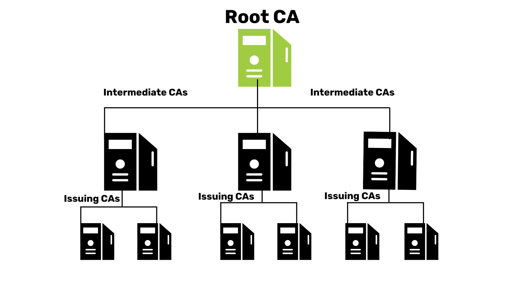
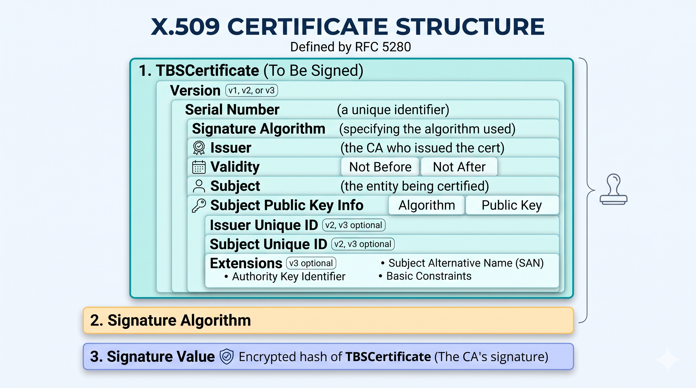
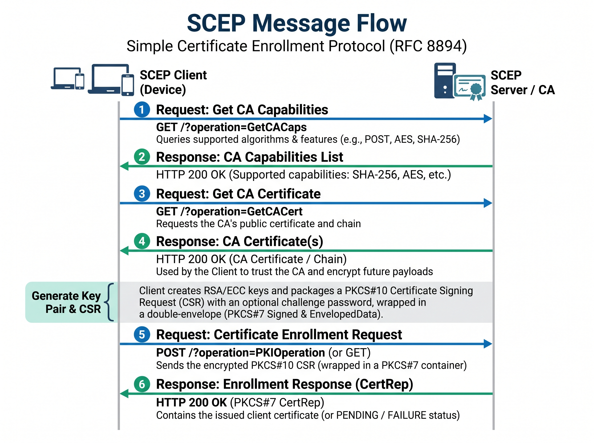
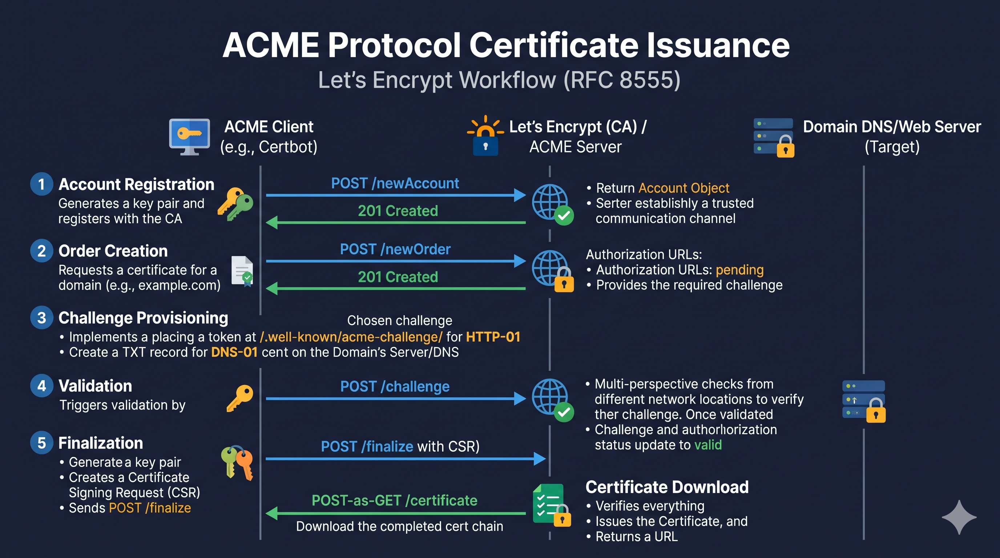

# SCEP (Simple Certificate Enrollment Protocol) and Related Concepts

## 1. Overview

- **SCEP** automates **certificate enrollment**: a device or server requests an X.509 certificate from a Certificate Authority (CA) over HTTP, with no manual steps.
- Created by Cisco (with VeriSign) around 2000 for routers, VPN gateways and other network devices.
- Standardised as **RFC 8894** (2020, Informational), after years as an expired Internet-Draft.
- It is built on two older standards:
  - **PKCS#10**: the certificate signing request (CSR) format.
  - **PKCS#7 / CMS**: the signed and encrypted message wrapper.
- Typical uses: MDM (Apple, Intune, Workspace ONE), Wi-Fi/802.1X and VPN certificates, network devices, and Microsoft **NDES**.

## 2. PKI Foundations

| Term | Meaning |
|---|---|
| **PKI** | Public Key Infrastructure: the people, policies and software that issue, manage and revoke certificates |
| **CA** | Certificate Authority: signs certificates and vouches for identities |
| **RA** | Registration Authority: validates requests and forwards them to the CA (NDES acts as an RA for SCEP) |
| **Root CA** | Self-signed trust anchor, often kept offline |
| **Intermediate / Issuing CA** | Signed by the root; issues end-entity certificates |
| **End entity** | Device, user or server that receives a certificate |
| **CSR (PKCS#10)** | Contains the public key, the subject name and optional attributes, signed with the matching private key |
| **X.509** | Standard certificate format: subject, issuer, serial number, validity, public key, extensions, signature |
| **CRL / OCSP** | Revocation checking: a published list, or a live online query |



*Fig. 1: PKI certificate hierarchy. A root CA signs intermediate CAs, which issue end-entity certificates. Trust flows down the chain, so a client trusting the root can validate every certificate beneath it.*



*Fig. 2: Structure of an X.509 certificate. It binds a subject identity to a public key and carries the issuer's digital signature. Know the key fields: subject, issuer, validity, public key and extensions.*

## 3. How SCEP Works

### Core idea

1. The client generates a **key pair** and a **PKCS#10 CSR**.
2. The client **authenticates** the request, usually with a **challenge password** (a shared secret placed in the CSR).
3. The client wraps the CSR in a **PKCS#7 envelope**:
   - **Signed** by the client's key, using a temporary self-signed certificate for first enrollment.
   - **Encrypted** with the CA's public key, so only the CA or RA can read it.
4. The CA or RA validates the request and either issues the certificate (**SUCCESS**), rejects it (**FAILURE**), or defers it for manual approval (**PENDING**).
5. The client receives the certificate in a signed and encrypted reply (**CertRep**). If PENDING, it polls with **GetCertInitial**.



*Fig. 3: SCEP enrollment flow. The client gets the CA certificate and capabilities, submits an encrypted PKCSReq, and receives a CertRep with the issued certificate. Note where the PENDING-and-poll loop fits.*

### Transport

- **HTTP** (commonly port 80). Message integrity and confidentiality come from the PKCS#7 envelope, not from TLS.
- The classic URL form is `http://host/path?operation=<op>&message=<base64>` (GET).
- **RFC 8894** adds **POST** support, which avoids length limits and encoding problems.

### Operations

| Operation | Purpose |
|---|---|
| **GetCACaps** | Ask what the CA supports (POST, AES, SHA-256, renewal, and so on) |
| **GetCACert** | Download the CA certificate or chain |
| **GetNextCACert** | Get the next CA certificate, for CA rollover |
| **PKIOperation** | Carries the signed and enveloped messages below |

### PKI messages (messageType values)

| Type | Number | Use |
|---|---|---|
| **CertRep** | 3 | Server response |
| **RenewalReq** | 17 | Renew using an existing certificate |
| **PKCSReq** | 19 | Initial enrollment request |
| **GetCertInitial** | 20 | Poll a pending request |
| **GetCert** | 21 | Retrieve an issued certificate by issuer and serial number |
| **GetCRL** | 22 | Retrieve a CRL |

### Key attributes in messages

| Attribute | Role |
|---|---|
| **transactionID** | Ties the request, polls and reply together |
| **senderNonce / recipientNonce** | Replay protection |
| **pkiStatus** | SUCCESS (0), FAILURE (2), PENDING (3) |
| **failInfo** | badAlg (0), badMessageCheck (1), badRequest (2), badTime (3), badCertId (4) |

## 4. Authentication and Security of SCEP

| Method | Notes |
|---|---|
| **Challenge password** | Shared secret in the CSR. Weak if it is static or reused; a **one-time, per-request** password is much safer. |
| **Manual approval** | Request stays PENDING until an admin approves it. |
| **Existing certificate** | Used for renewal. The old certificate signs the new request. |

**Known weaknesses**
- A static or shared challenge allows unauthorised enrollment if it leaks.
- It is often deployed over plain HTTP. Confidentiality depends on PKCS#7, so a compromised RA or exposed endpoint is a high-value target.
- **Legacy algorithms** (DES, 3DES, MD5, SHA-1) appear in old implementations.
- Traditionally **RSA only**, with no native ECC support.
- Limited support for modern lifecycle needs.

**Hardening**
- Use **one-time challenges**, short validity, and AES with SHA-256 or stronger.
- Restrict the SCEP URL to specific networks.
- Put NDES behind a reverse proxy, and monitor issuance logs.
- Use RenewalReq with an existing certificate for renewals.

## 5. Related Protocols: Comparison

| Protocol | Standard | Transport and security | Best for |
|---|---|---|---|
| **SCEP** | RFC 8894 | HTTP with a PKCS#7 envelope | Legacy network devices, MDM |
| **EST** | RFC 7030 | HTTPS (TLS), supports ECC, based on CMS | Modern device and IoT enrollment |
| **CMP** | RFC 4210 (updated by RFC 9810) | Flexible, rich feature set | Telecom, industrial and large PKIs |
| **ACME** | RFC 8555 | HTTPS with JSON, **domain-validation** challenges | Automated web server certificates (Let's Encrypt) |
| **MS auto-enrollment (WCCE)** | Microsoft | RPC/DCOM, Active Directory | Domain-joined Windows machines |



*Fig. 4: ACME issuance flow. The client proves control of a domain through a challenge, then submits a CSR. Compare this automated domain validation with SCEP's challenge-password approach.*

## 6. NDES and MDM Context

- **NDES (Network Device Enrollment Service)** is the Microsoft implementation of SCEP, running as a role on Windows Server with AD CS.
  - It acts as an RA between devices and the issuing CA.
  - It uses a **challenge password** (one-time, typically valid for about 60 minutes by default) and RA certificates.
- **Intune and Apple MDM**: a SCEP profile defines the CA URL, subject name format, key size, key usage and the challenge. The device generates its own key pair, so the private key stays on the device.
- **Intune SCEP vs PKCS profiles**:
  - **SCEP**: the device generates the key.
  - **PKCS imported or issued**: the key is created centrally and delivered to the device.

## 7. Practical Commands

Generate a key and CSR:

```bash
openssl genrsa -out device.key 2048
openssl req -new -key device.key -out device.csr -subj "/CN=device01"
```

Enroll with the open-source `sscep` client (typical usage):

```bash
sscep getca -u http://ca.example.com/scep -c ca.crt
sscep enroll -u http://ca.example.com/scep -c ca.crt-0 \
  -k device.key -r device.csr -l device.crt
```

Inspect the result:

```bash
openssl x509 -in device.crt -noout -subject -issuer -dates
```

## 8. Mnemonics and Memory Aids

- **SCEP flow:** **C**aps → **C**A cert → **K**eys & CSR → **P**KCSReq → **R**eply (CertRep).
- **pkiStatus 0 / 2 / 3:** SUCCESS = 0, FAILURE = 2, PENDING = 3. There is **no 1**.
- **SCEP vs EST:** SCEP = HTTP plus PKCS#7 envelope; EST = HTTPS (TLS) transport.
- **ACME = domain proof; SCEP = shared secret.**

## 9. Worked Examples

**Example 1: Pending request**
A SCEP client sends a PKCSReq and gets CertRep with `pkiStatus = 3`.
- Meaning: PENDING, awaiting manual approval.
- Action: poll with **GetCertInitial**, using the same **transactionID**.

**Example 2: Choosing a protocol**
An organisation needs to enroll IoT sensors that use ECC keys and need TLS-protected enrollment.
- **EST** fits best, since it supports ECC and TLS-based enrollment.
- SCEP is a poor fit because it is RSA-oriented and uses HTTP with an envelope.

**Example 3: Why encrypt the CSR?**
The envelope is encrypted with the CA's public key so only the CA or RA can read the request and its challenge password. Without TLS, this is SCEP's main confidentiality protection.

## 10. Practice Questions

**Q1 (Easy).** What does SCEP stand for, and which RFC standardises it?
**Answer:** Simple Certificate Enrollment Protocol, RFC 8894.

**Q2 (Easy).** Which two standards does SCEP build on for requests and message wrapping?
**Answer:** PKCS#10 (CSR) and PKCS#7/CMS (signed and enveloped data).

**Q3 (Moderate).** Why is a static challenge password a risk?
**Answer:** Anyone who obtains it can request certificates. Prefer a one-time, per-request password with a short lifetime.

**Q4 (Moderate).** Which operation lets a client discover whether the CA supports POST, AES and SHA-256?
**Answer:** **GetCACaps**.

**Q5 (Moderate).** What does a client send when its enrollment is PENDING?
**Answer:** **GetCertInitial**, with the same transactionID.

**Q6 (Moderate).** Which protocol uses domain-validation challenges to issue web server certificates automatically?
**Answer:** **ACME** (RFC 8555), used by Let's Encrypt.

**Q7 (Difficult).** A SCEP enrollment fails with `failInfo = 0`. What does it indicate?
**Answer:** **badAlg**. The algorithm used is not supported. Check the capabilities from GetCACaps and use a supported cipher and digest.

**Q8 (Difficult).** An engineer needs ECC certificates on managed devices and wants TLS protection for enrollment. Which protocol would you suggest, and why?
**Answer:** **EST** (RFC 7030). It runs over HTTPS and supports ECC, unlike traditional RSA-oriented SCEP.

## 11. Common Mistakes and Traps

- Confusing **SCEP** (enrollment) with **OCSP/CRL** (revocation checking).
- Assuming SCEP uses TLS by default. It commonly runs over plain HTTP and relies on PKCS#7 protection.
- Mixing up **CA** and **RA**: NDES is an RA, not the CA.
- Treating the challenge password as strong authentication. It is only a shared secret.
- Thinking **ACME** and **SCEP** validate identity the same way: ACME proves domain control, SCEP uses a shared secret or approval.
- Forgetting that **RenewalReq** (type 17) uses an existing certificate, while **PKCSReq** (type 19) is initial enrollment.
- Believing SCEP supports ECC natively. It is traditionally RSA-based.

## 12. Quick Revision Table

| Item | Key point |
|---|---|
| **SCEP** | Automated certificate enrollment protocol, RFC 8894 |
| **Built on** | PKCS#10 (CSR) and PKCS#7/CMS (signed and encrypted message) |
| **Transport** | HTTP (GET, plus POST in RFC 8894) |
| **Auth** | Challenge password, manual approval, or existing certificate |
| **Operations** | GetCACaps, GetCACert, GetNextCACert, PKIOperation |
| **Messages** | PKCSReq 19, CertRep 3, GetCertInitial 20, GetCert 21, GetCRL 22, RenewalReq 17 |
| **Status** | SUCCESS 0, FAILURE 2, PENDING 3 |
| **MS implementation** | NDES (acts as RA) |
| **Alternatives** | EST (TLS, ECC), CMP (feature-rich), ACME (domain validation), WCCE (AD) |
| **Main risks** | Static shared secret, HTTP transport, legacy crypto, RSA-only |