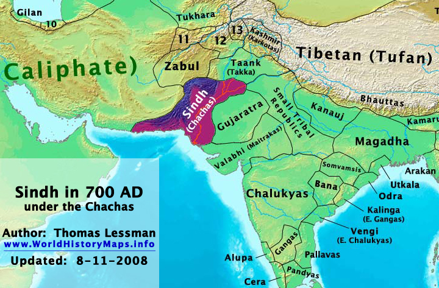
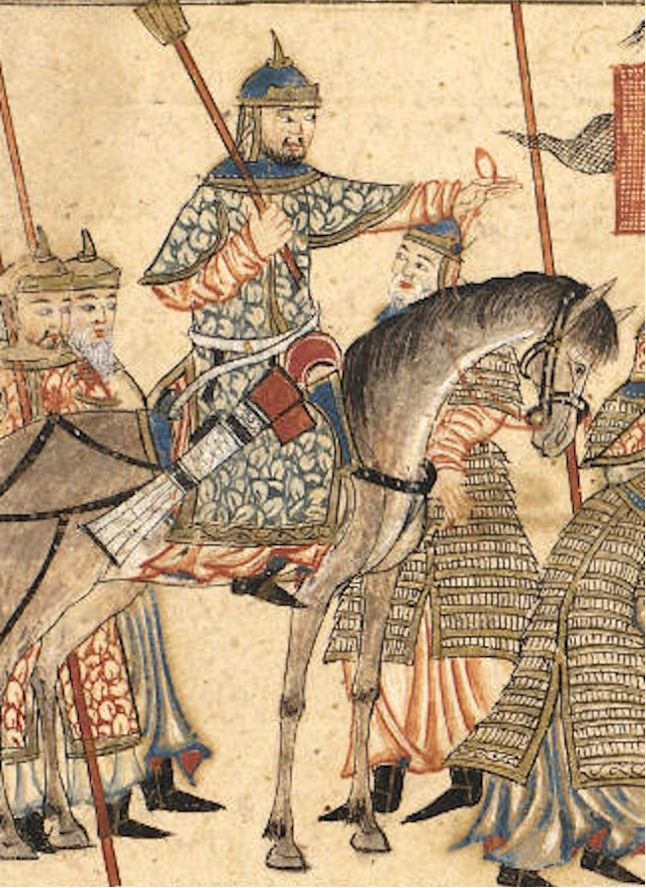
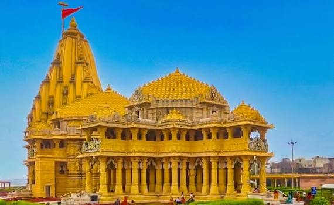
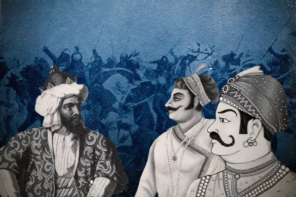
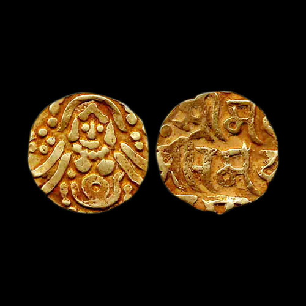
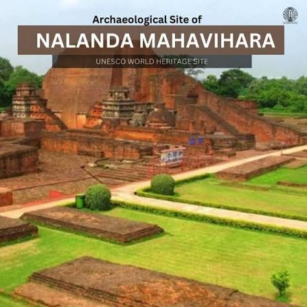
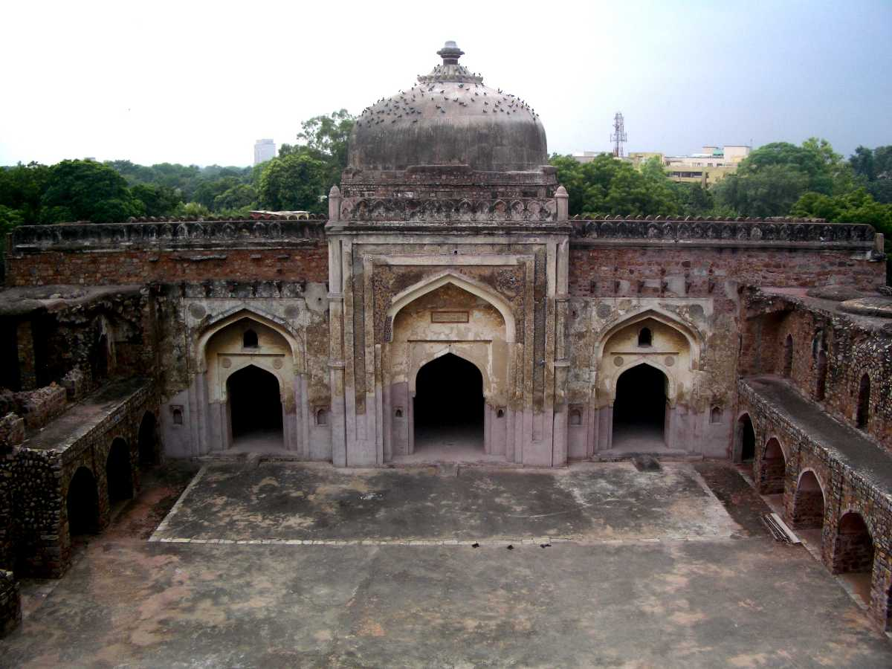

# ARAB AND TURKISH INVASIONS (Medieval History)

## 1. Core Concepts / Timeline

| Phase | Invader | Period | Opponent | Result |
|---|---|---|---|---|
| Arab | Muhammad bin Qasim | 711-715 CE | Raja Dahir (Sindh) | Arab rule in Sindh and Multan |
| Turkish (Ghaznavid) | Mahmud of Ghazni | 1000-1027 CE | Hindu Shahis, Pratiharas, Chandelas, Solankis | Plunder, Punjab annexed |
| Turkish (Ghurid) | Muhammad Ghori | 1175-1206 CE | Prithviraj Chauhan, Jaichand Gahadavala | Permanent Turkish rule, Delhi Sultanate (1206) |

- **Arab invasion** was a political and administrative conquest of a limited region.
- **Mahmud's raids** were mainly for plunder, not empire-building (except Punjab).
- **Ghori's invasions** aimed at permanent conquest and laid the foundation of Turkish rule in India.

---

## 2. Arab Invasion of Sindh

### Background
- First Arab naval raid: **c. 636-637 CE** (Caliph Umar's time) on **Thana** (near Bombay). It was unsuccessful.
- Later attempts on Debal and Broach failed. The expedition of **Ubaydullah** to Sindh also failed (c. 711).
- **Immediate cause:** Arab ships carrying gifts and travellers from Ceylon were looted by pirates near **Debal** (a port near modern Karachi). Dahir refused to punish the pirates.
- **Hajjaj bin Yusuf** (governor of Iraq, under Umayyad Caliph **Walid I**) sent his cousin and son-in-law **Muhammad bin Qasim**, aged about 17.

*Fig. 1: Arab conquest of Sindh, 711-712 CE. The campaign moved through Debal, Nerun, Sehwan and Raor to Brahmanabad and Multan; the Indus valley and its ports were the key objectives.*

### Course of the Conquest
- **Debal** captured in 711-712 CE (the date varies by source).
- **Nerun, Sehwan** surrendered or were taken.
- **Battle of Raor (Rawar), 712 CE:** Dahir was defeated and killed.
- **Brahmanabad, Aror (Alor)** fell, then **Multan** (called the "City of Gold" by Arabs).
- Dahir belonged to the **Brahmin (Chach) dynasty** of Sindh, which had replaced the Rai dynasty.
- Dahir's widow (Rani Ladi) is said to have performed jauhar at Raor.

### Administration and Policy
- Hindus were treated as **Zimmis** (protected people), like "People of the Book".
- **Jizya** was imposed on non-Muslims, but temples were largely not destroyed and Brahmins were retained in administration.
- Land revenue was kept in local hands.
- Muhammad bin Qasim was recalled in c. 715 after Walid's death and died in disgrace under the new Caliph **Sulaiman**.

### Source
- **Chachnama (Fathnama)**: Persian translation by **Ali bin Hamid Kufi** (c. 1216, under Nasiruddin Qabacha), based on an earlier Arabic text. It is the main source on Arab conquest of Sindh.

### Later Arab Rule
- Sindh split into two principalities: **Mansura** (Sindh) and **Multan**.
- **Mahmud of Ghazni** ended Arab (Ismaili) rule at Multan in **1010 CE**.

### Cultural Impact
- Indian works translated into Arabic: **Brahmagupta's Brahmasiddhanta** (as *Sindhind*, by Al-Fazari), **Charaka** and **Sushruta Samhita**, and the **Panchatantra** (as *Kalila wa Dimna*).
- Indian numerals and the decimal system reached the Arab world, and from there Europe.

### Why the Arab Invasion Had Limited Impact
- Arab expansion stopped at Sindh because of strong resistance from the **Pratiharas** (Nagabhata I) and **Rashtrakutas** (who traded with the Arabs).
- The conquest remained a peripheral Muslim enclave and the Arabs did not penetrate the Gangetic plain.

---

## 3. Turkish Invasions: Ghaznavids

### Rise of the Ghaznavids
- **Alptigin** (Turkish slave of the Samanids) founded Ghazni (c. 962).
- **Subuktigin** (977-997) clashed with Hindu Shahi king **Jayapala**.
- **Mahmud of Ghazni** (998-1030): born 971, first ruler to take the title **"Sultan"**. Recognised by Caliph **al-Qadir Billah**.

*Fig. 2: Mahmud of Ghazni (r. 998-1030). First ruler to adopt the title Sultan; his seventeen raids on India (per Elliot's count) targeted wealthy temples and cities.*

### Important Invasions

| Year | Event | Opponent / Place |
|---|---|---|
| 1001 | Battle of **Peshawar** | **Jayapala** (Hindu Shahi) defeated; he later self-immolated |
| 1004-06 | Bhatinda and Multan campaigns | Multan ruler Abul Fateh Daud |
| 1008 | Battle of **Waihind (Och/Hund)** | **Anandpala** with Hindu confederacy; Mahmud won |
| 1009 | **Nagarkot (Kangra)** | Rich temple plundered |
| 1010 | Multan | Ismaili Arab rule ended |
| 1014 | **Thanesar** | Chakraswami temple |
| 1018 | **Mathura and Kannauj** | Kannauj ruler **Rajyapala (Pratihara)** fled |
| 1019 | **Kalinjar** | Chandela king **Vidyadhara** |
| 1025-26 | **Somnath** (Kathiawar) | **Bhima I (Chaulukya/Solanki)** |
| 1027 | Last raid | Jats of Jud hills (Punjab) |

*Fig. 3: Somnath temple, Prabhas Patan (Gujarat). Its 1025-26 plunder by Mahmud is the most famous raid in Ghaznavid history; the ruler of Gujarat then was Bhima I.*

### Impact
- Punjab (up to Lahore) annexed into the Ghaznavid empire.
- Huge wealth taken to Ghazni; Indian artisans carried off.
- Weakened Hindu Shahis, opening the passage to the northwest for later invaders.

### Scholars at Mahmud's Court
| Scholar | Work |
|---|---|
| **Al-Biruni** | *Tahqiq-i-Hind* (Kitab-ul-Hind), a detailed account of Indian society, science and religion |
| **Firdausi** | *Shahnama* (Persian epic) |
| **Utbi** | *Kitab-i-Yamini* (Tarikh-i-Yamini) |
| **Baihaqi** | *Tarikh-i-Masudi* (written for Mahmud's son) |
| **Farrukhi, Unsuri** | Court poets |

---

## 4. Turkish Invasions: Muhammad Ghori

### Background
- **Muizzuddin Muhammad bin Sam** (Muhammad Ghori) belonged to the **Ghurid (Shansabani)** dynasty of Ghor (capital Firozkoh). His elder brother was **Ghiyasuddin**.
- Ghori sought to build a permanent empire in India.

### Chronology

| Year | Event |
|---|---|
| 1175 | Captured **Multan** and **Uchch** |
| 1178 | **Defeated** by **Mularaja II / Bhima II (Chaulukya)** near **Mount Abu** (Kayadara), his first major setback in India |
| 1179-86 | Peshawar, Lahore taken; **Khusrau Malik** (last Ghaznavid) overthrown (1186) |
| 1191 | **First Battle of Tarain**: **Prithviraj Chauhan** defeated Ghori |
| 1192 | **Second Battle of Tarain**: Ghori defeated Prithviraj; Turkish power established in north India |
| 1194 | **Battle of Chandawar** (Etawah): **Jaichand Gahadavala** (Kannauj) defeated |
| 1193-1203 | **Bakhtiyar Khilji** raided Bihar (Odantapuri, Vikramshila, Nalanda) and Bengal (c. 1204, Lakshmana Sena of Nadia) |
| 1206 | Ghori **assassinated** near the Jhelum (Dhamyak) and **Qutbuddin Aibak** founded the Delhi Sultanate |

*Fig. 4: Battles of Tarain, 1191-92 (modern Haryana). The second battle is a decisive turning point: Ghori's victory over Prithviraj Chauhan opened north India to Turkish rule.*

*Fig. 5: Coinage of Muhammad Ghori. Ghori issued gold coins in Indian style bearing goddess Lakshmi, showing early Turkish continuity with local monetary traditions.*

*Fig. 6: Nalanda ruins (Bihar). The great Buddhist centre was destroyed during Bakhtiyar Khilji's raids on Bihar, c. 1193-1203.*

### Sources
- **Hasan Nizami**: *Taj-ul-Maasir*
- **Minhaj-us-Siraj**: *Tabaqat-i-Nasiri*
- **Prithviraj Raso** (Chand Bardai) and **Prithviraj Vijay** (Jayanaka) on the Rajput side

### Aftermath
- Aibak (viceroy in Delhi) became the first Sultan.
- Aibak built **Quwwat-ul-Islam mosque** (Delhi) and **Adhai Din ka Jhonpra** (Ajmer).

*Fig. 7: Quwwat-ul-Islam mosque, Qutb complex, Delhi. Early Turkish monument built by Aibak, a marker of the start of Delhi Sultanate architecture.*

---

## 5. Comparison: Mahmud vs Ghori

| Point | Mahmud of Ghazni | Muhammad Ghori |
|---|---|---|
| Dynasty | Ghaznavid | Ghurid |
| Aim | Plunder (and Punjab) | Empire-building |
| Key battle | Waihind (1008) | Tarain II (1192), Chandawar (1194) |
| Famous raid | Somnath (1025-26) | Conquest of Delhi and Ajmer |
| Title | Sultan | Muizzuddin |
| Left behind | Wealth in Ghazni, scholars | Aibak as viceroy, Delhi Sultanate |

---

## 6. Causes of Turkish Success

- Rajputs fragmented, with constant internal rivalry (Chauhans vs Chandelas vs Gahadavalas vs Chaulukyas).
- Turkish mounted archers, mobile cavalry and better horses against Indian elephants and infantry.
- Defensive, honour-bound Rajput warfare, with no intelligence about the northwest frontier.
- Social divisions and weak political centralisation in India.

---

## 7. Common Exam Traps

- **Muhammad bin Qasim** conquered Sindh (not Punjab); **Mahmud** annexed Punjab.
- First Sultan title: **Mahmud**, not Ghori.
- Prithviraj **won** the first Tarain (1191) and **lost** the second (1192).
- Ghori's **first** major defeat in India: **Mount Abu (1178)**, against the Chaulukyas of Gujarat.
- **Mahmud** (not Ghori) attacked **Somnath**; **Ghori** (via Aibak) established rule.
- Chachnama = Arab conquest of Sindh. Kitab-ul-Hind = Al-Biruni (Mahmud's time).
- **Bakhtiyar Khilji** (not Ghori) destroyed Nalanda.
- Do not mix up **Ghazni** (Mahmud) with **Ghor** (Ghori).
- Anandpala fought at **Waihind (1008)**; Jayapala fought at **Peshawar (1001)**.

---

## 8. PYQ-Pattern Questions (with Solutions)

*These are PYQ-pattern questions, not verified actual PYQs.*

**Q1.** Who led the Arab invasion of Sindh in 712 CE?
(a) Mahmud of Ghazni (b) Muhammad bin Qasim (c) Hajjaj bin Yusuf (d) Qutbuddin Aibak

**Answer: (b)** Muhammad bin Qasim was sent by Hajjaj bin Yusuf, governor of Iraq.

**Q2.** The Chachnama deals with:
(a) Mahmud's invasions (b) Arab conquest of Sindh (c) Ghori's invasions (d) Timur's invasion

**Answer: (b)** It narrates the Arab conquest of Sindh, translated into Persian by Ali Kufi.

**Q3.** Which ruler of Sindh was defeated by Muhammad bin Qasim?
(a) Jayapala (b) Anandpala (c) Dahir (d) Prithviraj

**Answer: (c)** Dahir was defeated and killed at the Battle of Raor (712).

**Q4.** Who was the first Muslim ruler to take the title "Sultan"?
(a) Muhammad Ghori (b) Qutbuddin Aibak (c) Mahmud of Ghazni (d) Iltutmish

**Answer: (c)** Mahmud of Ghazni.

**Q5.** Al-Biruni, author of *Kitab-ul-Hind*, was a scholar in the court of:
(a) Muhammad Ghori (b) Mahmud of Ghazni (c) Muhammad bin Qasim (d) Iltutmish

**Answer: (b)**

**Q6.** Mahmud of Ghazni attacked the Somnath temple in:
(a) 1001 (b) 1018 (c) 1025-26 (d) 1192

**Answer: (c)** 1025-26, the ruler of Gujarat being Bhima I.

**Q7.** Who defeated Muhammad Ghori at the First Battle of Tarain (1191)?
(a) Jaichand (b) Prithviraj Chauhan (c) Bhima II (d) Anandpala

**Answer: (b)** Prithviraj Chauhan.

**Q8.** Who defeated Muhammad Ghori near Mount Abu in 1178?
(a) Prithviraj Chauhan (b) Jaichand (c) Mularaja II / Bhima II (Chaulukya) (d) Vidyadhara

**Answer: (c)**

**Q9.** At which battle was Jaichand Gahadavala defeated by Ghori?
(a) Tarain (b) Chandawar (c) Waihind (d) Raor

**Answer: (b)** Chandawar, 1194, near Etawah.

**Q10.** Which Hindu Shahi king fought Mahmud at Waihind in 1008?
(a) Jayapala (b) Anandpala (c) Dahir (d) Rajyapala

**Answer: (b)** Anandpala.

**Q11.** Who destroyed Nalanda University?
(a) Mahmud of Ghazni (b) Muhammad Ghori (c) Bakhtiyar Khilji (d) Qutbuddin Aibak

**Answer: (c)** Bakhtiyar Khilji (c. 1193-1203), a general of Ghori's Delhi establishment.

**Q12.** The immediate cause of the Arab invasion of Sindh was:
(a) Trade dispute (b) Piracy at Debal (c) Religious conflict (d) Hindu Shahi alliance

**Answer: (b)** Pirates looted Arab ships near Debal and Dahir did not act.

**Q13.** Where was Muhammad Ghori assassinated (1206)?
(a) Delhi (b) Ghazni (c) Near the Jhelum (Dhamyak) (d) Ajmer

**Answer: (c)**

**Q14.** *Taj-ul-Maasir* was written by:
(a) Minhaj-us-Siraj (b) Hasan Nizami (c) Al-Biruni (d) Utbi

**Answer: (b)** Hasan Nizami.

---

## 9. Practice Questions

**Q1.** Which Ghaznavid ruler was overthrown by Muhammad Ghori at Lahore in 1186?
(a) Mahmud (b) Masud (c) Khusrau Malik (d) Subuktigin

**Answer: (c)** Khusrau Malik was the last Ghaznavid ruler.

**Q2.** Which scholar, associated with the Persian epic *Shahnama*, was at Mahmud's court?
(a) Utbi (b) Firdausi (c) Baihaqi (d) Unsuri

**Answer: (b)** Firdausi.

**Q3.** Arab rule at Multan was ended by:
(a) Muhammad Ghori (b) Mahmud of Ghazni (c) Qutbuddin Aibak (d) Alptigin

**Answer: (b)** Mahmud, in 1010.

**Q4.** Who is considered the real founder of the Delhi Sultanate?
(a) Ghori (b) Aibak (c) Iltutmish (d) Balban

**Answer: (b)** Qutbuddin Aibak (1206), the first Sultan, though Iltutmish consolidated it.

**Q5.** *Prithviraj Raso* was composed by:
(a) Jayanaka (b) Chand Bardai (c) Hasan Nizami (d) Minhaj-us-Siraj

**Answer: (b)** Chand Bardai.

**Q6.** The Hindu Shahis were defeated at Peshawar in 1001 by:
(a) Subuktigin (b) Mahmud of Ghazni (c) Ghori (d) Alptigin

**Answer: (b)**

**Q7.** Which statement is correct?
(a) Mahmud lost the Second Battle of Tarain (b) Ghori lost the First Battle of Tarain (c) Dahir won at Raor (d) Jaichand won at Chandawar

**Answer: (b)** Ghori lost the first Tarain (1191); the others are false.

**Q8.** Which port was captured first by Muhammad bin Qasim?
(a) Broach (b) Thana (c) Debal (d) Kalyan

**Answer: (c)** Debal.

---

## 10. Last-Minute Revision Table

| Topic | Key Fact |
|---|---|
| Arab invasion | 711-712 CE, Muhammad bin Qasim vs Raja Dahir |
| Cause | Piracy at Debal |
| Key battle | Raor (712) |
| Main source | Chachnama |
| Governor behind it | Hajjaj bin Yusuf (Caliph Walid I) |
| Mahmud's title | Sultan (first) |
| Mahmud's reign | 998-1030; 17 raids (Elliot) |
| Peshawar | 1001 (Jayapala) |
| Waihind | 1008 (Anandpala) |
| Somnath | 1025-26 (Bhima I) |
| Al-Biruni's book | Tahqiq-i-Hind (Kitab-ul-Hind) |
| Ghori's first defeat | Mount Abu, 1178 |
| Tarain I | 1191, Prithviraj wins |
| Tarain II | 1192, Ghori wins |
| Chandawar | 1194, Jaichand defeated |
| Nalanda | Destroyed by Bakhtiyar Khilji |
| Ghori's death | 1206, near the Jhelum |
| Delhi Sultanate | Founded 1206 by Aibak |