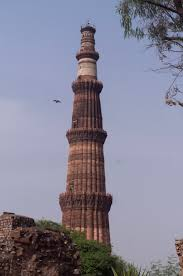
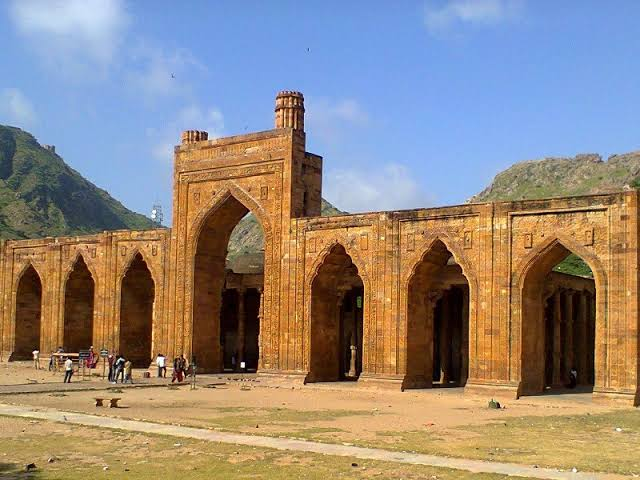
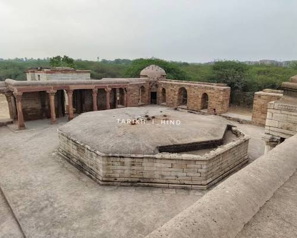
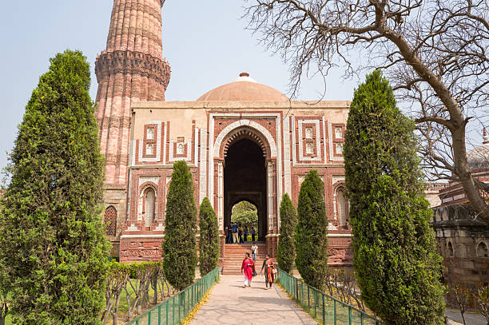
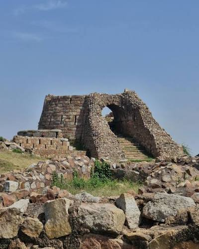
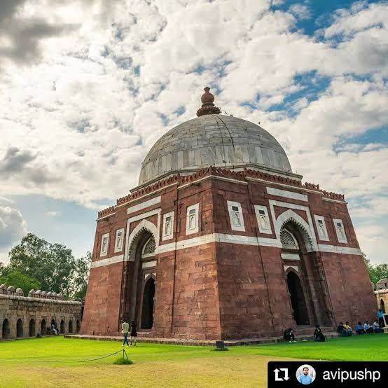
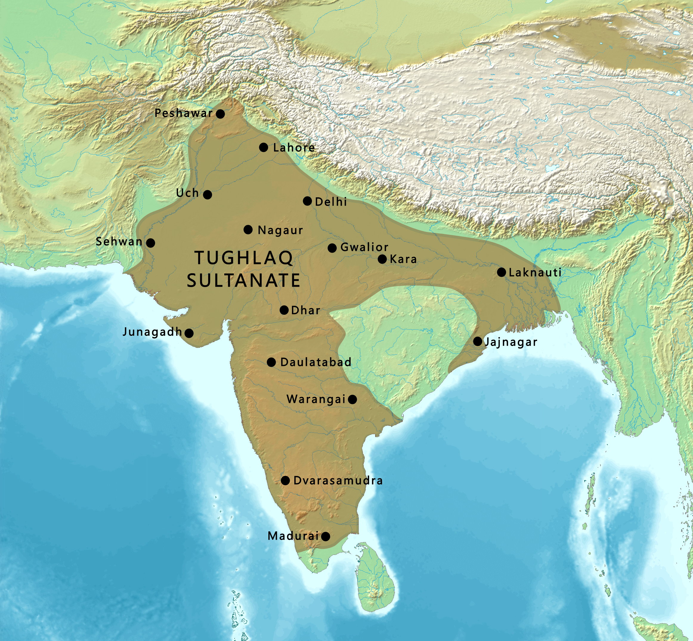
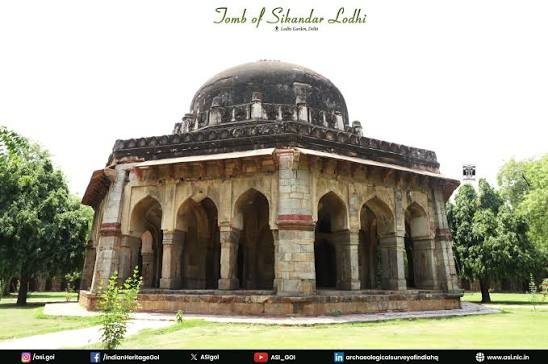

# Delhi Sultanate (1206-1526): SSC Notes

## 1. Core Concepts and Overview

- **Period:** 1206 to 1526 (after Muhammad Ghori's death to First Battle of Panipat).
- **Five dynasties:** Slave (Mamluk), Khalji, Tughlaq, Sayyid, Lodi.
- **Mnemonic:** **S**ultans **K**ill **T**he **S**ick **L**ions (Slave, Khalji, Tughlaq, Sayyid, Lodi).
- **Official language:** Persian. **Capital:** Delhi (Lahore briefly under Aibak; Agra from 1504 under Sikandar Lodi).
- **Background:** Muhammad Ghori won the Second Battle of Tarain (1192) and the Battle of Chandawar (1194). He appointed **Qutbuddin Aibak** as his viceroy.
- **Bakhtiyar Khalji** destroyed Nalanda and Vikramshila universities and conquered Bengal (about 1204).

$$
1526 - 1206 = \boxed{320 \text{ years}}
$$

### Dynasty Table

| Dynasty | Period | Founder | Last Ruler |
|---|---|---|---|
| Slave (Mamluk/Ilbari) | 1206-1290 | Qutbuddin Aibak | Kayumars |
| Khalji | 1290-1320 | Jalaluddin Khalji | Mubarak Shah (Khusrau Khan was a usurper) |
| Tughlaq | 1320-1414 | Ghiyasuddin Tughlaq | Nasiruddin Mahmud |
| Sayyid | 1414-1451 | Khizr Khan | Alauddin Alam Shah |
| Lodi | 1451-1526 | Bahlul Lodi | Ibrahim Lodi |

---

## 2. Slave Dynasty (1206-1290)

### Qutbuddin Aibak (1206-1210)
- First Sultan of Delhi; capital **Lahore**.
- Called **Lakh Baksh** (giver of lakhs) for his generosity.
- Built **Quwwat-ul-Islam mosque** (Delhi) and **Adhai Din Ka Jhonpra** (Ajmer).
- Began the **Qutub Minar**, dedicated to Sufi saint Khwaja Qutbuddin Bakhtiyar Kaki.
- Died in a fall from his horse while playing **chaugan (polo)** at Lahore.

*Fig. 1: Qutub Minar, Delhi. Begun by Aibak and completed by Iltutmish, it is the best-known Sultanate-era tower; SSC often asks who began it, who completed it and which saint it honours.*

*Fig. 2: Adhai Din Ka Jhonpra, Ajmer. Built by Aibak as an early Indo-Islamic mosque; its name is linked to a popular belief about two and a half days, a frequent one-liner in SSC exams.*

### Iltutmish (1211-1236)
- Real consolidator of the Sultanate (**Shamsi dynasty**); belonged to the Ilbari tribe.
- **Shifted capital** from Lahore to **Delhi**.
- Won the Battle of Tarain (1216) against Yildiz.
- Refused shelter to **Jalaluddin Mangbarni** during **Chengiz Khan's** arrival (1221), saving the Sultanate from Mongols.
- Got **investiture letter** from the **Abbasid Caliph** (1229).
- Introduced the **silver tanka** and **copper jital**; organised the **iqta system**.
- Created the **Turkan-i-Chihalgani** (Group of Forty nobles).
- Built the **Sultan Ghari** tomb (1231) for his son Nasiruddin Mahmud, the first Islamic mausoleum in India.
- Completed the Qutub Minar; built Hauz-i-Shamsi.

*Fig. 3: Sultan Ghari, Delhi. Built by Iltutmish in 1231 for his son Nasiruddin Mahmud, it is regarded as the first Islamic mausoleum in India.*

### Successors
- **Ruknuddin Firoz** (1236) was weak.
- **Razia Sultan (1236-1240):** first and only woman ruler of the Sultanate.
  - Appointed by Iltutmish; favoured the Abyssinian **Yaqut**.
  - Revolt by **Altuniya** (Bhatinda governor); killed near **Kaithal** (1240).
- **Bahram Shah** (1240-42), **Masud Shah** (1242-46).
- **Nasiruddin Mahmud (1246-1266):** Balban was his Naib. Minhaj-us-Siraj's *Tabaqat-i-Nasiri* is dedicated to him.

### Ghiyasuddin Balban (1266-1287)
- Earlier called **Ulugh Khan**; served as Naib to Nasiruddin Mahmud.
- **Dismantled the Chihalgani**.
- **Theory of kingship:** divine right (**Nibabat-i-Khudai**, **Zil-i-Ilahi**). Introduced **Sijda** and **Paibos**; introduced Persian festival **Nauroz**.
- Reorganised **Diwan-i-Arz** (military department).
- Policy of **blood and iron** against rebels; strong spy network.
- Crown Prince **Muhammad** was killed in a Mongol battle (1285).
- Successors: Kaiqubad (1287-90) and Kayumars (1290).

---

## 3. Khalji Dynasty (1290-1320)

### Jalaluddin Khalji (1290-1296)
- Founder; the **"Khalji Revolution"** ended the monopoly of Turkish nobles.
- Capital: **Kilokhri**.
- Murdered by nephew **Alauddin** at **Kara** (1296).

### Alauddin Khalji (1296-1316)
- Titles: **Sikandar-i-Sani**, **Yamin-ul-Khilafat**.
- Capital: **Siri** (new city).

**Conquests**

| Region | Year | Detail |
|---|---|---|
| Devagiri (Yadavas) | 1296 and 1307 | Ramchandra Deva; later Malik Kafur |
| Gujarat | 1299 | Karna Vaghela; Malik Kafur captured (Hazardinari) |
| Ranthambore | 1301 | Hammir Dev Chauhan |
| Chittor | 1303 | Rana Ratan Singh; renamed Khizrabad |
| Malwa | 1305 | Conquered |
| Warangal (Kakatiyas) | 1310 | Prataparudra |
| Dwarasamudra (Hoysalas) | 1311 | Ballala III |
| Madurai (Pandyas) | 1311 | Malik Kafur's Deccan campaign |

**Reforms**
- **Market control:** fixed prices for grain, cloth, horses, slaves and cattle.
  - **Diwan-i-Riyasat** (Yaqub), **Shahna-i-Mandi** (market superintendent), **Barid** and **Munhiyan** (spies).
  - Wheat price: 7.5 jitals per maund (Barani).
- **Military:** permanent standing army paid in cash; introduced **Dagh** (branding of horses) and **Chehra** (descriptive roll of soldiers).
- **Revenue:** land **measurement (paimaish)**, **kharaj** about 50 percent of produce.
  - Other taxes: **Ghari** (house), **Charai** (grazing), Jizya.
  - Created **Diwan-i-Mustakhraj** (arrears collection).
  - Curbed privileges of **Khuts and Muqaddams**.
- Took **4/5 of war booty** (Khams), leaving 1/5 for soldiers.
- Built **Siri Fort**, **Alai Darwaza** (1311), **Hauz Khas**.
- Contemporary: **Amir Khusrau** (Tuti-i-Hind, author of *Khazain-ul-Futuh*).
- Mongol invasions repulsed (Qutlugh Khwaja 1299, Targhi 1303).

*Fig. 4: Alai Darwaza, Delhi. Built in 1311 by Alauddin Khalji as a gateway to the Quwwat-ul-Islam mosque; it marks the Khalji period in Indo-Islamic architecture.*

### Successors
- Mubarak Shah (1316-20); his favourite **Khusrau Khan** usurped power and was killed by **Ghazi Malik (Ghiyasuddin Tughlaq)**.

---

## 4. Tughlaq Dynasty (1320-1414)

### Ghiyasuddin Tughlaq (1320-1325)
- Founder; earlier known as **Ghazi Malik**.
- Built **Tughlaqabad** (city and fort).
- Died when a pavilion collapsed at **Afghanpur** (near Kara/Delhi).
- Son Ulugh Khan (Juna Khan) captured **Warangal** during his reign.

*Fig. 5: Tughlaqabad Fort, Delhi. Built by Ghiyasuddin Tughlaq as the capital of the Tughlaq dynasty; remember it as the third city of Delhi after Qila Rai Pithora and Siri.*

*Fig. 6: Tomb of Ghiyasuddin Tughlaq, Delhi. Associated with the Tughlaq style marked by sloping walls; the tomb stands near the fort that he founded.*

### Muhammad bin Tughlaq (1325-1351)
- Real name **Fakhruddin Juna Khan**; learned in Persian, Arabic and astronomy.
- Barani called him a **"mixture of opposites"**.
- **Experiments:**
  1. **Doab tax hike** (1326-27), coinciding with famine.
  2. **Capital shifted** from Delhi to **Daulatabad (Devagiri)**, 1327; reversed later.
  3. **Token currency** (1329-30): brass and copper coins of silver tanka value; failed due to forgery.
  4. **Khurasan expedition** (planned, abandoned).
  5. **Qarachil expedition** (Himalayan region): army destroyed.
  6. Set up **Diwan-i-Amir-i-Kohi** (agriculture department) and gave **Takavi loans**.
- **Ibn Battuta** (Moroccan) visited in 1333; served as a Qazi of Delhi and wrote *Rihla*. Sent as envoy to China (1342).
- **Rebellions:** Ma'bar (1334-35), **Vijayanagara** (1336, Harihara and Bukka), **Bahmani Sultanate** (1347, Alauddin Hasan Bahman Shah), Bengal.
- Died at **Thatta (Sindh)** while chasing the rebel **Taghi**.

*Fig. 7: Delhi Sultanate under Muhammad bin Tughlaq. The Sultanate reached its greatest extent in his reign, but rebellions from Ma'bar, Bengal, Vijayanagara and the Bahmani region soon reduced it.*

### Firoz Shah Tughlaq (1351-1388)
- Cousin and successor of Muhammad bin Tughlaq.
- Built **Firozabad** (Kotla Firoz Shah), **Hissar, Fatehabad, Jaunpur** (1359).
- Moved **Ashokan pillars** from **Topra and Meerut** to Delhi.
- Wrote autobiography **Fatuhat-i-Firozshahi**.
- Revived **Jizya** (extended to Brahmins); abolished **21 vexing taxes**; four legal taxes: **Kharaj, Khams, Jizya, Zakat**.
- Gave Sultan only **1/5** of booty (Islamic law).
- Irrigation canals (Yamuna, Sutlej); established **Diwan-i-Khairat** (charity), **Diwan-i-Bandagan** (slaves) and an **employment bureau**.
- Made **iqta hereditary**; coins: **Adha** and **Bikh**.
- Authors: **Afif** (Tarikh-i-Firoz Shahi), **Barani**.

### Last Tughlaq and Timur
- **Nasiruddin Mahmud** (last Tughlaq).
- **Timur's invasion (1398):** sacked Delhi; its memoir is *Malfuzat-i-Timuri*.

---

## 5. Sayyid Dynasty (1414-1451)

| Ruler | Years | Key Point |
|---|---|---|
| **Khizr Khan** | 1414-1421 | Founder; titled **Rayat-i-Ala**; claimed to be Timur's deputy |
| Mubarak Shah | 1421-34 | *Tarikh-i-Mubarakshahi* by Yahya bin Ahmad Sirhindi |
| Muhammad Shah | 1434-43 | Weak ruler |
| Alauddin Alam Shah | 1443-51 | Abdicated in favour of Bahlul Lodi |

---

## 6. Lodi Dynasty (1451-1526)

- **Bahlul Lodi (1451-1489):** first **Afghan** dynasty; conquered **Jaunpur** (1479); issued **Bahluli coin**.
- **Sikandar Lodi (1489-1517):**
  - Founded **Agra** (1504) and moved capital there.
  - Introduced **Gaz-i-Sikandari** (measurement).
  - Wrote poetry under the pen name **Gulrukhi**.
- **Ibrahim Lodi (1517-1526):** defeated by **Babur** at the **First Battle of Panipat (21 April 1526)**. Daulat Khan Lodi and Alam Khan had invited Babur.

*Fig. 8: Tomb of Sikandar Lodi, Delhi. A representative Lodi-era tomb built in the octagonal style, linked with the Lodi dynasty that ruled until Babur's victory in 1526.*

---

## 7. Administration

| Office | Function |
|---|---|
| **Wazir** (Diwan-i-Wizarat) | Chief minister; finance |
| **Diwan-i-Arz** (Ariz-i-Mumalik) | Military department |
| **Diwan-i-Insha** | Correspondence |
| **Diwan-i-Risalat** | Religious affairs and appeals |
| **Sadr-us-Sudur** | Head of religious and charitable endowments |
| **Qazi-ul-Quzat** | Chief judge |
| **Barid-i-Mumalik** | Head of intelligence and news |

**Local administration**
- **Iqta** (muqti/wali) → **Shiq** (shiqdar) → **Pargana** (amil) → **Village** (muqaddam, patwari, khut, chaudhari).
- **Khalisa:** land directly under the Sultan.

**Specialised departments by ruler**

| Ruler | Department |
|---|---|
| Alauddin Khalji | Diwan-i-Mustakhraj, Diwan-i-Riyasat |
| Muhammad bin Tughlaq | Diwan-i-Amir-i-Kohi |
| Firoz Shah Tughlaq | Diwan-i-Khairat, Diwan-i-Bandagan |

---

## 8. Architecture (Indo-Islamic)

| Monument | Builder | Note |
|---|---|---|
| Quwwat-ul-Islam Mosque (Delhi) | Aibak | First mosque in Delhi |
| Adhai Din Ka Jhonpra (Ajmer) | Aibak | Early mosque |
| Qutub Minar | Aibak, Iltutmish | Honours Sufi saint Bakhtiyar Kaki |
| Sultan Ghari | Iltutmish | First Islamic mausoleum in India |
| Alai Darwaza, Siri | Alauddin Khalji | Gateway of Qutub complex |
| Tughlaqabad | Ghiyasuddin Tughlaq | Fort-city with sloping walls |
| Jahanpanah | Muhammad bin Tughlaq | Fortified Delhi city |
| Firozabad, Kotla | Firoz Shah Tughlaq | City with Ashokan pillar |

**Delhi cities in order:** Qila Rai Pithora → Siri → Tughlaqabad → Jahanpanah → Firozabad.

---

## 9. Economy and Currency

- **Tanka:** silver coin; **Jital:** copper coin.
- **Iqta:** revenue assignment (Iltutmish); Firoz made it hereditary.
- Alauddin: land measured, 50 percent revenue; market controls.
- Muhammad bin Tughlaq: token currency (1329-30); agriculture loans (Takavi).
- Firoz Shah: canals, charity, abolished vexing taxes.

---

## 10. Religion, Literature and Travellers

**Sufi orders**

| Order | Saints | Region |
|---|---|---|
| **Chishti** | Khwaja Moinuddin Chishti, Qutbuddin Bakhtiyar Kaki, Baba Farid, **Nizamuddin Auliya**, Nasiruddin Chiragh-i-Delhi | Ajmer, Delhi |
| **Suhrawardi** | Bahauddin Zakariya | Multan |

**Authors and works**

| Author | Work |
|---|---|
| Minhaj-us-Siraj | *Tabaqat-i-Nasiri* |
| Amir Khusrau | *Khazain-ul-Futuh*, poetry |
| Ziauddin Barani | *Tarikh-i-Firoz Shahi*, *Fatwa-i-Jahandari* |
| Shams-i-Siraj Afif | *Tarikh-i-Firoz Shahi* |
| Isami | *Futuh-us-Salatin* |
| Yahya bin Ahmad Sirhindi | *Tarikh-i-Mubarakshahi* |
| Ibn Battuta | *Rihla* |

---

## 11. Shortcuts and Quick Computation

- **Reign lengths:**

$$
1351 - 1325 = \boxed{26 \text{ years}} \quad \text{(Muhammad bin Tughlaq)}
$$

$$
1388 - 1351 = \boxed{37 \text{ years}} \quad \text{(Firoz Shah Tughlaq)}
$$

- **Price calculation (wheat at 7.5 jitals per maund):**

$$
8 \times 7.5 = \boxed{60 \text{ jitals}}
$$

- **Foreign events:** Chengiz Khan (1221, Iltutmish), Timur (1398, Nasiruddin Mahmud), Babur (1526, Ibrahim Lodi).
- **"First" facts:** Razia (first woman), Alauddin (first Dagh and Chehra), Sultan Ghari (first Islamic mausoleum), Bahlul (first Afghan dynasty).

---

## 12. PYQ-Pattern Questions with Solutions

**Q1.** Who is regarded as the founder of the Delhi Sultanate?
(a) Iltutmish (b) Qutbuddin Aibak (c) Balban (d) Razia

**Answer:** (b)
**Solution:** Aibak, Ghori's viceroy, became the first Sultan in 1206.

**Q2.** The silver tanka and copper jital were introduced by:
(a) Alauddin Khalji (b) Balban (c) Iltutmish (d) Firoz Shah

**Answer:** (c)
**Solution:** Iltutmish standardised Sultanate coinage.

**Q3.** The system of Dagh and Chehra was introduced by:
(a) Balban (b) Alauddin Khalji (c) Firoz Shah (d) Sikandar Lodi

**Answer:** (b)
**Solution:** Alauddin's military reforms.

**Q4.** Who shifted the capital to Daulatabad?
(a) Firoz Shah (b) Alauddin (c) Muhammad bin Tughlaq (d) Ghiyasuddin

**Answer:** (c)
**Solution:** Muhammad bin Tughlaq moved it in 1327.

**Q5.** Ibn Battuta visited India during the reign of:
(a) Alauddin Khalji (b) Muhammad bin Tughlaq (c) Firoz Shah (d) Balban

**Answer:** (b)
**Solution:** He arrived in 1333 and served as Qazi of Delhi.

**Q6.** The Chihalgani was dismantled by:
(a) Iltutmish (b) Razia (c) Balban (d) Alauddin

**Answer:** (c)
**Solution:** Balban broke the power of the Group of Forty.

**Q7.** Iltutmish received investiture from:
(a) Ghori (b) Abbasid Caliph (c) Chengiz Khan (d) Timur

**Answer:** (b)
**Solution:** Letter of investiture from the Abbasid Caliph in 1229.

**Q8.** Ashokan pillars at Delhi were brought by Firoz Shah from:
(a) Sarnath and Lumbini (b) Topra and Meerut (c) Kausambi and Vaishali (d) Sanchi and Gaya

**Answer:** (b)
**Solution:** Topra and Meerut pillars were moved to Firozabad and Delhi.

**Q9.** Who founded Agra in 1504?
(a) Bahlul Lodi (b) Ibrahim Lodi (c) Sikandar Lodi (d) Babur

**Answer:** (c)
**Solution:** Sikandar Lodi shifted capital to Agra.

**Q10.** First Battle of Panipat (1526) was fought between Babur and:
(a) Sikandar Lodi (b) Ibrahim Lodi (c) Bahlul Lodi (d) Muhammad Shah

**Answer:** (b)
**Solution:** Ibrahim Lodi was defeated on 21 April 1526.

**Q11.** Match the work and author:
(1) Tabaqat-i-Nasiri (2) Fatuhat-i-Firozshahi (3) Rihla
(A) Ibn Battuta (B) Firoz Shah (C) Minhaj-us-Siraj

**Answer:** 1-C, 2-B, 3-A
**Solution:** Standard author-work mapping.

**Q12.** Which statement about Alauddin Khalji is correct?
(a) He gave 4/5 of booty to soldiers. (b) He kept 4/5 of booty for the state. (c) He abolished Jizya. (d) He introduced token currency.

**Answer:** (b)
**Solution:** Alauddin took 4/5 of booty (Khams); Firoz returned to 1/5.

---

## 13. Practice Questions

**Q1.** Jaunpur was founded by:
(a) Firoz Shah Tughlaq (b) Alauddin Khalji (c) Ibrahim Lodi (d) Balban

**Answer:** (a)
**Solution:** Founded in 1359 by Firoz.

**Q2.** Timur invaded India during the reign of:
(a) Firoz Shah (b) Nasiruddin Mahmud (c) Khizr Khan (d) Ibrahim Lodi

**Answer:** (b)
**Solution:** Timur sacked Delhi in 1398, in the last Tughlaq's reign.

**Q3.** The title **Rayat-i-Ala** was used by:
(a) Khizr Khan (b) Bahlul Lodi (c) Mubarak Shah (d) Sikandar Lodi

**Answer:** (a)
**Solution:** Khizr Khan, founder of the Sayyid dynasty.

**Q4.** Diwan-i-Mustakhraj was set up by:
(a) Balban (b) Alauddin Khalji (c) Muhammad bin Tughlaq (d) Firoz Shah

**Answer:** (b)
**Solution:** It dealt with arrears of revenue.

**Q5.** Alauddin Khalji murdered Jalaluddin Khalji at:
(a) Delhi (b) Kara (c) Lahore (d) Multan

**Answer:** (b)
**Solution:** Murdered in 1296 at Kara.

**Q6.** Rebel who defeated Razia and caused her death near Kaithal belonged to:
(a) Lahore (b) Bhatinda (c) Multan (d) Ajmer

**Answer:** (b)
**Solution:** Altuniya, governor of Bhatinda.

**Q7.** Vijayanagara Empire was founded in the reign of:
(a) Alauddin Khalji (b) Firoz Shah (c) Muhammad bin Tughlaq (d) Balban

**Answer:** (c)
**Solution:** Founded in 1336 by Harihara and Bukka.

**Q8.** How many years did Alauddin Khalji rule (1296-1316)?
(a) 10 (b) 15 (c) 20 (d) 25

**Answer:** (c)
**Solution:**

$$
1316 - 1296 = \boxed{20}
$$

---

## 14. Common Exam Traps

- **Aibak vs Iltutmish:** Aibak founded the Sultanate; Iltutmish consolidated it and is its real founder.
- **Qutub Minar:** begun by Aibak, completed by Iltutmish; Firoz repaired upper storeys.
- **Booty share:** Alauddin took 4/5; Firoz returned to Islamic law (1/5).
- **Department confusion:** Diwan-i-Mustakhraj (Alauddin) vs Diwan-i-Amir-i-Kohi (Muhammad bin Tughlaq) vs Diwan-i-Bandagan (Firoz).
- **Authors:** Barani and Afif both wrote *Tarikh-i-Firoz Shahi*.
- **Token currency:** Muhammad bin Tughlaq used brass and copper coins, not paper money.
- **Timur** (1398) vs **Babur** (1526): different invaders.
- **Capital transfers:** Daulatabad (Muhammad bin Tughlaq) vs Agra (Sikandar Lodi).
- **Jaunpur:** founded by Firoz Shah Tughlaq, not Sikandar Lodi.
- **Ghiyasuddin Tughlaq** is also known as Ghazi Malik.

---

## 15. Last-Minute Revision Table

| Ruler | Key Facts |
|---|---|
| Aibak | First Sultan; Lakh Baksh; died playing polo |
| Iltutmish | Silver tanka; Chihalgani; Caliph's investiture |
| Razia | First woman ruler; Altuniya revolt |
| Balban | Blood and iron; Sijda and Paibos; Nauroz |
| Jalaluddin | Khalji founder; Kilokhri |
| Alauddin | Market control; Dagh and Chehra; Siri; Alai Darwaza |
| Ghiyasuddin | Tughlaq founder; Tughlaqabad |
| Muhammad bin Tughlaq | Daulatabad; token currency; Ibn Battuta |
| Firoz Shah | Canals; Jaunpur; Ashokan pillars; Jizya on Brahmins |
| Khizr Khan | Sayyid founder; Rayat-i-Ala |
| Bahlul Lodi | First Afghan dynasty; Jaunpur conquest |
| Sikandar Lodi | Agra founded; Gaz-i-Sikandari; Gulrukhi |
| Ibrahim Lodi | Defeated at Panipat 1526 |