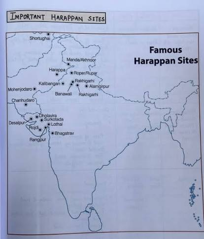
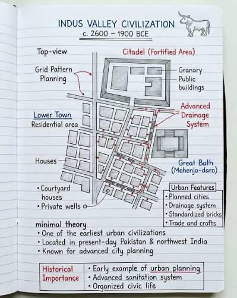
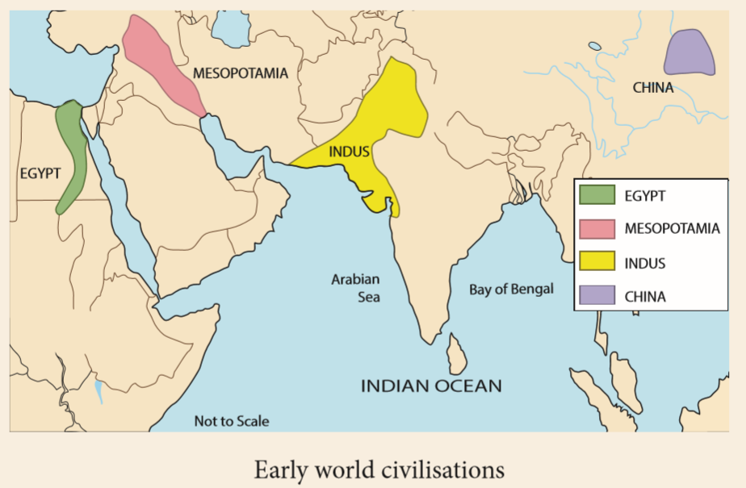
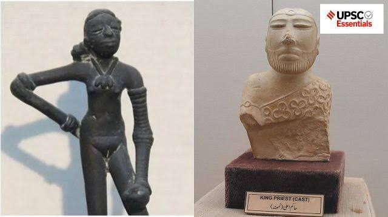
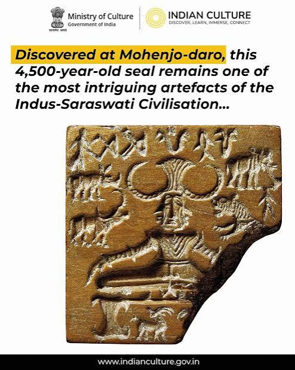
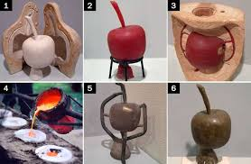
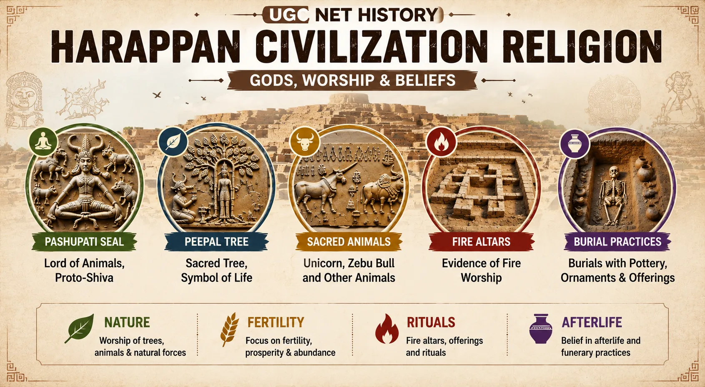
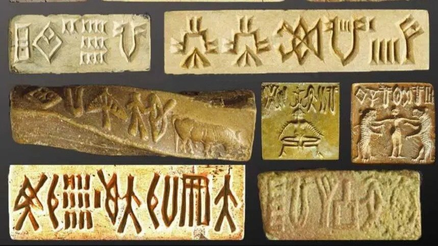
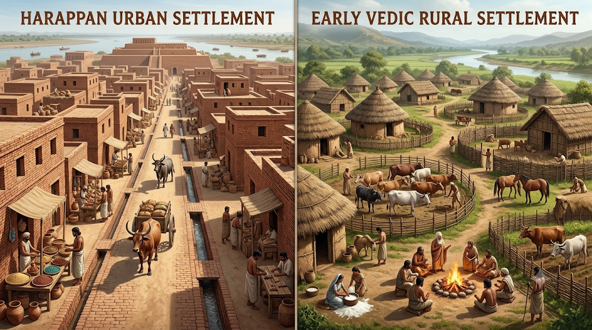

> **How to use image placeholders:** Replace each placeholder block with an image, for example: ``. Keep the short caption beneath the image for revision.

# SSC CGL History – Indus Valley Civilization

## 1. Introduction

- Also known as **Harappan Civilization**.
- Bronze Age civilization.
- Mature Harappan period: **2600–1900 BCE**.
- Named after Harappa, the first excavated site.
- Harappa was excavated by **Daya Ram Sahni in 1921**.
- Mohenjo-daro was discovered by **R. D. Banerji in 1922**.
- John Marshall announced the discovery of the civilization in 1924.

### Three Phases

| Phase | Period |
|---|---|
| Early Harappan | 3300–2600 BCE |
| Mature Harappan | 2600–1900 BCE |
| Late Harappan | 1900–1300 BCE |

## 2. Important Harappan Sites

| Site | Present Location | Important Findings |
|---|---|---|
| Harappa | Punjab, Pakistan | Granary, Cemetery R-37 |
| Mohenjo-daro | Sindh, Pakistan | Great Bath, Dancing Girl, Priest-King |
| Dholavira | Gujarat, India | Water management, three-part city |
| Lothal | Gujarat, India | Dockyard, bead-making |
| Kalibangan | Rajasthan, India | Ploughed field, fire altars |
| Rakhigarhi | Haryana, India | One of the largest Harappan sites |
| Banawali | Haryana, India | Toy plough, fortified settlement |
| Chanhudaro | Sindh, Pakistan | Bead-making, craft production |
| Surkotada | Gujarat, India | Horse remains reported |
| Daimabad | Maharashtra, India | Bronze sculptures |

### Important Site Facts

- Mohenjo-daro means **Mound of the Dead**.
- Great Bath was discovered at Mohenjo-daro.
- Dockyard was found at Lothal.
- Evidence of a ploughed field was found at Kalibangan.
- Dholavira is famous for advanced water conservation.
- Rakhigarhi is among the largest Harappan sites.
- Chanhudaro was an important craft-production centre.
- Dholavira is a UNESCO World Heritage Site.

## 3. Town Planning

- Cities followed a planned grid pattern.
- Roads generally intersected at right angles.
- Cities were divided into:
  - **Citadel:** Raised section of the city.
  - **Lower Town:** Residential area.
- Houses were generally made of baked bricks.
- Standardized bricks followed approximately 1:2:4 ratio (thickness:width:length).
- Advanced drainage system.
- Covered drains along roads.
- Houses often had bathrooms and wells.
- Many cities had public wells and water-management facilities.

**Important:** Harappans were particularly advanced in urban planning and sanitation.

## 4. Economy

### Agriculture

- Agriculture was an important occupation.
- Wheat and barley were important crops.
- Evidence of rice cultivation at some sites.
- Cotton cultivation was practised.
- Harappans were among the earliest cotton cultivators.
- Ploughed field evidence was found at Kalibangan.

### Animals

- Bull, buffalo, sheep, goat and elephant were known.
- Humped bull was commonly represented in seals.
- Horse evidence is limited and debated.

### Trade

- Internal and external trade existed.
- Trade relations with Mesopotamia.
- Mesopotamian texts referred to a region called **Meluhha**, generally identified with the Indus region.
- Lothal was an important trade centre.
- Standardized weights and measures were used.
- Trade was probably conducted through barter.

### Crafts

- Bead-making.
- Pottery.
- Metalworking.
- Shell and ivory work.
- Jewellery production.

## 5. Art and Architecture

### Important Artifacts

| Artifact | Site / Significance |
|---|---|
| Dancing Girl | Mohenjo-daro; bronze statue |
| Priest-King | Mohenjo-daro; steatite sculpture |
| Pashupati Seal | Mohenjo-daro |
| Red sandstone male torso | Harappa |
| Terracotta toys | Various sites |
| Unicorn seals | Common Harappan seal motif |

### Important Facts

- Dancing Girl was made using the **lost-wax technique**.

- Seals were generally made of steatite.
- Unicorn was a very common seal motif.
- Harappans used bronze, copper, gold and silver.
- Iron was not commonly used during this civilization.

## 6. Religion

- Worship of mother goddess is suggested by terracotta figurines.
- Pashupati seal is associated by some scholars with a proto-Shiva figure.
- Nature worship was possibly practised.
- Sacred trees and animals were represented on seals.
- Fire altars were found at Kalibangan and some other sites.
- No definite evidence of large temples has been found.

## 7. Script

- Harappan script remains undeciphered.
- Mostly pictographic in nature.
- Inscriptions are generally short.
- Writing direction was often right to left.
- Some inscriptions show boustrophedon writing.
- Found on seals, pottery and other objects.

## 8. Political and Social Life

- No universally accepted evidence of a single king or emperor.
- Standardized weights, bricks and urban planning suggest strong organization.
- Society included traders, artisans, farmers and other occupational groups.
- Cities had organized residential and commercial areas.
- Evidence suggests a well-developed urban society.

## 9. Decline of Indus Valley Civilization

The decline occurred gradually around 1900 BCE in the Mature Harappan phase.

### Major Theories

1. Climate change and weakening monsoon.
2. Changes in river courses.
3. Flooding in some settlements.
4. Decline in long-distance trade.
5. Environmental degradation.

**Important:** There is no universally accepted single cause of the decline. The old theory of a single Aryan invasion destroying the civilization is not accepted as an established explanation.

## 10. Important One-Liners for SSC

| Question | Answer |
|---|---|
| First excavated Harappan site | Harappa |
| Discoverer of Harappa | Daya Ram Sahni |
| Discoverer of Mohenjo-daro | R. D. Banerji |
| Great Bath | Mohenjo-daro |
| Dockyard | Lothal |
| Ploughed field | Kalibangan |
| Water management | Dholavira |
| Dancing Girl | Mohenjo-daro |
| Priest-King | Mohenjo-daro |
| One of the largest Harappan sites in India | Rakhigarhi |
| Harappan script | Undeciphered |
| Common seal material | Steatite |
| Common seal motif | Unicorn |
| Important crops | Wheat and barley |
| Early cotton cultivation | Harappan civilization |
| Important trade partner | Mesopotamia |
| Mesopotamian name for Indus region | Meluhha |
| Metal not commonly used | Iron |
| Civilization period | Bronze Age |
| Dancing Girl technique | Lost-wax technique |
| Great Bath city | Mohenjo-daro |
| UNESCO World Heritage Harappan site | Dholavira |

## 11. Harappan vs Vedic Civilization

| Feature | Harappan | Early Vedic |
|---|---|---|
| Period | Bronze Age | Early Vedic period |
| Economy | Agriculture and trade | Cattle rearing and agriculture |
| Settlement | Urban | Mainly rural |
| Script | Undeciphered | Oral tradition |
| Political structure | Not clearly known | Tribal kingdoms |
| Religion | Nature and fertility-related worship (suggested) | Nature worship |
| Main building material | Baked bricks | Wood and other materials |
| Important animal | Bull | Cow and horse |

---

# SSC Practice Questions – Indus Valley Civilization

**Scoring:** +1 correct | -0.25 incorrect | 0 skipped.

## Questions

### 1. Which was the first excavated site of the Indus Valley Civilization?

- A. Mohenjo-daro
- B. Harappa
- C. Lothal
- D. Dholavira

### 2. Who discovered Harappa?

- A. R. D. Banerji
- B. John Marshall
- C. Daya Ram Sahni
- D. Alexander Cunningham

### 3. The Great Bath was discovered at:

- A. Harappa
- B. Lothal
- C. Mohenjo-daro
- D. Kalibangan

### 4. Which Harappan site is famous for its dockyard?

- A. Dholavira
- B. Lothal
- C. Banawali
- D. Rakhigarhi

### 5. Evidence of a ploughed field was found at:

- A. Kalibangan
- B. Harappa
- C. Mohenjo-daro
- D. Chanhudaro

### 6. Which Harappan site is famous for its water conservation system?

- A. Lothal
- B. Dholavira
- C. Surkotada
- D. Banawali

### 7. The Dancing Girl statue was made of:

- A. Gold
- B. Silver
- C. Bronze
- D. Copper

### 8. The Dancing Girl was discovered at:

- A. Harappa
- B. Mohenjo-daro
- C. Lothal
- D. Kalibangan

### 9. Harappan seals were generally made of:

- A. Iron
- B. Steatite
- C. Marble
- D. Granite

### 10. Which was a common motif on Harappan seals?

- A. Horse
- B. Unicorn
- C. Lion
- D. Tiger

### 11. The Harappan script is:

- A. Sanskrit
- B. Brahmi
- C. Undeciphered
- D. Kharosthi

### 12. Which metal was not commonly used by the Harappans?

- A. Copper
- B. Bronze
- C. Iron
- D. Gold

### 13. Which civilization was contemporary with the Harappan Civilization and had trade relations with it?

- A. Roman
- B. Mesopotamian
- C. Greek
- D. Chinese Shang

### 14. The Mesopotamian name generally associated with the Indus region was:

- A. Sumer
- B. Akkad
- C. Meluhha
- D. Babylon

### 15. Which Harappan site is famous for bead-making?

- A. Chanhudaro
- B. Kalibangan
- C. Rakhigarhi
- D. Banawali

### 16. The famous Priest-King sculpture was discovered at:

- A. Lothal
- B. Mohenjo-daro
- C. Harappa
- D. Dholavira

### 17. Which Harappan site is located in Haryana?

- A. Lothal
- B. Rakhigarhi
- C. Mohenjo-daro
- D. Chanhudaro

### 18. Which crop was an important agricultural product of Harappans?

- A. Wheat
- B. Tea
- C. Coffee
- D. Rubber

### 19. Which Harappan site provides evidence of fire altars?

- A. Kalibangan
- B. Harappa only
- C. Rakhigarhi only
- D. Chanhudaro only

### 20. The Harappan Civilization belonged to which age?

- A. Stone Age
- B. Bronze Age
- C. Iron Age
- D. Neolithic Age

### 21. Which technique was used to make the Dancing Girl statue?

- A. Stone carving
- B. Lost-wax technique
- C. Pottery moulding
- D. Wood carving

### 22. The Harappan cities were generally planned according to:

- A. Circular pattern
- B. Grid pattern
- C. Random pattern
- D. Radial pattern

### 23. Which Harappan site is associated with Cemetery R-37?

- A. Harappa
- B. Lothal
- C. Dholavira
- D. Kalibangan

### 24. Which statement about the Harappan script is correct?

- A. It has been completely deciphered.
- B. It was written only on copper plates.
- C. It remains undeciphered.
- D. It was written in Sanskrit.

### 25. Which is considered one of the major reasons for the decline of the Harappan Civilization?

- A. A single confirmed Aryan invasion
- B. Climate change and river shifts
- C. Roman invasion
- D. Industrial revolution

---

## Answer Key with Explanations

| Q.No. | Answer | Explanation |
|---|---|---|
| 1 | B | Harappa was the first excavated site. |
| 2 | C | Daya Ram Sahni excavated Harappa in 1921. |
| 3 | C | Great Bath was found at Mohenjo-daro. |
| 4 | B | Lothal is famous for its dockyard. |
| 5 | A | Ploughed field evidence was found at Kalibangan. |
| 6 | B | Dholavira had an advanced water management system. |
| 7 | C | Dancing Girl is a bronze sculpture. |
| 8 | B | Dancing Girl was found at Mohenjo-daro. |
| 9 | B | Steatite was commonly used for seals. |
| 10 | B | Unicorn was a common seal motif. |
| 11 | C | Harappan script remains undeciphered. |
| 12 | C | Iron was not commonly used. |
| 13 | B | Harappans traded with Mesopotamia. |
| 14 | C | Meluhha is generally identified with the Indus region. |
| 15 | A | Chanhudaro was a major bead-making centre. |
| 16 | B | Priest-King sculpture was found at Mohenjo-daro. |
| 17 | B | Rakhigarhi is located in Haryana. |
| 18 | A | Wheat was an important crop. |
| 19 | A | Kalibangan provides evidence of fire altars. |
| 20 | B | Harappan Civilization was a Bronze Age civilization. |
| 21 | B | Lost-wax technique was used. |
| 22 | B | Harappan cities followed grid planning. |
| 23 | A | Cemetery R-37 was found at Harappa. |
| 24 | C | The script remains undeciphered. |
| 25 | B | Climate change and river shifts are among the major explanations. |

## Quick Revision Checklist

- [ ] Important Harappan sites and their locations
- [ ] Great Bath, Dockyard and Dancing Girl
- [ ] Dholavira water management
- [ ] Kalibangan ploughed field
- [ ] Harappan town planning and drainage
- [ ] Agriculture and domestication
- [ ] Mesopotamian trade and Meluhha
- [ ] Harappan seals and script
- [ ] Bronze sculptures and lost-wax technique
- [ ] Decline of the civilization

## Sources for Further Reading

- NCERT: Bricks, Beads and Bones – The Harappan Civilisation
- Archaeological Survey of India
- UNESCO: Archaeological Site of Dholavira