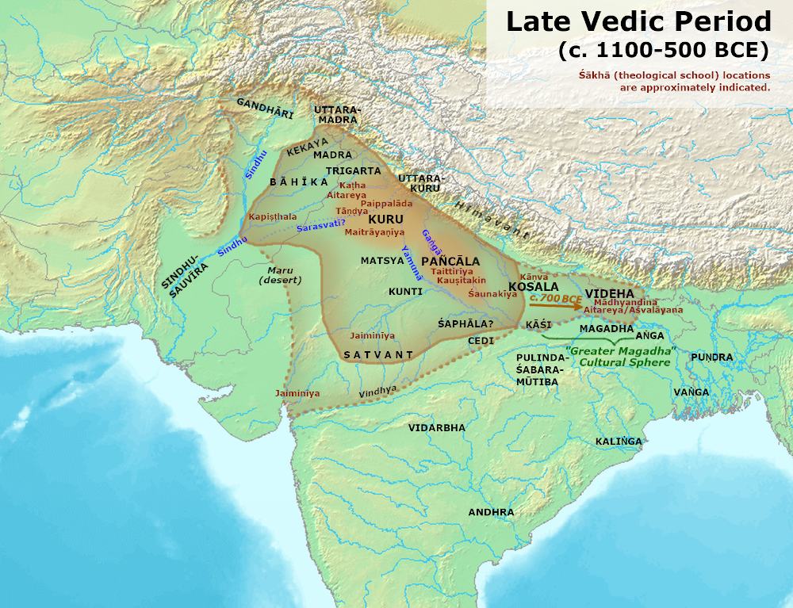
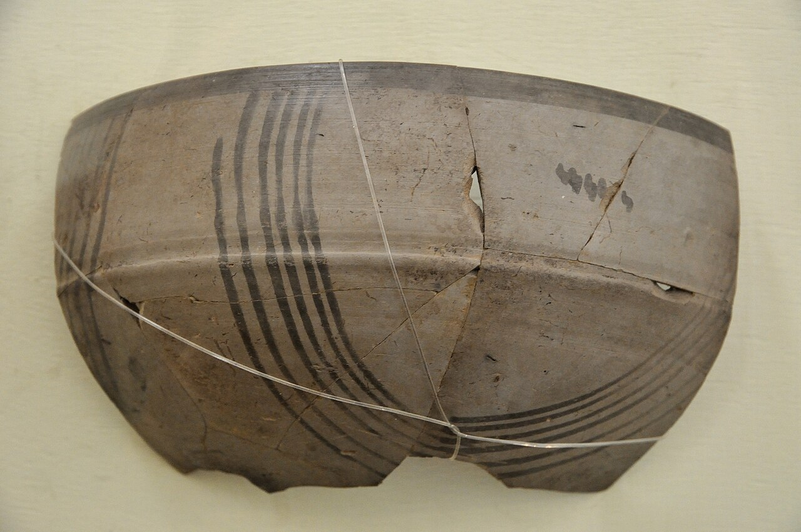
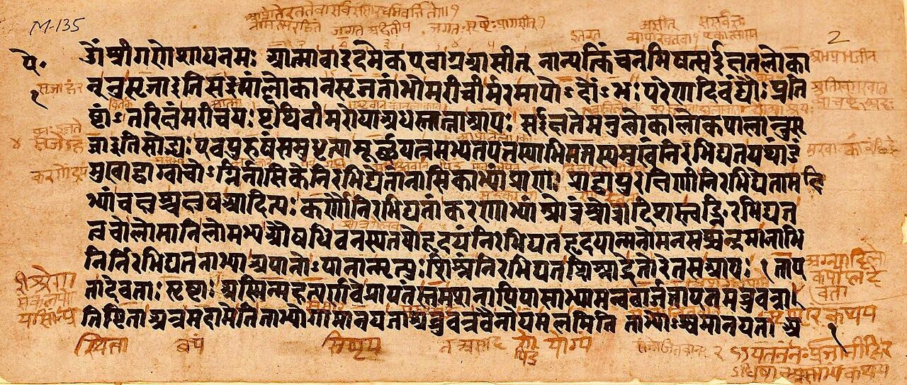

# Vedic Age (c. 1500 BCE – 600 BCE): High-Yield SSC Notes

---

## 1. Core Concepts / Definitions

* **Timeframe & Division:**
* **Early Vedic Age (Rigvedic Period):** **1500 BCE – 1000 BCE** (Centered in the **Sapta Sindhu** or land of seven rivers).
* **Later Vedic Age:** **1000 BCE – 600 BCE** (Centered in the **Ganga-Yamuna Doab** and *Aryavarta*).

* **Aryan Origin Theories (Frequently Asked):**
* **Central Asian Theory:** Max Muller (Most widely accepted).
* **Arctic Region Theory:** Bal Gangadhar Tilak (*The Arctic Home in the Vedas*).
* **Tibet Theory:** Swami Dayananda Saraswati (*Satyarth Prakash*).
* **Sapta Sindhu (Indigenous) Theory:** A.C. Das.

* **Epigraphic Evidence of Indo-Aryans:**
* **Boghazkoi Inscription (1400 BCE, Asia Minor/Turkey):** Mentions four Vedic gods—**Indra, Varuna, Mitra, and Nasatyas (Ashvins)**—witnessing a treaty between Hittite and Mitanni kings.
* **Kassite Inscription (1600 BCE, Iraq):** Mentions Aryan names.

* **Material & Archaeological Markers:**
* **Early Vedic:** Ochre Coloured Pottery (**OCP**), Copper-Bronze age (*Ayas* meant copper/bronze).
* **Later Vedic:** Painted Grey Ware (**PGW**) pottery and introduction of **Iron** (*Shyama Ayas* or *Krishna Ayas*, earliest evidence at **Atranjikhera**, UP).

**Figure: Map of Late Vedic Culture — geographical expansion from Sapta Sindhu into the Ganga-Yamuna Doab and Bihar**

**Figure: Painted Grey Ware pottery — fine grey Iron Age ceramics marking Later Vedic settlements**

---

## 2. Vedic Literature Classification

Vedic literature is divided into **Shruti** (that which is heard/revealed—apaurusheya) and **Smriti** (that which is remembered/human-composed).

### A. The Four Vedas (Samhitas)

| Veda | Core Subject | Reciting Priest | Upaveda | Key SSC Facts |
| --- | --- | --- | --- | --- |
| **Rigveda** | Hymns & Prayers (*Suktas*) | **Hotri** | **Ayurveda** (Medicine) | Oldest text; **10 Mandalas**, **1,028 Hymns**, 10,600 verses; UNESCO Memory of the World Register. |
| **Samaveda** | Melodies & Chants | **Udgatri** | **Gandharvaveda** (Music) | Root of Indian classical music; borrows most verses from Rigveda; includes *Dhrupad* raga origins. |
| **Yajurveda** | Sacrificial Formulas & Rituals | **Adhvaryu** | **Dhanurveda** (Archery/Warfare) | Divided into **Krishna** (Black—prose + verse) and **Shukla** (White—only verse, *Vajasaneyi Samhita*). |
| **Atharvaveda** | Charms, Spells, Magic & Medicine | **Brahma** (Supervisor) | **Shilpaveda** (Architecture/Craft) | Non-Aryan origin elements; mentions **Sabha and Samiti as twin daughters of Prajapati**. |

**Figure: Rigveda Sanskrit manuscript — oldest surviving Vedic text written in Devanagari script**

### B. Rigveda Mandalas (High-Yield Exam Traps)

* **Mandalas II to VII:** Oldest parts, called **Family Books** (*Gotra/Vamsha Mandalas*), composed by sage families (Gritsamada, Vishvamitra, Vamadeva, Atri, Bharadvaja, Vashistha).
* **Mandala III:** Composed by **Vishvamitra**; contains the **Gayatri Mantra** dedicated to solar deity **Savitri**.
* **Mandala VII:** Describes the **Battle of Ten Kings (*Dasharajna War*)**.
* **Mandala IX:** Completely dedicated to **Soma** (God of plants and intoxicating drink).
* **Mandala X:** Latest addition; contains **Purusha Sukta** (first mention of the four *Varnas* emerging from cosmic man *Purusha*) and **Nasadiya Sukta** (Hymn of Creation).

### C. Brahmanas, Aranyakas, and Upanishads

* **Brahmanas:** Prose commentaries explaining Vedic hymns and sacrificial rules.
* *Rigveda:* Aitareya, Kaushitaki.
* *Samaveda:* Tandya Mahabrahmana (Panchavimsha), Jaiminiya.
* *Yajurveda:* **Shatapatha Brahmana** (oldest and largest; mentions **Videgha Mathava**'s eastward expansion and agricultural rituals), Taittiriya.
* *Atharvaveda:* Gopatha Brahmana (only one).

* **Aranyakas (Forest Books):** Concluding portions of Brahmanas; meant for hermits/students in forests; transition from ritualism to philosophy.
* **Upanishads (Vedanta = End of Vedas):** Total **108**; philosophical texts focusing on *Atman* (soul) and *Brahman* (ultimate reality).
* **Mundaka Upanishad:** Source of national motto **"Satyameva Jayate"**.
* **Chandogya Upanishad:** Earliest mention of first three *Ashramas* and Krishna (son of Devaki).
* **Jabala Upanishad:** First mention of all **four Ashramas** (*Brahmacharya, Grihastha, Vanaprastha, Sannyasa*).
* **Brihadaranyaka Upanishad:** Oldest Upanishad; contains **Yajnavalkya-Gargi dialogue** and *"Tamaso Ma Jyotirgamaya"*.
* **Katha Upanishad:** Dialogue between **Yama and Nachiketa**.

### D. Vedangas (6 Limbs of Vedas — Smriti)

1. **Shiksha:** Phonetics / Pronunciation
2. **Kalpa:** Rituals (*Shrauta, Grihya, Dharma Sutras*)
3. **Vyakarana:** Grammar (Panini's *Ashtadhyayi*)
4. **Nirukta:** Etymology (Yaska's *Nirukta*)
5. **Chhanda:** Metrics / Prosody (Pingala's *Chhandashastra*)
6. **Jyotisha:** Astronomy (Lagadha's *Vedanga Jyotisha*)

---

## 3. Important Concepts for SSC

### A. Early Vedic vs. Later Vedic Comparison

| Parameter | Early Vedic Period (1500–1000 BCE) | Later Vedic Period (1000–600 BCE) |
| --- | --- | --- |
| **Core Geography** | Sapta Sindhu (Punjab & Haryana) | Ganga-Yamuna Doab (Kuru-Panchala) |
| **Economy** | Pastoralism primary; cattle (*Gavishthi* = war for cows) | Settled agriculture primary; rice (*Vrihi*), wheat (*Godhuma*) |
| **Polity** | Tribal chief (*Rajan*); non-hereditary; no standing army | Territorial kingdoms (*Janapada*); hereditary kingship; *Ratnins* |
| **Assemblies** | **Sabha, Samiti, Vidatha, Gana** very powerful | *Vidatha* disappeared; *Sabha* & *Samiti* dominated by nobles |
| **Taxation** | Voluntary tribute called **Bali** | Mandatory taxes: **Bali, Bhaga ($\frac{1}{6}$th), Shulka** |
| **Social System** | Flexible occupation-based *Varna*; no child marriage/sati | Birth-based rigid *Varna*; *Gotra* exogamy & *Ashrama* established |
| **Status of Women** | High; attended assemblies; scholars (**Ghosha, Lopamudra, Apala**) | Declined; barred from *Sabha/Samiti*; scholars (**Gargi, Maitreyi**) |
| **Chief Deities** | **Indra** (250 hymns), **Agni** (200 hymns), **Varuna** | **Prajapati** (Creator), **Vishnu** (Preserver), **Rudra** (Destroyer) |

### B. Rigvedic Rivers (Modern vs. Ancient Names)

| Rigvedic Name | Modern Name | SSC Exam Note |
| --- | --- | --- |
| **Sindhu** | Indus | Most frequently mentioned river |
| **Saraswati** | Ghaggar-Hakra | Most sacred river (*Naditama* = best of rivers) |
| **Vitasta** | Jhelum | Northernmost Punjab tributary |
| **Askini** | Chenab | — |
| **Parushni** | Ravi | Site of **Battle of Ten Kings** |
| **Vipasha** | Beas | — |
| **Shutudri** | Sutlej | Easternmost Punjab tributary |
| **Sadanira** | Gandak | Boundary between Kosala and Videha |
| **Kubha / Krumu** | Kabul / Kurram | Rivers in Afghanistan mentioned in Rigveda |

### C. Key Vedic Terms & Officers

* **Gavishthi:** Search/war for cows.
* **Aghanya:** "Not to be killed" — term used for **cow**.
* **Gomat:** Wealthy man owning many cattle.
* **Duhitri:** Daughter (literally "one who milks the cow").
* **Nishka / Satamana / Krishnala:** Gold/silver metallic pieces used as media of exchange (not regular stamped coins).
* **Vrajapati:** Officer in charge of pasture lands.
* **Gramani:** Head of the village (*Grama*).
* **Kulapa:** Head of the family (*Kula*).
* **Bhagadugha:** Tax collector (Later Vedic).
* **Sangrahitri:** Treasurer (Later Vedic).

### D. Major Royal Sacrifices (Later Vedic)

* **Rajasuya:** Royal consecration ceremony conferring supreme power on the king.
* **Ashvamedha:** Horse sacrifice establishing unchallenged territorial sovereignty.
* **Vajapeya:** Chariot race sacrifice where the royal chariot was made to win against kinsmen.

### E. Six Systems of Indian Philosophy (*Shad-Darshanas*)

| Philosophy | Founder | Core Focus |
| --- | --- | --- |
| **Samkhya** | Kapila | Oldest school; dualism (*Purusha* & *Prakriti*) |
| **Yoga** | Patanjali | Salvation through meditation & physical discipline |
| **Nyaya** | Gautama (Akshapada) | Logic and epistemology |
| **Vaisheshika** | Kanada | Atomic theory (*Anu*) of the universe |
| **Purva Mimamsa** | Jaimini | Vedic rituals and *Dharma* |
| **Uttara Mimamsa (Vedanta)** | Badarayana | Upanishadic philosophy of *Brahman* |

---

## 4. Shortcuts and Revision Mnemonics

* **Four Vedas Chronological Order:** **R**avi **S**ings **Y**esterday's **A**nthem $\rightarrow$ **R**ig, **S**ama, **Y**ajur, **A**tharva.
* **Punjab Rivers (North to South):** **J**ust **C**all **R**avi **B**efore **S**unday $\rightarrow$ **J**helum (Vitasta), **C**henab (Askini), **R**avi (Parushni), **B**eas (Vipasha), **S**utlej (Shutudri).
* **Boghazkoi Gods:** **I**ndia **M**ade **V**ery **N**ice $\rightarrow$ **I**ndra, **M**itra, **V**aruna, **N**asatyas.
* **Tribal Hierarchy (Smallest to Largest):** **K**ula (Family) $\rightarrow$ **G**rama (Village) $\rightarrow$ **V**is (Clan) $\rightarrow$ **J**ana (Tribe) $\rightarrow$ **R**ashtra (Country).
* Mnemonic: **K**ing **G**ives **V**ery **J**oyful **R**ule.

---

## 5. PYQs / PYQ-Pattern Questions with Solutions

**Q1.** From which Upanishad is the national motto of India, *"Satyameva Jayate"*, taken? *(SSC CGL)*

**Answer:** Mundaka Upanishad

**Solution:** *Mundaka Upanishad* (associated with Atharvaveda) contains the phrase *"Satyameva Jayate Nanritam"* (Truth alone triumphs, not falsehood).

**Q2.** On the banks of which river was the famous *Dasharajna* (Battle of Ten Kings) fought? *(SSC CGL / CPO)*

**Answer:** Parushni (Ravi)

**Solution:** Described in Mandala VII of the Rigveda, King Sudas of the Bharata tribe defeated a confederacy of ten tribes on the banks of river Parushni (modern Ravi).

**Q3.** Which Veda contains the *Gayatri Mantra*? *(SSC CHSL)*

**Answer:** Rigveda

**Solution:** Composed by sage Vishvamitra, the Gayatri Mantra appears in the **3rd Mandala** of the Rigveda and is dedicated to solar deity Savitri.

**Q4.** In the Rigvedic period, what did the term *Aghanya* refer to? *(SSC CGL)*

**Answer:** Cow

**Solution:** *Aghanya* literally means "not to be killed," indicating the high economic and sacred value of cows in pastoral Rigvedic society.

**Q5.** Which Veda is considered the origin of Indian classical music? *(SSC MTS / CHSL)*

**Answer:** Samaveda

**Solution:** *Samaveda* (Book of Chants) sets Rigvedic hymns to musical melodies (*Saman*) sung by the *Udgatri* priest.

**Q6.** Who was the most important deity during the Early Vedic period? *(SSC CGL)*

**Answer:** Indra

**Solution:** Indra (*Purandara* — breaker of forts) was the chief god of war and rain, with **250 hymns** dedicated to him in the Rigveda, followed by Agni (200 hymns).

**Q7.** Which archaeological pottery culture is primarily associated with the Later Vedic period? *(SSC CPO)*

**Answer:** Painted Grey Ware (PGW)

**Solution:** Painted Grey Ware (1000–600 BCE) alongside iron tools marks the Later Vedic settlements in the Ganga-Yamuna Doab.

**Q8.** In which Mandala of the Rigveda does the *Purusha Sukta*, mentioning the four Varnas, appear? *(SSC CGL)*

**Answer:** 10th Mandala

**Solution:** The 10th Mandala (latest stratum) contains the *Purusha Sukta*, describing Brahmana, Kshatriya, Vaishya, and Shudra emerging from the cosmic being Purusha.

**Q9.** Which of the following Vedic assemblies ceased to exist during the Later Vedic period? *(SSC CGL Pattern)*

**Answer:** Vidatha

**Solution:** *Vidatha* (the oldest tribal assembly where women actively participated) completely disappeared in the Later Vedic phase, while *Sabha* and *Samiti* lost their democratic character.

**Q10.** Who is the propounder of the *Vaisheshika* school of Indian philosophy? *(SSC CHSL)*

**Answer:** Maharishi Kanada

**Solution:** Kanada formulated the *Vaisheshika Darshana*, proposing that all physical objects are reducible to finite atoms (*Anu*).

---

## 6. Practice Questions

**Q1.** Which Brahmana text narrates the story of Videgha Mathava carrying sacrificial fire eastward across the river Sadanira?

**Answer:** Shatapatha Brahmana

**Solution:** Attached to the Shukla Yajurveda, *Shatapatha Brahmana* records the eastward Aryan expansion into Videha (North Bihar).

**Q2.** What was the ancient Rigvedic name of the river Chenab?

**Answer:** Askini

**Solution:** The five Punjab rivers are Vitasta (Jhelum), Askini (Chenab), Parushni (Ravi), Vipasha (Beas), and Shutudri (Sutlej).

**Q3.** Which Upanishad contains the famous philosophical dialogue between Yama (God of Death) and young Nachiketa?

**Answer:** Katha Upanishad

**Solution:** *Katha Upanishad* (Krishna Yajurveda) records the conversation between Nachiketa and Yama on the nature of the soul and death.

**Q4.** Who among the following was a renowned woman philosopher of the Later Vedic period who debated sage Yajnavalkya?

**Answer:** Gargi Vachaknavi

**Solution:** As recorded in the *Brihadaranyaka Upanishad*, Gargi challenged Yajnavalkya in King Janaka's court. (Lopamudra and Apala belong to the Early Vedic period).

**Q5.** What was the designation of the officer responsible for collecting taxes during the Later Vedic period?

**Answer:** Bhagadugha

**Solution:** *Bhagadugha* collected the royal share (*Bhaga*), whereas *Sangrahitri* acted as the royal treasurer.

**Q6.** Which Vedanga deals specifically with etymology and the explanation of obscure Vedic words?

**Answer:** Nirukta

**Solution:** Yaska's *Nirukta* is the foundational text on Vedic etymology.

**Q7.** The 1400 BCE Boghazkoi inscription, which mentions Vedic deities, was discovered in which modern-day country?

**Answer:** Turkey

**Solution:** Boghazkoi (Hattusa) is located in Anatolia (modern-day Turkey).

---

## 7. Common Exam Traps

* **Most Mentioned vs. Most Sacred River:**
* *Trap:* Marking Saraswati as the most mentioned river in the Rigveda.
* *Fact:* **Sindhu (Indus)** is the most frequently mentioned river; **Saraswati** is the most sacred river (*Naditama*).

* **Ganga & Yamuna Mentions in Rigveda:**
* *Trap:* Assuming Ganga was the central river of the Rigveda.
* *Fact:* **Ganga** is mentioned only **once** (in the 10th Mandala) and **Yamuna** **three times**.

* **Early vs. Later Vedic Women Scholars:**
* *Trap:* Mixing up Early and Later Vedic female scholars.
* *Fact:* Early Vedic = **Lopamudra, Ghosha, Apala, Vishwavara**. Later Vedic = **Gargi, Maitreyi**.

* **Iron Usage in Early Vedic Period:**
* *Trap:* Thinking Rigvedic Aryans used iron weapons.
* *Fact:* Iron (*Krishna/Shyama Ayas*) was **unknown** in the Early Vedic period; it appeared around **1000 BCE** in the Later Vedic period.

* **Chandogya vs. Jabala Upanishad (Ashramas):**
* *Trap:* Marking Chandogya for all four Ashramas.
* *Fact:* *Chandogya* mentions only the **first three** Ashramas; *Jabala Upanishad* mentions all **four** (including *Sannyasa*).

---

## 8. Last-Minute Revision Table

| Category | Key Fact / Name | Associated Detail |
| --- | --- | --- |
| **Oldest Veda** | Rigveda | 10 Mandalas, 1,028 Hymns, Hotri priest |
| **Gayatri Mantra** | 3rd Mandala (Rigveda) | Composed by Vishvamitra; dedicated to Savitri |
| **Varna Origin** | 10th Mandala (*Purusha Sukta*) | First mention of 4 Varnas |
| **Music Veda** | Samaveda | Udgatri priest; Gandharvaveda |
| **Ritual Veda** | Yajurveda | Adhvaryu priest; Krishna & Shukla branches |
| **Magic/Medicine Veda** | Atharvaveda | Brahma priest; Sabha & Samiti = daughters of Prajapati |
| **Satyameva Jayate** | Mundaka Upanishad | National motto of India |
| **4 Ashramas** | Jabala Upanishad | Brahmacharya, Grihastha, Vanaprastha, Sannyasa |
| **Battle of 10 Kings** | River Parushni (Ravi) | King Sudas (Bharata) defeated 10 tribes |
| **Iron Name** | Shyama / Krishna Ayas | Appeared c. 1000 BCE (Later Vedic) |
| **Early Vedic Tax** | Bali | Voluntary offering to Rajan |
| **Later Vedic Tax** | Bhaga | Mandatory $\frac{1}{6}$th share of produce |