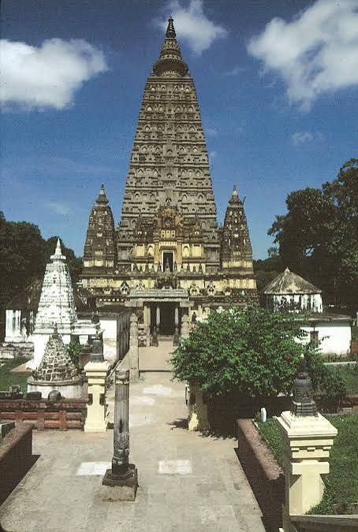
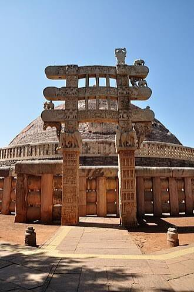
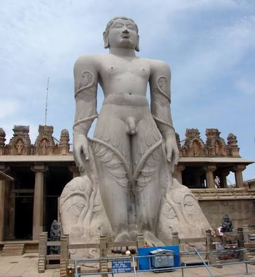
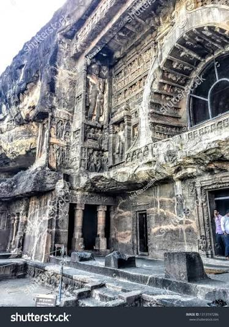

# Buddhism and Jainism — High-Yield SSC Notes

---

## 1. Core Concepts & Origins

* **Background:** Both arose in the **6th century BCE** in the Gangetic plains as heterodox (Nastika) protest movements against complex Vedic rituals, animal sacrifices, and rigid Varna hierarchy.
* **Language of Preaching:** Both rejected Sanskrit and preached in vernacular languages—**Pali** (Buddhism) and **Prakrit / Ardhamagadhi** (Jainism)—making teachings accessible to Vaishyas and Shudras.
* **Common Doctrines:** Both rejected the infallibility of the Vedas, emphasized **Ahimsa** (non-violence), believed in **Karma** and **rebirth**, and aimed at liberation (**Nirvana / Moksha**) from the cycle of transmigration.
* **Key Philosophical Difference:**
* **Buddhism:** Denies the existence of an eternal soul (**Anatta / Anatman**) and God; advocates the **Middle Path (Majjhima Patipada)**.
* **Jainism:** Believes every living and non-living entity possesses a soul (**Jiva**); denies a creator God (places Jinas above gods); advocates **extreme asceticism**.

---

## 2. Buddhism: Life, Teachings & Councils

### Life of Gautama Buddha

| Event / Aspect | Key Fact | Symbol (Hinayana Art) |
| --- | --- | --- |
| **Birth** | **563 BCE** at **Lumbini** (Rummindei, Nepal) in the **Shakya** clan | Lotus and Bull |
| **Parents & Family** | Father: **Suddhodana**; Mother: **Mahamaya**; Foster Mother: **Mahaprajapati Gautami** (first Bhikkhuni); Wife: **Yashodhara**; Son: **Rahula** | — |
| **Renunciation** | Left home at age **29** (**Mahabhinishkramana**) with charioteer **Channa** and horse **Kanthaka** | Horse |
| **Enlightenment** | At age **35** (**Nirvana / Sambodhi**) under a **Peepal (Bodhi) tree** at **Bodh Gaya** on the banks of river **Niranjana (Phalgu)** | Bodhi Tree |
| **First Sermon** | At **Sarnath** (Deer Park / Isipatana) to 5 ascetics (**Dhammachakkapavattana**) | Wheel (Dharmachakra) |
| **Death** | At age **80** (**483 BCE**) at **Kushinagar** (**Mahaparinirvana**) in the Malla republic | Stupa / Footprints |

*Fig. 1: Mahabodhi Temple, Bodh Gaya. Built at the site where Gautama Buddha attained enlightenment under the Bodhi tree; a UNESCO World Heritage Site and major Buddhist pilgrimage center.*

### Core Buddhist Doctrines

* **Four Noble Truths (Arya Satyani):**
1. **Dukkha:** The world is full of suffering.
2. **Samudaya:** Desire (**Tanha / Trishna**) is the root cause of suffering.
3. **Nirodha:** Suffering can be ended by eliminating desire.
4. **Magga:** Suffering ceases by following the **Eightfold Path**.

* **Noble Eightfold Path (Ashtangika Marga):** Right View, Right Resolve, Right Speech, Right Conduct, Right Livelihood, Right Effort, Right Mindfulness, and Right Concentration.
* **Triratna (Three Jewels):** **Buddha** (the Enlightened One), **Dhamma** (the Teachings), and **Sangha** (the Monastic Order).
* **Kshanikavada:** Doctrine of momentariness (everything in the universe is impermanent—*Anicca*).
* **Pratityasamutpada:** Doctrine of dependent origination (nothing exists independently; every effect has a cause).

### Four Buddhist Councils (Frequently Tested)

| Council | Year | Place | Patron (Ruler) | President | Key Outcome |
| --- | --- | --- | --- | --- | --- |
| **First** | 483 BCE | **Rajagriha** (Sattaparni Cave) | **Ajatashatru** (Haryanka) | **Mahakassapa** | Compilation of **Sutta Pitaka** (by Ananda) and **Vinaya Pitaka** (by Upali) |
| **Second** | 383 BCE | **Vaishali** | **Kalashoka** (Shishunaga) | **Sabakami** | Split into **Sthaviravadins** (orthodox) and **Mahasanghikas** (liberal) |
| **Third** | 250 BCE | **Pataliputra** | **Ashoka** (Maurya) | **Moggaliputta Tissa** | Compilation of **Abhidhamma Pitaka**; missionaries sent abroad (Mahendra & Sanghamitra to Sri Lanka) |
| **Fourth** | 72 CE / 1st C CE | **Kundalavana** (Kashmir) | **Kanishka** (Kushan) | **Vasumitra** (Vice: **Ashvaghosha**) | Division into **Hinayana** and **Mahayana**; Sanskrit adopted by Mahayana |

### Buddhist Literature & Sects

* **Tripitaka (Three Baskets — in Pali):**
1. **Vinaya Pitaka:** Rules of monastic discipline for monks and nuns.
2. **Sutta Pitaka:** Buddha's sermons and discourses; divided into 5 Nikayas (*Khuddaka Nikaya* contains **Jataka tales**—stories of Buddha's previous births—and *Dhammapada*).
3. **Abhidhamma Pitaka:** Philosophical and psychological analysis of Buddhist doctrines.

* **Non-Canonical Texts:** **Milindapanho** (dialogue in Pali between Indo-Greek king Menander and monk **Nagasena**), **Dipavamsa** and **Mahavamsa** (Sri Lankan chronicles), **Buddhacharita** (Sanskrit biography of Buddha by **Ashvaghosha**).
* **Major Sects:**
* **Hinayana (Lesser Vehicle):** Orthodox; regards Buddha as a great human teacher, not a god; uses **Pali**; worships symbols; prevalent in Sri Lanka, Myanmar, Thailand.
* **Mahayana (Greater Vehicle):** Treats Buddha as a deity; worships images/idols; uses **Sanskrit**; introduces **Bodhisattvas** (e.g., *Avalokiteshvara / Padmapani*, *Maitreya* — future Buddha); prevalent in China, Japan, Korea.
* **Vajrayana (Thunderbolt Vehicle):** Tantric Buddhism; emerged in eastern India (Bengal/Bihar) around 7th–8th century CE; worships female deities like **Tara**.

*Fig. 2: Great Stupa, Sanchi. Commissioned by Emperor Ashoka in the 3rd century BCE to enshrine relics of the Buddha; an iconic example of early Buddhist stupa architecture.*

---

## 3. Jainism: Tirthankaras, Doctrines & Councils

### The 24 Tirthankaras

* **Tirthankara:** Literally "ford-maker"—a spiritual teacher who conquers *Samsara* and shows the path to liberation.
* **1st Tirthankara:** **Rishabhanatha (Adinatha)** — Symbol: **Bull** (mentioned in the *Rig Veda*).
* **22nd Tirthankara:** **Neminatha / Arishtanemi** — Symbol: **Conch** (considered a cousin of Lord Krishna).
* **23rd Tirthankara:** **Parshvanatha** — Prince of Kashi (son of King Ashvasena); attained enlightenment on **Sammed Shikhar (Parasnath Hill, Jharkhand)**; Symbol: **Hooded Serpent**. Preached **Chaturthi** (4 vows: Truth, Non-violence, Non-stealing, Non-possession).
* **24th Tirthankara:** **Vardhamana Mahavira** — Symbol: **Lion**.

### Life of Vardhamana Mahavira

* **Birth:** **540 BCE** (or 599 BCE in traditional chronology) at **Kundagrama** (near Vaishali, Bihar) in the **Jnatrika** Kshatriya clan.
* **Family:** Father: **Siddhartha**; Mother: **Trishala** (sister of Lichchhavi chief Chetaka); Wife: **Yashoda**; Daughter: **Anojja / Priyadarshana** (married to **Jamali**, Mahavira's first disciple and first rebel).
* **Renunciation & Kaivalya:** Renounced worldly life at age **30**; attained supreme knowledge (**Kaivalya**) at age **42** under a **Sal tree** at **Jrimbhikagrama** on the banks of river **Rijupalika**.
* **Titles:** **Jina** (conqueror), **Mahavira** (great hero), **Nirgrantha** (free from all bonds), **Kevalin**.
* **Death (Nirvana):** At age **72** (**468 BCE**) at **Pavapuri** (near Rajgir, Bihar).

*Fig. 3: Gommateshwara (Bahubali) Monolith, Shravanabelagola. A 57-foot monolithic granite statue built by Ganga minister Chavundaraya in the 10th century CE; site of the Mahamastakabhisheka festival and Chandragupta Maurya's Sallekhana.*

### Core Jain Doctrines

* **Triratna (Three Jewels of Jainism):**
1. **Samyak Darshana** (Right Faith)
2. **Samyak Jnana** (Right Knowledge)
3. **Samyak Charitra** (Right Conduct)

* **Pancha Mahavratas (Five Great Vows):**
1. **Ahimsa** (Non-violence)
2. **Satya** (Truthfulness)
3. **Asteya** (Non-stealing)
4. **Aparigraha** (Non-possession of property)
5. **Brahmacharya** (Celibacy — **added by Mahavira** to Parshvanatha's 4 vows)

* **Anekantavada:** Doctrine of manifold nature of reality (truth has many aspects).
* **Syadvada:** Doctrine of conditioned predication / relative judgment (*"maybe"* — sevenfold logic, *Saptabhangi Naya*).
* **Sallekhana / Santhara:** Voluntary fasting unto death to purge karma.

### Jain Councils & Sects

| Council | Period | Place | President | Key Outcome |
| --- | --- | --- | --- | --- |
| **First** | c. 300 BCE | **Pataliputra** | **Sthulabhadra** | Compilation of **12 Angas** (replacing 14 Purvas); formal split into **Shvetambaras** and **Digambaras** |
| **Second** | 512 CE | **Vallabhi** (Gujarat) | **Devardhi Kshamasramana** | Final compilation of **12 Angas** and **12 Upangas** in **Ardhamagadhi Prakrit** |

* **Reason for Schism:** During a 12-year famine in Magadha, **Bhadrabahu** migrated to **Shravanabelagola** (Karnataka) with Chandragupta Maurya, maintaining strict nudity, while **Sthulabhadra** stayed back in Magadha and permitted white garments.
* **Digambaras (Sky-clad):** Led by **Bhadrabahu**; practice complete nudity (male monks); believe women cannot attain liberation directly without being reborn as men; reject canonical status of surviving Angas.
* **Shvetambaras (White-clad):** Led by **Sthulabhadra**; wear white clothes; believe women can attain liberation (19th Tirthankara **Mallinatha** is considered female by Shvetambaras, male by Digambaras).
* **Important Jain Texts:** **Kalpasutra** (biographies of Tirthankaras, written in Sanskrit by **Bhadrabahu**), **Parishishtaparvan** (by **Hemachandra**), **Acharanga Sutra** (monastic rules).

---

## 4. Important Concepts & Architecture for SSC

* **Buddhist Architectural Forms:**
* **Stupa:** Hemispherical dome (*Anda*) housing relics of Buddha/monks, topped by *Harmika* and *Chhatri*, surrounded by *Vedika* (railing) and *Toranas* (gateways). Examples: **Sanchi**, **Bharhut**, **Amaravati**, **Dhamek Stupa (Sarnath)**.
* **Chaitya:** Prayer/assembly hall with a stupa at the apsidal end (e.g., **Karle Chaitya**, **Ajanta Cave 9 & 10**).
* **Vihara:** Monastic residence for monks (e.g., **Nalanda**, **Vikramashila**, **Ajanta**).

* **Buddhist Universities & Founders:**
* **Nalanda** (Bihar) — **Kumaragupta I** (Gupta dynasty)
* **Vikramashila** (Bihar) — **Dharmapala** (Pala dynasty)
* **Odantapuri** (Bihar) — **Gopala** (Pala dynasty)
* **Vallabhi** (Gujarat) — **Bhattarka** (Maitraka dynasty; center of Hinayana)

* **Jain Monuments & Patrons:**
* **Dilwara Temples** (Mount Abu, Rajasthan) — White marble temples built by Solanki ministers (**Vimal Vasahi** by Vimal Shah; **Luna Vasahi** by Vastupala and Tejapala).
* **Hathigumpha Inscription** (Udayagiri, Odisha) — **Kharavela** (Chedi dynasty, staunch Jain patron).
* **Khajuraho Jain Temples** (e.g., Parshvanatha Temple) — **Chandela** rulers.
* **Ellora Caves (Caves 30–34)** — **Rashtrakuta** rulers (e.g., *Indra Sabha*).

*Fig. 4: Ajanta Caves, Maharashtra. A complex of 29 rock-cut Buddhist chaityas and viharas dating from the 2nd century BCE to 5th century CE, famous for murals depicting Jataka tales.*

---

## 5. Common Exam Traps

* **Triratna Confusion:**
* Buddhist Triratna = **Buddha, Dhamma, Sangha**.
* Jain Triratna = **Samyak Darshana, Samyak Jnana, Samyak Charitra**.

* **Trees & Rivers of Enlightenment:**
* Buddha = **Peepal (Bodhi) tree**, **Niranjana (Phalgu)** river, **Bodh Gaya**.
* Mahavira = **Sal tree**, **Rijupalika** river, **Jrimbhikagrama**.

* **5th Vow of Jainism:** Parshvanatha gave **4 vows**; only the 5th vow (**Brahmacharya**) was added by **Mahavira**.
* **First Woman in Buddhist Sangha:** **Mahaprajapati Gautami** (Buddha's foster mother) was the first *Bhikkhuni*, admitted at **Vaishali** on **Ananda's** persuasion—NOT Yashodhara.
* **Buddha's Contemporary Rulers:** **Bimbisara** and **Ajatashatru** (Magadha), **Prasenajit** (Kosala), **Udayana** (Vatsa). Ashoka and Kanishka lived centuries later.

---

## 6. Last-Minute Revision Table

| Parameter | Buddhism | Jainism |
| --- | --- | --- |
| **Founder / Last Teacher** | Gautama Buddha (Siddhartha) | Rishabhanatha (1st); Vardhamana Mahavira (24th) |
| **Birth & Death** | 563 BCE (Lumbini) – 483 BCE (Kushinagar) | 540 BCE (Kundagrama) – 468 BCE (Pavapuri) |
| **Enlightenment Site** | Bodh Gaya (Peepal tree, Niranjana river) | Jrimbhikagrama (Sal tree, Rijupalika river) |
| **Core Path** | Middle Path (*Majjhima Patipada*) | Extreme Asceticism & Non-violence |
| **Soul (*Atman*)** | Denied (*Anatta*) | Accepted (*Jiva* in everything) |
| **Creator God** | Agnostic / Silent | Denied (Jinas > Gods) |
| **Primary Language** | Pali (later Sanskrit in Mahayana) | Ardhamagadhi / Prakrit (later Sanskrit) |
| **Canonical Texts** | Tripitaka (Vinaya, Sutta, Abhidhamma) | Agamas (12 Angas, 12 Upangas) |
| **Major Sects** | Hinayana, Mahayana, Vajrayana | Digambara, Shvetambara |

---

## 7. PYQs / PYQ-Pattern Questions with Solutions

**Q1. Where did Gautama Buddha deliver his first sermon, known as Dharmachakrapravartana? (SSC CGL)**

* **Answer:** **Sarnath (Deer Park / Isipatana)**
* **Solution:** After attaining enlightenment at Bodh Gaya, Buddha walked to Sarnath near Varanasi and preached his first sermon on the Four Noble Truths to five former ascetic companions.

**Q2. Who was the president of the Fourth Buddhist Council held in Kashmir under the patronage of Kanishka? (SSC CHSL)**

* **Answer:** **Vasumitra**
* **Solution:** The 4th Buddhist Council (1st century CE) at Kundalavana was presided over by **Vasumitra**, with **Ashvaghosha** serving as vice-president.

**Q3. Which of the five great vows (Pancha Mahavratas) of Jainism was added by Vardhamana Mahavira? (SSC CPO)**

* **Answer:** **Brahmacharya (Celibacy)**
* **Solution:** The 23rd Tirthankara, Parshvanatha, prescribed four vows (*Ahimsa, Satya, Asteya, Aparigraha*). Mahavira added the fifth vow, *Brahmacharya*.

**Q4. The 'Jataka' tales are associated with which religion and form part of which Pitaka? (SSC CGL)**

* **Answer:** **Buddhism; Khuddaka Nikaya of Sutta Pitaka**
* **Solution:** Jatakas contain over 500 stories describing the previous births of Gautama Buddha in human and animal forms.

**Q5. Who authored the 'Kalpasutra', a sacred Jain text containing biographies of the Tirthankaras? (SSC CGL)**

* **Answer:** **Bhadrabahu**
* **Solution:** Bhadrabahu, the spiritual preceptor of Chandragupta Maurya and leader of the Digambara tradition, composed the *Kalpasutra* in Sanskrit.

**Q6. Which Buddhist text records the philosophical dialogue between Indo-Greek ruler Menander and Buddhist monk Nagasena? (SSC MTS)**

* **Answer:** **Milindapanho (Questions of Milinda)**
* **Solution:** Written in Pali, *Milindapanho* captures King Menander's questions on Buddhist metaphysics answered by Nagasena, leading to Menander's conversion.

**Q7. At which place did Chandragupta Maurya spend his last days and perform Sallekhana? (SSC CHSL)**

* **Answer:** **Shravanabelagola (Karnataka)**
* **Solution:** Chandragupta Maurya abdicated his throne, accompanied Jain saint Bhadrabahu to Shravanabelagola during the Magadhan famine, and ended his life through *Sallekhana*.

**Q8. What was the symbol associated with the first Jain Tirthankara, Rishabhanatha? (SSC CGL)**

* **Answer:** **Bull**
* **Solution:** Each of the 24 Tirthankaras has a distinct emblem (*Lanchhana*): Rishabhanatha (Bull), Parshvanatha (Serpent), and Mahavira (Lion).

**Q9. In Buddhism, what does the 'Chaitya' refer to? (SSC CPO)**

* **Answer:** **A prayer or worship hall containing a stupa**
* **Solution:** While *Viharas* served as living quarters for monks, *Chaityas* were rock-cut or structural prayer halls housing a stupa at the far end.

**Q10. Who was the first woman to be ordained as a Bhikkhuni in the Buddhist Sangha? (SSC CGL)**

* **Answer:** **Mahaprajapati Gautami**
* **Solution:** At Vaishali, Buddha reluctantly agreed—upon the intercession of his chief disciple Ananda—to admit his foster mother Mahaprajapati Gautami into the monastic order.

---

## 8. Practice Questions

**Q1. Which of the following pairs of Buddhist Council and its presiding monk is INCORRECTLY matched?**
(A) First Council — Mahakassapa
(B) Second Council — Sabakami
(C) Third Council — Moggaliputta Tissa
(D) Fourth Council — Upali

* **Answer:** **(D) Fourth Council — Upali** (The Fourth Council was presided over by Vasumitra; Upali recited the Vinaya Pitaka at the First Council.)

**Q2. Under which tree and beside which river did Vardhamana Mahavira attain Kaivalya?**
(A) Peepal tree; Niranjana river
(B) Sal tree; Rijupalika river
(C) Banyan tree; Gandak river
(D) Sal tree; Punpun river

* **Answer:** **(B) Sal tree; Rijupalika river**

**Q3. The philosophical doctrine of 'Syadvada' (theory of conditioned predication) belongs to:**
(A) Hinayana Buddhism
(B) Jainism
(C) Ajivika sect
(D) Vajrayana Buddhism

* **Answer:** **(B) Jainism**

**Q4. Which ruler of the Pala dynasty founded the famous Buddhist monastery and university at Vikramashila?**
(A) Gopala
(B) Dharmapala
(C) Devapala
(D) Mahipala I

* **Answer:** **(B) Dharmapala**

**Q5. Which of the following statements about Shvetambara and Digambara sects is true?**
(A) Digambaras believe the 19th Tirthankara Mallinatha was a woman.
(B) Shvetambaras were led by Bhadrabahu during the Magadhan famine.
(C) Digambaras believe women cannot attain liberation without being reborn as men.
(D) Both sects accept the 12 Angas compiled at Vallabhi as authoritative.

* **Answer:** **(C) Digambaras believe women cannot attain liberation without being reborn as men.**

**Q6. In early Buddhist art, the event of 'Mahabhinishkramana' is represented by which symbol?**
(A) Wheel
(B) Lotus
(C) Horse
(D) Bodhi Tree

* **Answer:** **(C) Horse**

**Q7. Who presided over the Second Jain Council held at Vallabhi in 512 CE?**
(A) Sthulabhadra
(B) Devardhi Kshamasramana
(C) Hemachandra
(D) Haribhadra

* **Answer:** **(B) Devardhi Kshamasramana**