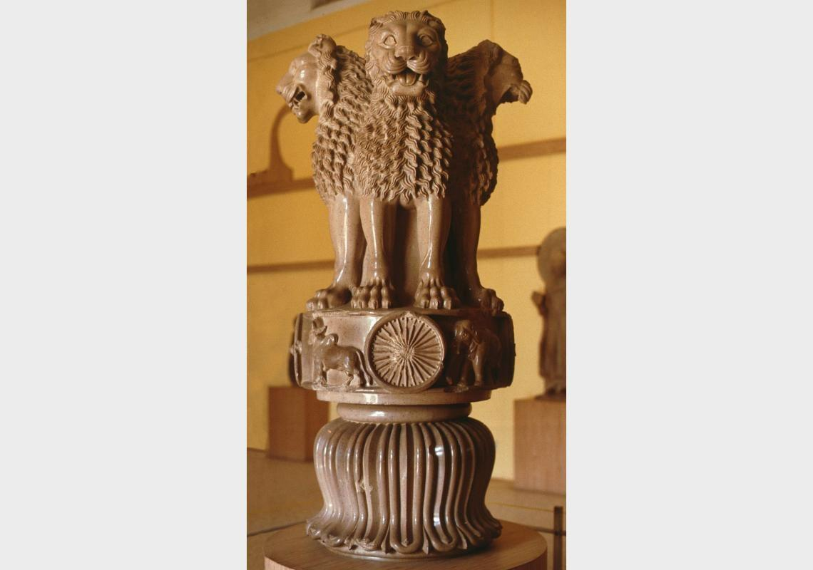
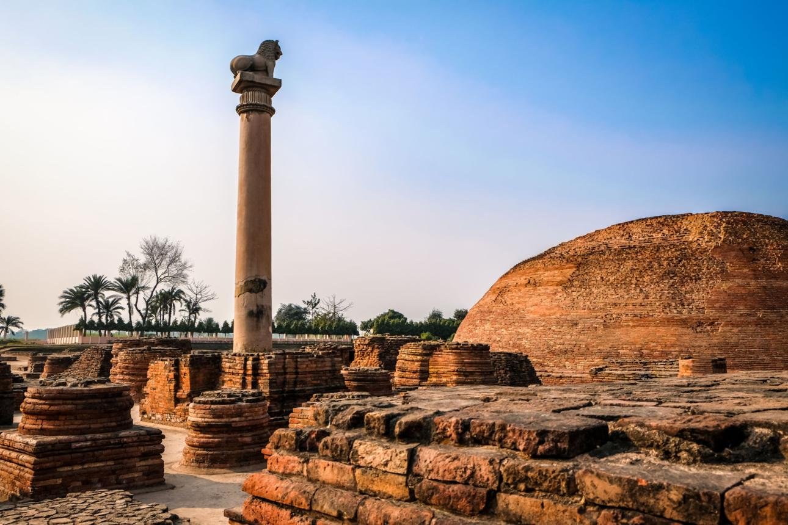
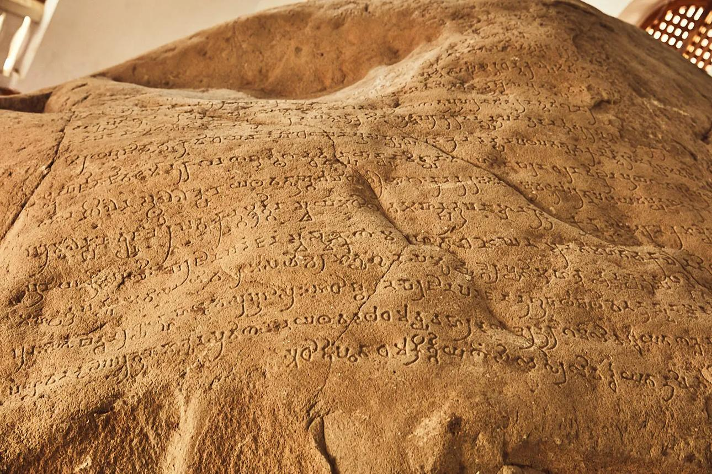
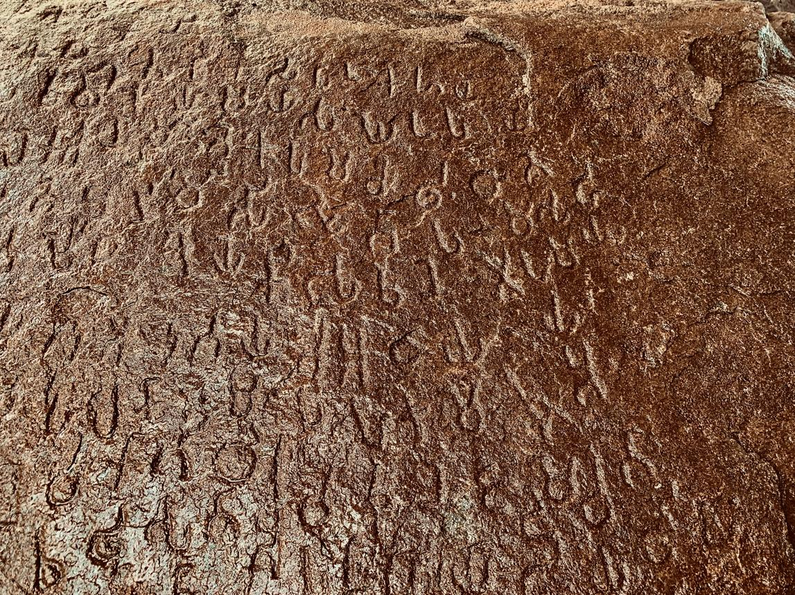
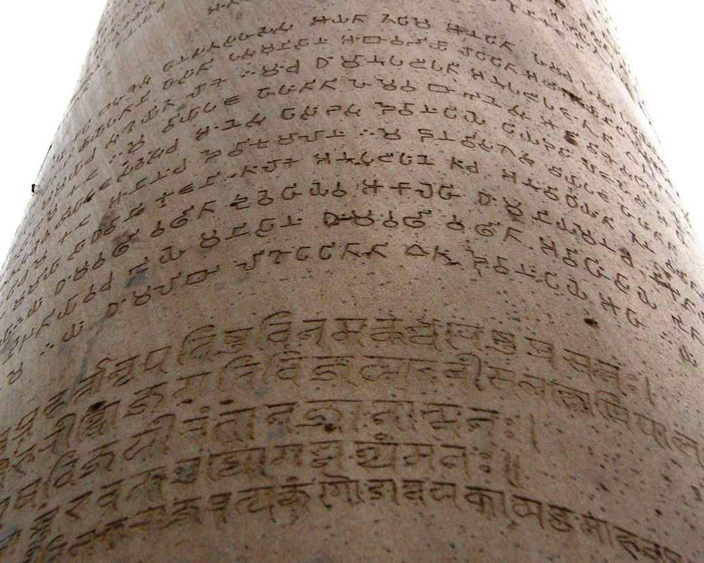
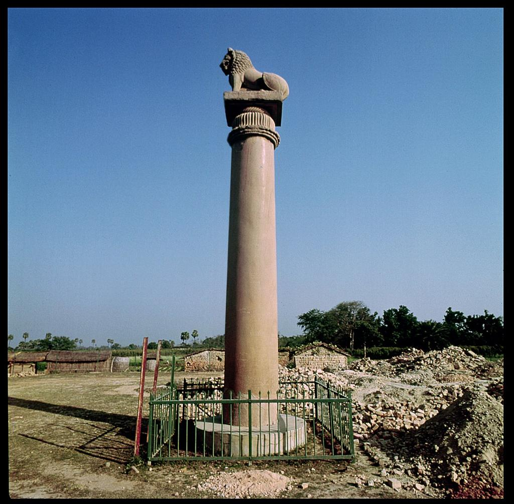
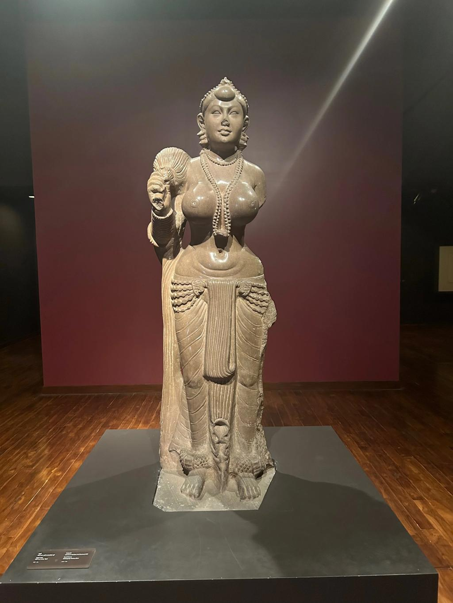
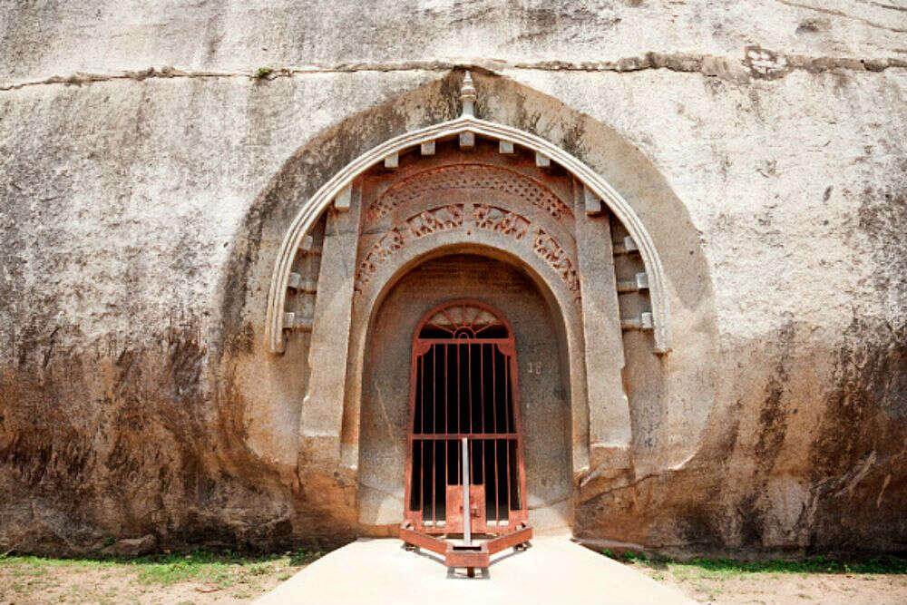

# Mauryan Empire (322–185 BCE)

## 1. Important Rulers – Chronological Order

| Ruler               | Reign         | Important Facts                           |
| ------------------- | ------------- | ----------------------------------------- |
| Chandragupta Maurya | 322–298 BCE   | Founder of Mauryan Empire                 |
| Bindusara           | 298–273 BCE   | Son of Chandragupta; known as Amitraghata |
| Ashoka              | 273–232 BCE   | Greatest Mauryan ruler; Kalinga War       |
| Dasharatha          | 232–224 BCE   | Successor of Ashoka                       |
| Brihadratha         | Until 185 BCE | Last Mauryan ruler                        |

Important:

- Founded by Chandragupta Maurya in 322 BCE.
- Capital: Pataliputra (modern Patna).
- Last ruler: Brihadratha.
- Mauryan dynasty ended in 185 BCE.
- Founded after the overthrow of the Nanda dynasty.

## 2. Chandragupta Maurya (322–298 BCE)

- Founder of the Mauryan Empire.
- Defeated Dhana Nanda, the last Nanda ruler.
- Guided by Chanakya (Kautilya/Vishnugupta).
- Defeated Seleucus Nicator around 305 BCE.
- Signed a treaty with Seleucus:
  - Received territories in the northwest.
  - Gave 500 war elephants to Seleucus.
- Greek ambassador Megasthenes visited his court.
- Megasthenes wrote Indica.
- Later tradition associates Chandragupta with Jainism.
- According to Jain tradition, he died at Shravanabelagola (Karnataka).

### Important Personalities

| Personality         | Association                          |
| ------------------- | ------------------------------------ |
| Chanakya / Kautilya | Arthashastra; Chandragupta's advisor |
| Megasthenes         | Greek ambassador; Indica             |
| Seleucus Nicator    | Greek ruler defeated by Chandragupta |

## 3. Bindusara (298–273 BCE)

- Son of Chandragupta Maurya.
- Known as Amitraghata (Slayer of enemies).
- Greek sources refer to him as Amitrochates.
- Maintained diplomatic relations with Greek kingdoms.
- Greek ambassador Deimachus visited his court.
- According to Buddhist tradition, he appointed Ashoka as governor of Ujjain.
- Extended Mauryan influence in the Deccan.

Exam Trap:

- Megasthenes → Chandragupta Maurya.
- Deimachus → Bindusara.

## 4. Ashoka (273–232 BCE)







5

### Kalinga War

- Fought around 261 BCE.
- Kalinga corresponds mainly to present-day Odisha.
- Ashoka conquered Kalinga in his 8th regnal year.
- War caused massive destruction and loss of life.
- Ashoka was deeply affected by the suffering.
- Adopted the policy of Dhamma.
- Promoted non-violence, tolerance and welfare.

Important: Kalinga War is described in Major Rock Edict XIII.

### Ashoka's Dhamma

- Moral code of conduct, not a new religion.
- Emphasised:
  - Non-violence (Ahimsa).
  - Respect for elders.
  - Respect for all religions.
  - Compassion towards living beings.
  - Truthfulness and kindness.
  - Welfare of people and animals.

### Important Officials

| Official          | Function                           |
| ----------------- | ---------------------------------- |
| Dhamma Mahamatras | Promoted Dhamma                    |
| Rajukas           | Administrative and judicial duties |
| Pradeshikas       | Provincial administration          |
| Yuktas            | Revenue and administrative work    |

### Important Facts

- Ashoka sent missionaries to spread Buddhism.
- His son Mahinda and daughter Sanghamitta were associated with spreading Buddhism in Sri Lanka.
- Third Buddhist Council was held at Pataliputra during his reign.
- Presided over by Moggaliputta Tissa.
- Ashoka's inscriptions were mainly written in Prakrit.
- Most inscriptions were written in Brahmi script.
- In the northwest, Kharosthi script was also used.
- Some inscriptions were written in Greek and Aramaic.
- James Prinsep deciphered the Brahmi script in 1837.

## 5. Ashoka's Inscriptions and Edicts





7

| Edict                 | Important Information                                                 |
| --------------------- | --------------------------------------------------------------------- |
| Major Rock Edict I    | Prohibition of animal sacrifices and restrictions on animal slaughter |
| Major Rock Edict II   | Medical facilities for humans and animals                             |
| Major Rock Edict III  | Respect for parents, elders and Brahmanas                             |
| Major Rock Edict V    | Appointment of Dhamma Mahamatras                                      |
| Major Rock Edict XII  | Religious tolerance                                                   |
| Major Rock Edict XIII | Kalinga War and remorse                                               |
| Major Rock Edict XIV  | Summary of Ashoka's inscriptions                                      |

Important Places of Inscriptions

| Place    | State / Region | Significance                                |
| -------- | -------------- | ------------------------------------------- |
| Girnar   | Gujarat        | Major Rock Edicts                           |
| Dhauli   | Odisha         | Rock edicts; Kalinga region                 |
| Jaugada  | Odisha         | Rock edicts                                 |
| Sarnath  | Uttar Pradesh  | Lion Capital                                |
| Sanchi   | Madhya Pradesh | Ashokan inscriptions and Buddhist monuments |
| Maski    | Karnataka      | Uses the name Ashoka                        |
| Kandahar | Afghanistan    | Greek-Aramaic inscriptions                  |

Most Important Exam Fact:

- The Maski inscription explicitly mentions the name Ashoka.
- The Lion Capital of Sarnath is India's National Emblem.

## 6. Mauryan Administration

- Highly centralised administration.
- King was the supreme authority.
- Capital: Pataliputra.
- Empire divided into provinces.

### Important Provincial Centres

| Province      | Capital     |
| ------------- | ----------- |
| North-western | Taxila      |
| Western       | Ujjain      |
| Eastern       | Tosali      |
| Southern      | Suvarnagiri |

### Administrative Structure

- King: Supreme executive authority.
- Mantriparishad: Council of ministers.
- Amatyas: High officials.
- Rajukas: Administrative and judicial officials.
- Samaharta: Chief revenue collector.
- Sannidhata: Treasurer.

### Sources of Mauryan Administration

- Arthashastra: Written by Kautilya.
- Indica: Written by Megasthenes.
- Ashokan inscriptions: Primary historical sources.

## 7. Economy and Society

- Agriculture was the main occupation.
- Land revenue was an important source of income.
- State controlled certain industries and resources.
- Trade and commerce flourished.
- Punch-marked coins were widely used.
- Roads connected important cities.
- Pataliputra was a major political and commercial centre.

Important: Land revenue was generally known as Bhaga.

## 8. Art and Architecture







4

### Important Features

- Highly polished sandstone pillars.
- Famous for Mauryan polish.
- Pillars generally made of single pieces of stone (monolithic).
- Animal capitals were common.
- Stupas were built or enlarged during the Mauryan period.
- Barabar caves are examples of rock-cut architecture.

### Important Monuments

| Monument             | Significance                               |
| -------------------- | ------------------------------------------ |
| Sarnath Lion Capital | National Emblem of India                   |
| Barabar Caves        | Earliest surviving rock-cut caves in India |
| Sanchi Stupa         | Associated with Ashoka                     |
| Didarganj Yakshi     | Famous example of polished stone sculpture |

### Barabar Caves

- Located in Bihar.
- Excavated during Ashoka's reign and that of his grandson Dasharatha.
- Donated mainly to the Ajivika sect.
- Famous for polished interiors.

## 9. Buddhism and the Mauryan Empire

| Buddhist Council | Location    | Patron / Ruler | President                           |
| ---------------- | ----------- | -------------- | ----------------------------------- |
| First            | Rajagriha   | Ajatashatru    | Mahakassapa                         |
| Second           | Vaishali    | Kalashoka      | Sabakami                            |
| Third            | Pataliputra | Ashoka         | Moggaliputta Tissa                  |
| Fourth           | Kashmir     | Kanishka       | Vasumitra (traditional attribution) |

SSC Focus:

- Third Buddhist Council → Ashoka.
- Fourth Buddhist Council → Kanishka.
- Mahinda and Sanghamitta → Sri Lanka.
- Ashoka promoted Buddhism but his Dhamma was a broader moral code.

## 10. Decline of the Mauryan Empire

- Weak successors after Ashoka.
- Large empire became difficult to administer.
- Financial and administrative difficulties.
- Provincial revolts and growing decentralisation.
- Brihadratha was the last Mauryan ruler.
- He was assassinated by his commander-in-chief Pushyamitra Shunga in 185 BCE.
- Established the Shunga dynasty.

## 11. Important Books and Foreign Travellers

| Book / Work   | Author        | Association                        |
| ------------- | ------------- | ---------------------------------- |
| Arthashastra  | Kautilya      | Mauryan administration and economy |
| Indica        | Megasthenes   | Chandragupta's court               |
| Mudrarakshasa | Vishakhadatta | Rise of Chandragupta Maurya        |
| Rajatarangini | Kalhana       | History of Kashmir                 |

Exam Trap: Mudrarakshasa is a later Sanskrit play about Chandragupta Maurya's rise, not a contemporary account.

## 12. PYQ / PYQ-Pattern Questions with Solutions

Q1. Who founded the Mauryan Empire?

Answer: Chandragupta Maurya.

Explanation: He established the dynasty in 322 BCE after overthrowing the Nanda dynasty.

Q2. Who was the author of Arthashastra?

Answer: Kautilya (Chanakya).

Explanation: Arthashastra discusses statecraft, administration, taxation and diplomacy.

Q3. Who was the Greek ambassador in the court of Chandragupta Maurya?

Answer: Megasthenes.

Explanation: He wrote Indica, describing contemporary Indian society and administration.

Q4. Which Mauryan ruler was known as Amitraghata?

Answer: Bindusara.

Explanation: The title means Slayer of enemies.

Q5. In which edict is the Kalinga War mentioned?

Answer: Major Rock Edict XIII.

Explanation: It describes Ashoka's remorse following the Kalinga War.

Q6. Who deciphered the Brahmi script?

Answer: James Prinsep (1837).

Explanation: His work enabled historians to read Ashokan inscriptions.

Q7. Where was the Third Buddhist Council held?

Answer: Pataliputra.

Explanation: It was held during Ashoka's reign under Moggaliputta Tissa.

Q8. Which Ashokan inscription mentions his name explicitly?

Answer: Maski inscription.

Explanation: It helped establish the identification of Devanampiya Piyadasi with Ashoka.

Q9. Who was the last Mauryan ruler?

Answer: Brihadratha.

Explanation: He was assassinated by Pushyamitra Shunga.

Q10. Which foreign traveller visited Chandragupta Maurya's court?

Answer: Megasthenes.

Explanation: He was sent by Seleucus Nicator as an ambassador.

Q11. Which sect received donations of the Barabar Caves?

Answer: Ajivika sect.

Explanation: Ashoka and Dasharatha donated caves to Ajivika ascetics.

Q12. Which Ashokan edict discusses religious tolerance?

Answer: Major Rock Edict XII.

Explanation: It promotes respect and restraint towards different religious sects.

## 13. Additional Practice Questions

Q1. Who was the father of Ashoka?

Answer: Bindusara.

Q2. Which Mauryan ruler defeated Seleucus Nicator?

Answer: Chandragupta Maurya.

Q3. What was the capital of the Mauryan Empire?

Answer: Pataliputra.

Q4. Which script was predominantly used in Ashoka's inscriptions?

Answer: Brahmi.

Q5. Who was the Greek ambassador during Bindusara's reign?

Answer: Deimachus.

Q6. Which Mauryan ruler is associated with the Barabar Caves?

Answer: Ashoka and his grandson Dasharatha.

Q7. Who assassinated Brihadratha?

Answer: Pushyamitra Shunga.

Q8. Which Mauryan official was responsible for promoting Dhamma?

Answer: Dhamma Mahamatra.

## 14. Common Exam Traps

| Confusing Facts           | Correct Answer             |
| ------------------------- | -------------------------- |
| Founder of Mauryan Empire | Chandragupta Maurya        |
| Last Mauryan ruler        | Brihadratha                |
| Amitraghata               | Bindusara                  |
| Indica                    | Megasthenes                |
| Arthashastra              | Kautilya                   |
| Kalinga War               | Ashoka                     |
| Kalinga War Edict         | Major Rock Edict XIII      |
| Religious tolerance       | Major Rock Edict XII       |
| Third Buddhist Council    | Ashoka                     |
| Fourth Buddhist Council   | Kanishka                   |
| Brahmi decipherment       | James Prinsep              |
| Maski inscription         | Explicitly mentions Ashoka |
| Barabar Caves             | Ajivikas                   |
| Shunga dynasty founder    | Pushyamitra Shunga         |
| National Emblem           | Sarnath Lion Capital       |

## 15. Last-Minute Revision Table

| Topic                          | Must Remember        |
| ------------------------------ | -------------------- |
| Empire founded                 | 322 BCE              |
| Founder                        | Chandragupta Maurya  |
| Capital                        | Pataliputra          |
| Advisor                        | Chanakya             |
| Greek ambassador               | Megasthenes          |
| Book by Megasthenes            | Indica               |
| Bindusara's title              | Amitraghata          |
| Greek ambassador to Bindusara  | Deimachus            |
| Greatest Mauryan ruler         | Ashoka               |
| Kalinga War                    | 261 BCE              |
| Kalinga War edict              | XIII                 |
| Ashoka's Dhamma                | Moral code           |
| Third Buddhist Council         | Pataliputra          |
| Council president              | Moggaliputta Tissa   |
| Main inscription script        | Brahmi               |
| Brahmi deciphered by           | James Prinsep        |
| Maski inscription              | Name Ashoka          |
| Barabar Caves                  | Ajivikas             |
| National Emblem                | Sarnath Lion Capital |
| Last Mauryan ruler             | Brihadratha          |
| Dynasty that succeeded Mauryas | Shunga               |
| Mauryan Empire ended           | 185 BCE              |

## 16. Chronological Flow – Mauryan Empire

```
322 BCE
   |
   v
Chandragupta Maurya
   |
   |  Defeated Dhana Nanda
   |  Defeated Seleucus Nicator
   |
   v
Bindusara (Amitraghata)
   |
   |  Greek ambassador: Deimachus
   |
   v
Ashoka
   |
   |  Kalinga War (261 BCE)
   |  Adopted Dhamma
   |  Third Buddhist Council
   |
   v
Dasharatha
   |
   v
Later Mauryan Rulers
   |
   v
Brihadratha (Last Mauryan ruler)
   |
   |  Assassinated by Pushyamitra Shunga
   |
   v
185 BCE
Shunga Dynasty established
```
