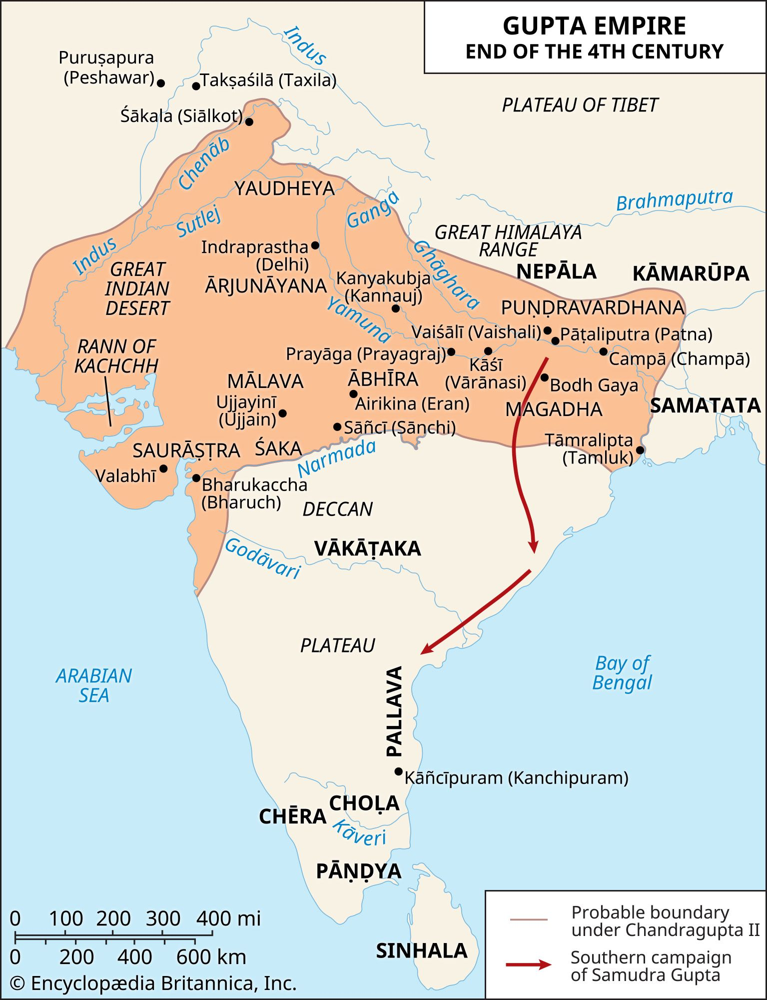
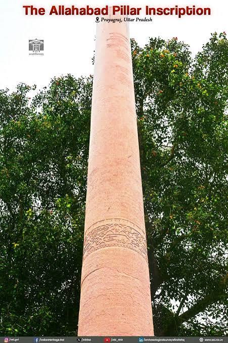
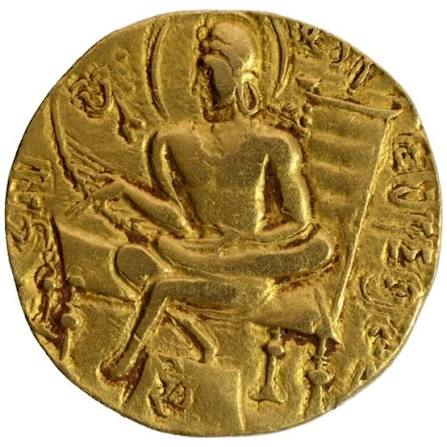
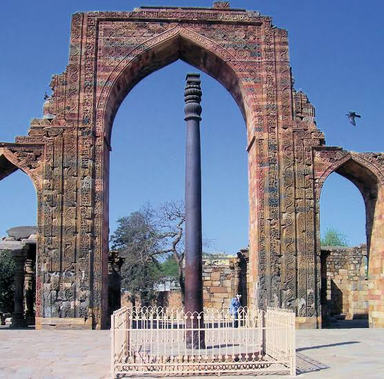
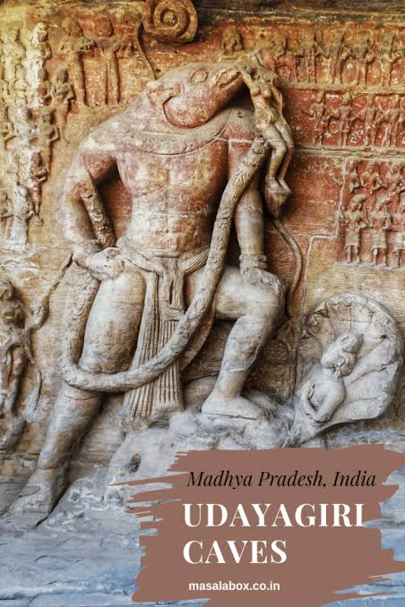
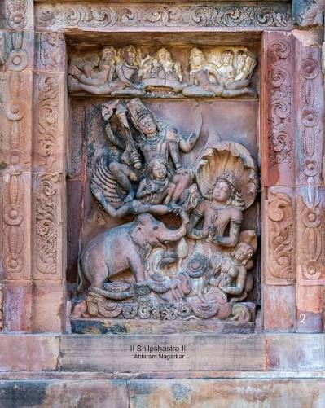
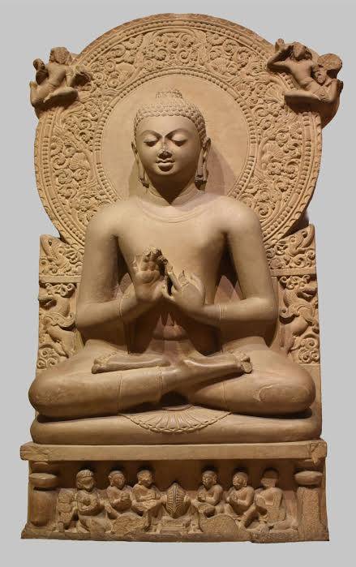

# Gupta Empire (c. 319–550 CE)

## 1. Core Concepts

- **Period:** c. 319-320 CE to c. 550 CE (Gupta Samvat begins 319-320 CE).
- **Capital:** Pataliputra (Ujjain was a second capital under Chandragupta II).
- **Origin:** Magadha and Prayaga region.
- **Importance:** Called the **"Golden Age"** (V.A. Smith) for its literature, science and temple art. Later historians (R.S. Sharma and others) question this because of declining trade, rising land grants and early feudal tendencies.
- **Founder:** **Sri Gupta** (title Maharaja).
  - Chinese pilgrim **I-tsing** mentions a temple he built for Chinese pilgrims.
- **Second ruler:** **Ghatotkacha** (Maharaja).
- **Emblem:** Garuda.

### Rulers at a Glance

| Ruler | Period (c. CE) | Key Points |
|---|---|---|
| Sri Gupta | 240–280 | Founder, Maharaja |
| Ghatotkacha | 280–319 | Maharaja |
| **Chandragupta I** | 319–335 | First **Maharajadhiraja**; married Lichchhavi princess **Kumaradevi**; started Gupta Era |
| **Samudragupta** | 335–375 | "Napoleon of India"; Prayag Prashasti; Ashvamedha |
| Ramagupta | brief | Known from *Devichandraguptam*; conflict with Shakas |
| **Chandragupta II (Vikramaditya)** | 375–415 | Defeated Western Kshatrapas; Fa-Hien visited |
| **Kumaragupta I** | 415–455 | Mahendraditya; Nalanda founded |
| **Skandagupta** | 455–467 | Repulsed Hunas; repaired Sudarshana lake |
| Later Guptas | 467–550 | Purugupta, Narasimhagupta Baladitya, Budhagupta, Vishnugupta (last) |

## 2. Chandragupta I (c. 319–335)

- Matrimonial alliance with the **Lichchhavis** (Kumaradevi) strengthened Gupta power.
- Issued the **Chandragupta–Kumaradevi** gold coins.
- Samudragupta is called **Lichchhavi-dauhitra** (daughter's son of the Lichchhavis).

## 3. Samudragupta (c. 335–375)

- **Source:** **Prayag Prashasti** (Allahabad Pillar inscription), composed by **Harishena**, his court poet and Sandhivigrahika.
  - Engraved on an Ashokan pillar, which also carries Ashoka's edicts and a later Jahangir inscription.
  - Language and style: Sanskrit, Champu.

### Conquest Policy

| Region | Policy | Details |
|---|---|---|
| **Aryavarta** (North) | **Prasabhoddharana** (violent uprooting) | Defeated and annexed 9 kings (e.g., Nagasena, Achyuta, Ganapatinaga) |
| **Dakshinapatha** (South) | **Grahana–Moksha–Anugraha** (captured, freed, reinstated) | 12 kings, including **Vishnugopa of Kanchi** (Pallava) and Hastivarman of Vengi |
| **Atavika rajyas** (forest chiefs) | Made servants | Control over forest routes |
| **Pratyanta** (frontier) states | Paid tribute, obeyed orders, attended court | Samatata, Davaka, Kamarupa, Nepal, Kartripura |
| Tribal republics | Tribute | Malavas, Yaudheyas, Arjunayanas, Madrakas, Abhiras |
| Foreign powers | Homage and gifts | Daivaputra-Shahi-Shahanushahi (Kushanas), Shakas, Simhala (Sri Lanka) |

- **Titles:** Kaviraja, Parakramanka, Sarvarajochchhetta (uprooter of all kings), Dharmaprachirabandhu.
- Performed the **Ashvamedha** and issued Ashvamedha coins.
- **Meghavarna**, king of Sri Lanka, was allowed to build a monastery at Bodh Gaya.
- Was himself a poet and a musician, and a Vishnu devotee.
- Patronised the Buddhist scholar **Vasubandhu**.

## 4. Chandragupta II "Vikramaditya" (c. 375–415)

- **Titles:** Vikramaditya, Shakari, Simhavikrama, Devagupta, Devaraja.
- Defeated the **Western Kshatrapas** (Rudrasimha III), which gave access to Gujarat ports. Issued **silver coins**.
- **Matrimonial alliances:**
  - Married **Kuberanaga** (Naga princess).
  - His daughter **Prabhavatigupta** married the Vakataka king **Rudrasena II**. She ruled as regent, as shown in the Poona and Riddhapur plates.
- **Fa-Hien (Faxian)** visited between 399 and 414 CE and wrote *Fo-Kuo-Ki*.
- **Navaratnas** (traditional): Kalidasa, Amarasimha, Varahamihira, Dhanvantari, Kshapanaka, Shanku, Vetalabhatta, Ghatakarpara, Vararuchi.
- **Mehrauli Iron Pillar inscription** (Delhi) mentions king "Chandra", usually identified as Chandragupta II. It records the crossing of the "seven mouths of the Indus" and the defeat of the **Vahlikas** (Bactria).

- **Udayagiri caves** (Vidisha) have an inscription of Chandragupta II and the famous **Varaha** sculpture.

## 5. Kumaragupta I and Skandagupta

### Kumaragupta I (c. 415–455)
- **Titles:** Mahendraditya, Ashvamedha-Mahendra.
- **Nalanda University** traditionally credited to him.
- Peacock-type coins (Kartikeya on peacock).
- Faced an invasion by the **Pushyamitras** late in his reign.

### Skandagupta (c. 455–467)
- Titles: Vikramaditya, Kramaditya.
- Successfully **repelled the Hunas (Hephthalites)**.
- **Junagadh (Girnar) rock inscription:** repair of **Sudarshana lake** by **Chakrapalita** (son of governor Parnadatta).
  - History of the lake: Pushyagupta (Mauryan, Chandragupta), Tushaspa (Ashoka), Rudradaman (150 CE), Skandagupta.
- **Bhitari Pillar inscription** (Ghazipur) records his victory over the Hunas.

## 6. Decline

- Hun invasions: **Toramana** (Eran Boar inscription) and **Mihirakula** (capital Sakala/Sialkot).
- **Yashodharman** of Malwa (Mandasor inscription) and **Narasimhagupta Baladitya** defeated Mihirakula.
- Rise of feudatories, land grants (loss of revenue) and new regional powers (Maukharis, Later Guptas, Pushyabhutis).
- Last known ruler: Vishnugupta (c. 540–550).

## 7. Administration

| Level | Unit | Head / Official |
|---|---|---|
| Centre | Kingdom | Maharajadhiraja, Parama-bhattaraka |
| Province | **Bhukti** | **Uparika** |
| District | **Vishaya** | **Vishayapati** (Kumaramatya / Ayuktaka) |
| Sub-district | Vithi | Vithi officers |
| Village | Grama | **Gramika**, Gramavriddha |
| Town | Pura | Purapala |

### Important Officials

| Official | Function |
|---|---|
| **Kumaramatya** | High official, recruited directly by the king |
| **Mahasandhivigrahika** | Minister for war and peace |
| **Mahabaladhikrita** | Army chief |
| **Mahadandanayaka** | Chief judicial/military officer |
| **Mahapratihara** | Palace chief |
| **Pustapala** | Record keeper |
| **Dandapashika** | Police |

### Revenue

| Tax | Meaning |
|---|---|
| **Bhaga** | King's share of produce (one-sixth) |
| **Bhoga** | Periodic supplies (fruit, firewood, flowers) |
| **Kara** | Tax on villages/cultivators |
| **Bali** | Religious or voluntary tax (later compulsory) |
| **Udranga / Uparikara** | Water/tax on tenants |
| **Vishti** | Forced labour |

- Land grants to Brahmanas (**Agrahara / Brahmadeya**) came with administrative and judicial rights, which fed early feudalism.
- Land types: **Kshetra** (cultivated), **Khila** (waste), **Vastu** (habitable), **Aprahata** (forest/jungle).
- **Damodarpur copper plates** (Bengal) record land sales.

## 8. Economy and Society

- Gold coins (**Dinara**) were plentiful. Silver coins (**Rupyaka**) were used in west India. Copper coins were used for small transactions, and **cowries** are mentioned by Fa-Hien.
- Roman trade declined. Trade with South-East Asia continued through **Tamralipti** (east) and **Bharukachchha/Broach** (west).
- **Shrenis** (guilds) and nigamas were active. Sarthavahas were caravan leaders.
- Fa-Hien noted a mild administration, little capital punishment, and free **hospitals** at Pataliputra. **Chandalas** were treated as untouchables.
- **Eran inscription of Bhanugupta (510 CE)** gives the earliest inscriptional evidence of **Sati**.

## 9. Literature and Science

### Literature

| Author | Works |
|---|---|
| **Kalidasa** | *Abhijnanashakuntalam, Meghaduta, Raghuvamsha, Kumarasambhava, Ritusamhara, Malavikagnimitra, Vikramorvashiyam* |
| **Shudraka** | *Mrichchhakatika* |
| **Vishakhadatta** | *Mudrarakshasa, Devichandraguptam* |
| **Amarasimha** | *Amarakosha* |
| **Vishnusharma** | *Panchatantra* |
| **Vatsyayana** | *Kamasutra* |

- **Smritis:** Narada, Katyayana, Brihaspati, Parashara.
- The Puranas, Ramayana and Mahabharata were compiled or finalised in this period.

### Science

| Scholar | Contribution |
|---|---|
| **Aryabhata** | *Aryabhatiya* (499 CE); rotation of the Earth; causes of eclipses; value of π ≈ 3.1416; place-value system |
| **Varahamihira** | *Brihat Samhita, Panchasiddhantika, Brihat Jataka* |
| **Vagbhata** | *Ashtanga Sangraha* (medicine) |
| **Palakapya** | *Hastyayurveda* (elephants) |
| **Dhanvantari** | Medicine (traditional Navaratna) |

- The decimal place-value system and the concept of zero developed during this age.

## 10. Art, Architecture and Religion

### Temples
- Beginning of the **Nagara style**: flat roofs, a **garbhagriha**, and a square sanctum with a porch.

| Temple | Place |
|---|---|
| **Dashavatara Temple** | Deogarh (UP), with Sheshashayi Vishnu and Gajendra Moksha panels |
| **Bhitargaon Temple** | Kanpur (UP), brick temple |
| **Parvati Temple** | Nachna Kuthara (MP) |
| **Shiva Temple** | Bhumara (MP) |
| **Vishnu Temple** | Tigawa (MP) |

### Sculpture and Painting
- **Sarnath school:** the famous seated Buddha in dharmachakra pravartana mudra (Chunar sandstone).
- **Mathura school:** standing Buddha with a plain halo.
- **Sultanganj Buddha** (Bhagalpur): copper statue, about 7.5 ft.
- Painting: **Ajanta** (Caves 16, 17) and **Bagh caves** (MP).

### Coin Types

| Ruler | Types |
|---|---|
| Samudragupta | Standard, Archer, Battle-axe, Lyrist, Tiger-slayer, Ashvamedha |
| Chandragupta II | Chhatra, Lion-slayer, Horseman, Archer |
| Kumaragupta I | Peacock, Horseman |

### Religion
- **Vaishnavism / Bhagavatism** was dominant. The Gupta kings took the title **Parama Bhagavata**.
- The **Dashavatara** idea took shape. Buddhism and Jainism continued, with the Jain canon compiled at the **Valabhi** council (c. 454 CE).

## 11. Foreign Accounts and Inscriptions

| Source | Notes |
|---|---|
| **Fa-Hien** | Chinese pilgrim, under Chandragupta II |
| **I-tsing** | Mentions Sri Gupta's temple |
| Prayag Prashasti | Samudragupta |
| Mehrauli Iron Pillar | Chandra (Chandragupta II) |
| Udayagiri Cave | Chandragupta II |
| Bhitari Pillar | Skandagupta |
| Junagadh (Girnar) | Skandagupta |
| Eran Pillar | Bhanugupta (Sati) |
| Mandasor | Yashodharman |

## 12. PYQ-Pattern Questions with Solutions

> These are exam-pattern questions, not verified PYQs.

**Q1. Who composed the Prayag Prashasti?**
(a) Kalidasa (b) Harishena (c) Vishakhadatta (d) Banabhatta
**Answer: (b) Harishena.** He was Samudragupta's Sandhivigrahika and court poet.

**Q2. Which Gupta ruler is called the "Napoleon of India"?**
(a) Chandragupta II (b) Skandagupta (c) Samudragupta (d) Kumaragupta I
**Answer: (c) Samudragupta.** The title was given by V.A. Smith for his military conquests.

**Q3. Fa-Hien visited India during the reign of:**
(a) Samudragupta (b) Chandragupta II (c) Kumaragupta I (d) Harsha
**Answer: (b) Chandragupta II.** His stay was c. 399–414 CE.

**Q4. The Gupta Era started in:**
(a) 78 CE (b) 57 BCE (c) 319–320 CE (d) 606 CE
**Answer: (c).** The Gupta Samvat is linked to Chandragupta I's accession. 78 CE is the Shaka Era, 57 BCE the Vikram Samvat and 606 CE Harsha's era.

**Q5. The Mehrauli Iron Pillar inscription refers to the victory over the "Vahlikas" of:**
(a) Kashmir (b) Bactria (c) Gujarat (d) Magadha
**Answer: (b) Bactria.** The "Chandra" of the inscription is usually identified with Chandragupta II.

**Q6. Nalanda University was founded by:**
(a) Harsha (b) Ashoka (c) Kumaragupta I (d) Dharmapala
**Answer: (c) Kumaragupta I.** Harsha and the Palas later patronised it. Vikramashila was founded by Dharmapala.

**Q7. Which Gupta ruler repelled the first Huna invasion?**
(a) Skandagupta (b) Narasimhagupta (c) Budhagupta (d) Vishnugupta
**Answer: (a) Skandagupta.** This is recorded in the Bhitari Pillar inscription.

**Q8. *Devichandraguptam* is written by:**
(a) Vishakhadatta (b) Shudraka (c) Bharavi (d) Bhasa
**Answer: (a) Vishakhadatta.** It deals with Ramagupta and Chandragupta II.

**Q9. The earliest inscriptional evidence of Sati comes from:**
(a) Prayag Prashasti (b) Eran inscription (c) Junagadh inscription (d) Bhitari Pillar
**Answer: (b) Eran inscription.** It is dated 510 CE and belongs to Bhanugupta's reign.

**Q10. Under the Guptas, a province was called:**
(a) Rashtra (b) Bhukti (c) Janapada (d) Ahara
**Answer: (b) Bhukti.** Its head was the Uparika.

**Q11. Samudragupta's policy towards the southern kings was:**
(a) Prasabhoddharana (b) Grahana-Moksha-Anugraha (c) Digvijaya only (d) Annexation
**Answer: (b).** Southern kings were captured, freed and reinstated. Prasabhoddharana was used for Aryavarta.

**Q12. Prabhavatigupta, daughter of Chandragupta II, married:**
(a) Rudrasena II (b) Pravarasena (c) Harishena (d) Rudradaman
**Answer: (a) Rudrasena II** of the Vakataka dynasty.

**Q13. *Aryabhatiya* was composed in:**
(a) 399 CE (b) 499 CE (c) 599 CE (d) 699 CE
**Answer: (b) 499 CE.** The author was Aryabhata of Kusumapura.

**Q14. The Junagadh inscription of Skandagupta records repair of:**
(a) Mahabodhi temple (b) Nalanda (c) Sudarshana lake (d) Sanchi Stupa
**Answer: (c) Sudarshana lake.** The repair was done by Chakrapalita.

## 13. Practice Questions

**Q1. Which coin type shows Samudragupta playing the veena?**
(a) Archer (b) Lyrist (c) Standard (d) Battle-axe
**Answer: (b) Lyrist.**

**Q2. Which dynasty did Chandragupta I ally with through marriage?**
(a) Nagas (b) Vakatakas (c) Lichchhavis (d) Kadambas
**Answer: (c) Lichchhavis.**

**Q3. Along with Narasimhagupta Baladitya, which ruler is credited with defeating Mihirakula?**
(a) Yashodharman (b) Skandagupta (c) Toramana (d) Pulakeshin II
**Answer: (a) Yashodharman.** Mandasor inscription.

**Q4. Who wrote *Hastyayurveda*?**
(a) Palakapya (b) Charaka (c) Vagbhata (d) Susruta
**Answer: (a) Palakapya.**

**Q5. Which Chinese pilgrim mentions the temple built by Sri Gupta?**
(a) Fa-Hien (b) Hiuen Tsang (c) I-tsing (d) Sung-yun
**Answer: (c) I-tsing.**

**Q6. Which of the following is NOT a Gupta-period temple?**
(a) Dashavatara, Deogarh (b) Bhitargaon (c) Kailasa, Ellora (d) Tigawa Vishnu temple
**Answer: (c).** The Kailasa temple at Ellora belongs to the Rashtrakutas.

**Q7. Consider the statements:**
1. Samudragupta's Dakshinapatha campaign led to annexation of southern kingdoms.
2. Vishnugopa of Kanchi was among the defeated southern kings.
Which is/are correct?
(a) Only 1 (b) Only 2 (c) Both (d) Neither
**Answer: (b) Only 2.** Southern kings were reinstated, not annexed.

**Q8. Which Gupta ruler issued the Chhatra-type and Lion-slayer coins?**
(a) Chandragupta II (b) Kumaragupta I (c) Skandagupta (d) Ramagupta
**Answer: (a) Chandragupta II.** Peacock-type coins belong to Kumaragupta I.

## 14. Common Exam Traps

| Trap | Correct Fact |
|---|---|
| Prayag Prashasti author | **Harishena**, not Kalidasa |
| Founder of Gupta dynasty | **Sri Gupta**, not Chandragupta I |
| First Maharajadhiraja Gupta king | **Chandragupta I** |
| Fa-Hien vs Hiuen Tsang | Fa-Hien: Gupta (Chandragupta II). Hiuen Tsang: Harsha |
| Mehrauli Pillar | Not Mauryan; Chandragupta II's period |
| Nalanda founder | Kumaragupta I (not Harsha, not Ashoka) |
| Sati inscription | **Eran (510 CE)**, not Samudragupta's |
| Samvat confusion | Gupta 319–320 CE, Shaka 78 CE, Vikram 57 BCE |
| Aryabhata vs Brahmagupta | Aryabhata: 499 CE (Gupta). Brahmagupta: 7th century (Brahmasphutasiddhanta) |
| Malavikagnimitra | Written by Kalidasa, but hero is the Shunga king Agnimitra |
| Samudragupta south policy | **Grahana-Moksha-Anugraha**, not annexation |
| Skandagupta | Repulsed Hunas; Toramana and Mihirakula came later |

## 15. Last-Minute Revision Table

| Topic | Key Fact |
|---|---|
| Gupta Era | 319–320 CE |
| Capital | Pataliputra (second: Ujjain) |
| Napoleon of India | Samudragupta |
| Allahabad Pillar | Harishena; Prayag Prashasti |
| Mehrauli Pillar | Chandra (Chandragupta II) |
| Fa-Hien | 399–414 CE; Chandragupta II |
| Vikramaditya | Chandragupta II (Shakari) |
| Nalanda | Kumaragupta I |
| Huna repulsion | Skandagupta |
| Junagadh | Sudarshana lake repair |
| Bhukti head | Uparika |
| Sati | Eran inscription, 510 CE |
| Aryabhata | *Aryabhatiya*, 499 CE |
| Varahamihira | *Brihat Samhita, Panchasiddhantika* |
| Kalidasa | *Shakuntalam, Meghaduta, Raghuvamsha* |
| Temple art | Dashavatara (Deogarh); Bhitargaon |
| Sarnath school | Buddha in dharmachakra pravartana mudra |
| Last Gupta king | Vishnugupta |
| Decline | Hunas, feudatories, loss of revenue |