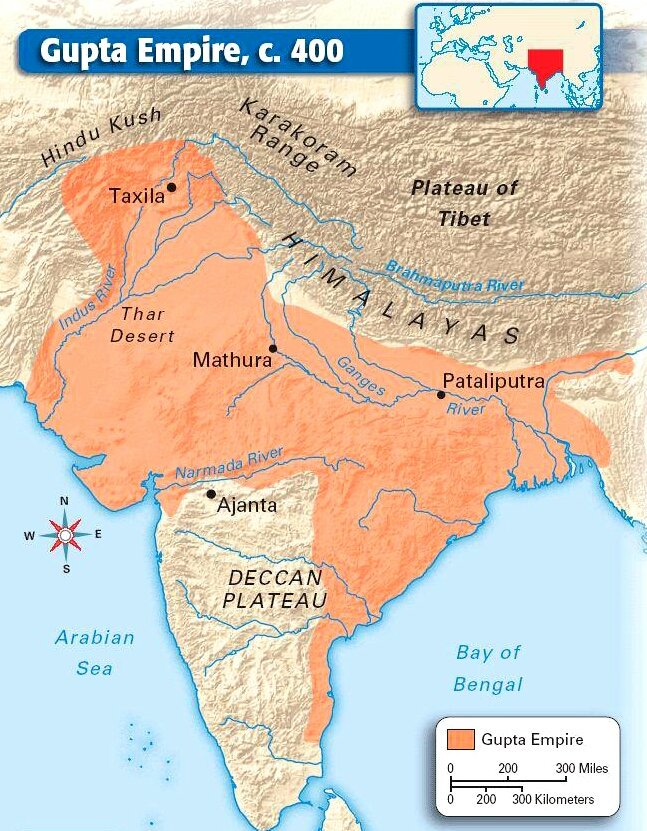
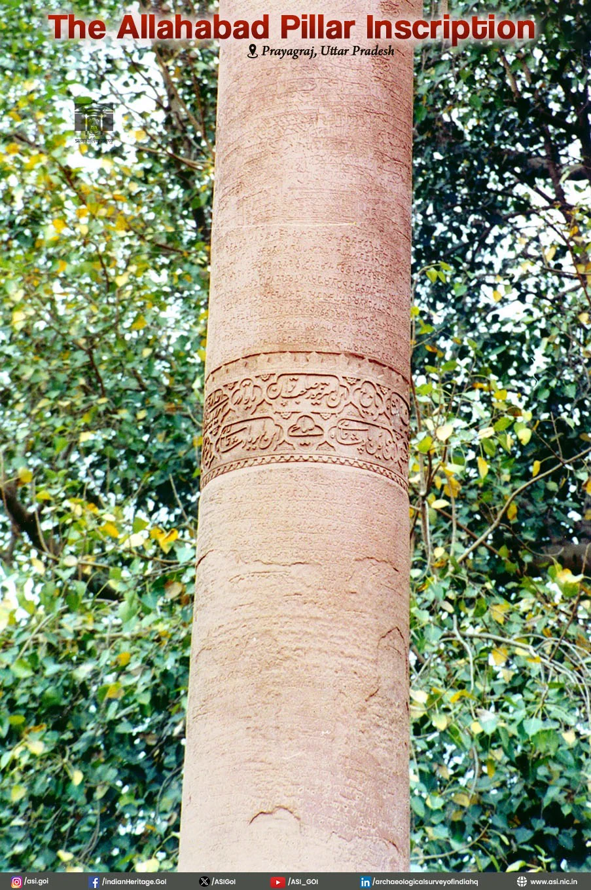
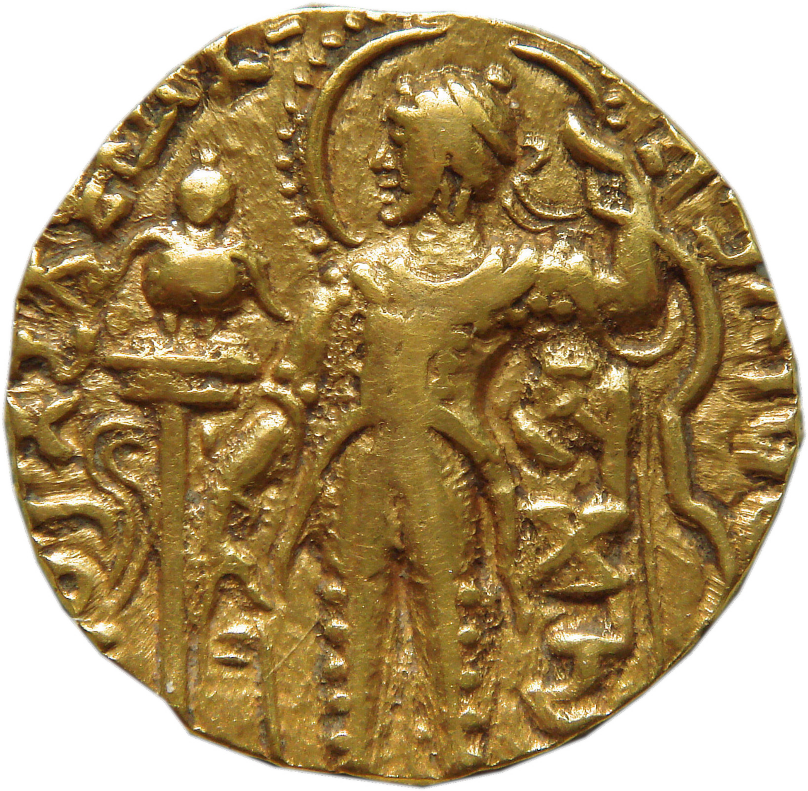
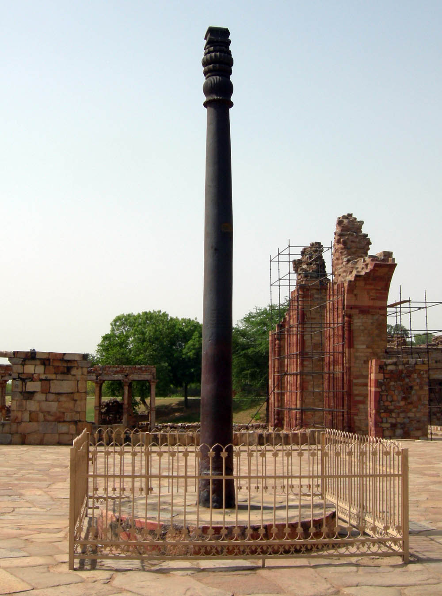
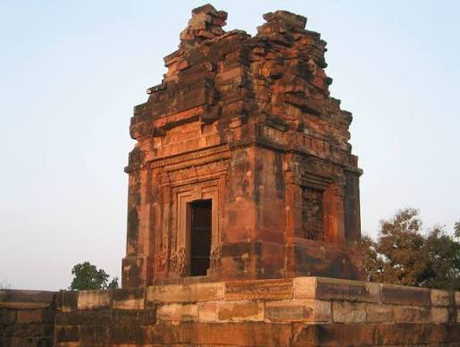
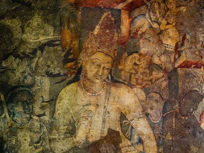

# Gupta Empire (c. 319–550 CE)

## 1. Core Concepts / Definitions

- **Period:** c. 319–320 CE to c. 550 CE. Called the **Classical Age** of ancient India. The "Golden Age" label is debated by modern historians.
- **Capital:** Pataliputra (Magadha). **Second capital:** Ujjain, under Chandragupta II.
- **Gupta Era:** starts **319–320 CE**, with the accession of Chandragupta I. Conversion:

$$
\boxed{\text{CE year} = \text{Gupta year} + 319}
$$

- **Founder:** Sri Gupta. His successor was Ghatotkacha. Both used the title *Maharaja*.
- **Language and script:** Sanskrit became the court language. The script was Brahmi, developing into the Gupta script.

*Fig. 1: Extent of the Gupta Empire. Its core was the Ganga plain and Magadha, with expansion under Samudragupta and Chandragupta II. Frequently asked in map-based questions.*

## 2. Important Rulers (High-Yield)

### Chandragupta I (c. 319–335 CE)
- First to take the title **Maharajadhiraja**.
- Married **Kumaradevi**, a **Lichchhavi** princess. This marriage raised Gupta prestige.
- Issued the **Chandragupta–Kumaradevi** type gold coins.
- Started the **Gupta Era**.

### Samudragupta (c. 335–375 CE)
- Called the **"Napoleon of India"** by V.A. Smith.
- Main source: **Allahabad Pillar Inscription (Prayag Prashasti)**, composed by **Harishena** in Sanskrit.
- The pillar was originally an **Ashokan pillar**, with Samudragupta's inscription added later.
- **Aryavarta (North India) policy:** violent uprooting (**prasabhoddharana**) of 9 kings.
- **Dakshinapatha (South India) policy:** capture, then release and reinstatement (**grahana-moksha-anugraha**) of 12 kings, including **Vishnugopa of Kanchi**.
- Forest kings (**Atavika rajas**) were made servants. Frontier states paid tribute.
- **Meghavarna**, king of Sri Lanka, sent a mission to build a monastery at **Bodh Gaya**.
- Titles: **Kaviraja**, **Vikramanka**, **Parakramanka**.
- Coins: **Lyrist (Veena)**, **Ashvamedha**, Archer, Battle-axe and Tiger-slayer types.

*Fig. 2: Allahabad Pillar, Prayagraj. Carries Harishena's Prayag Prashasti on Samudragupta's conquests, and is the key source for his reign.*

*Fig. 3: Lyrist-type coin of Samudragupta. It reflects his patronage of music and his title Kaviraja.*

### Ramagupta
- Known from **Devichandraguptam** by **Vishakhadatta**.
- The play refers to his surrender of his queen Dhruvadevi to a Shaka ruler. Chandragupta II then intervened.

### Chandragupta II "Vikramaditya" (c. 375–415 CE)
- Defeated the **Western Kshatrapas (Shakas)** of Malwa and Gujarat, ending Shaka rule. Titles: **Shakari** and **Vikramaditya**.
- Made **Ujjain** a second capital.
- **Matrimonial alliances:**
  - Married **Kuberanaga**, a Naga princess.
  - Married his daughter **Prabhavati Gupta** to **Rudrasena II** of the Vakatakas.
- **Fa-Hien (Faxian)** visited India during his reign. His travel account is the *Fo-kuo-ki*.
- Introduced **silver coins** for the western regions.
- **Navaratnas** (nine gems) traditionally linked to his court: Kalidasa, Amarasimha, Varahamihira and others. Historically uncertain.
- **Mehrauli Iron Pillar**, Delhi, is widely attributed to a ruler "Chandra", usually identified with Chandragupta II.

*Fig. 4: Iron Pillar, Mehrauli. Known for its corrosion resistance and an inscription naming a king Chandra, generally identified with Chandragupta II.*

### Kumaragupta I (c. 415–455 CE)
- Title: **Mahendraditya**.
- Founded **Nalanda University**.
- Issued **Ashvamedha** and **Peacock (Kartikeya)** type coins.
- **Mandasor Inscription** records a **silk-weavers' guild** migrating to Dasapura and building a sun temple.

### Skandagupta (c. 455–467 CE)
- Titles: **Vikramaditya** and **Kramaditya**.
- Repelled the first **Huna** invasion. Source: **Bhitari Pillar Inscription**.
- **Junagadh (Girnar) Inscription:** records repair of **Sudarshana Lake** by Parnadatta's son **Chakrapalita**.
- The Sudarshana Lake was first built in the Mauryan period and repaired by Rudradaman I.

### Later Guptas and Decline
- Rulers: Purugupta, **Narasimhagupta Baladitya**, Kumaragupta II, **Budhagupta**, and **Vishnugupta** (last).
- **Decline causes:**
  - Huna invasions (**Toramana** and **Mihirakula**).
  - Rise of feudatories and land grants.
  - Weak succession and loss of revenue.
  - Rise of regional powers such as the Maukharis, Vakatakas and Yashodharman.

## 3. Administration

| Unit/Post | Meaning |
|---|---|
| Maharajadhiraja, Parama-bhattaraka | Imperial titles |
| Kumaramatya | Chief officials, like later IAS-type cadre |
| Sandhivigrahika | Minister of war and peace |
| Mahadandanayaka | Chief judicial/military officer |
| Mahabaladhikrita | Commander of army |
| Bhukti / Uparika | Province / Its governor |
| Vishaya / Vishayapati | District / Its head |
| Vithi | Sub-district unit |
| Gramika | Village head |
| Pustapala | Record keeper |
| Dandapashika | Police official |

- **Revenue:** **Bhaga** (king's share, about one-sixth of produce), **Bhoga**, **Kara**, **Uparikara**, **Vishti** (forced labour).
- **Land grants:** **Agrahara** and **Brahmadeya** grants to Brahmins began a feudal tendency.
- **Land types:** **Kshetra** (cultivable), **Khila** (waste), **Vasti** (habitable), **Aprahata** (jungle), **Gapatha-saraha** (pasture).

$$
\text{Bhaga} \approx \frac{1}{6} \text{ of produce}
$$

## 4. Economy

- Gold coins: **Dinara**. Silver: **Rupyaka**. Large gold issues show a monetised economy, but coin purity declined later.
- Guilds: **Nigama**, **Shreni**, **Sarthavaha** (caravan leader).
- Ports: **Tamralipti** (east), **Broach/Bharuch**, **Kalyan**, **Sopara** (west).
- Indo-Roman trade declined. Trade with Southeast Asia and China continued.
- Trade slowed in the later period, and land-based economy and grants grew.

## 5. Society and Religion

- Varna system hardened. **Fa-Hien** noted that **Chandalas** lived outside towns.
- Status of women declined.
- **Eran Inscription (510 CE, Bhanugupta)** gives the first epigraphic reference to **Sati**.
- Revival of Brahmanism, **Vaishnavism** (Vishnu as chief deity) and **Shaivism**. **Bhakti** and **temple worship** grew.
- Buddhism and Jainism were tolerated. Nalanda grew as a Buddhist centre.
- Fa-Hien reports mild administration and few capital punishments.

## 6. Literature, Science and Art

### Literature

| Author | Work |
|---|---|
| Kalidasa | Abhijnanashakuntalam, Meghaduta, Raghuvamsha, Kumarasambhava, Ritusamhara, Malavikagnimitram, Vikramorvashiyam |
| Shudraka | Mrichchhakatika |
| Vishakhadatta | Mudrarakshasa, Devichandraguptam |
| Vishnu Sharma | Panchatantra |
| Amarasimha | Amarakosha |
| Vatsyayana | Kamasutra |
| Harishena | Prayag Prashasti |

### Science

- **Aryabhata** (b. 476 CE, Kusumapura): wrote **Aryabhatiya** (499 CE).
  - Gave place value and the use of zero.
  - Earth rotates on its axis.
  - Explained eclipses scientifically.
  - Approximate value of pi:

$$
\pi \approx \frac{62832}{20000} = \boxed{3.1416}
$$

- **Varahamihira:** *Panchasiddhantika* and *Brihat Samhita* (astronomy, astrology and general knowledge).
- **Vagbhata:** medicine (*Ashtanga Sangraha*).

### Art and Architecture

- **Dashavatara Temple, Deogarh**: Vishnu temple with Shikhara, an early stone temple.
- **Bhitargaon**: brick temple (Kanpur).
- **Udayagiri caves** (Vidisha, MP): Varaha relief.
- **Ajanta** (cave paintings) and **Bagh caves**.
- **Sarnath** and **Mathura** schools of Buddha sculpture.
- **Sultanganj Buddha**: large copper image (Bhagalpur, Bihar).
- Early **Nagara style** temples developed.

*Fig. 5: Dashavatara Temple, Deogarh. An important Gupta-period Vishnu temple in Lalitpur district, Uttar Pradesh, and an early example of temple architecture with a Shikhara.*

*Fig. 6: Ajanta Caves murals. Famous Buddhist paintings of the Gupta and Vakataka age; a frequent topic in Art and Culture questions.*

*Fig. 7: Sarnath school Buddha image. Represents Gupta sculpture at its peak, known for serenity and refined craftsmanship.*

## 7. Important Inscriptions and Sources

| Source | Ruler / Fact |
|---|---|
| Allahabad Pillar (Prayag Prashasti) | Samudragupta, by Harishena |
| Mehrauli Iron Pillar | Chandra (Chandragupta II) |
| Mathura Pillar Inscription | Chandragupta II (dated) |
| Udayagiri Cave Inscription | Chandragupta II |
| Mandasor Inscription | Kumaragupta I, silk weavers' guild |
| Bhitari Pillar | Skandagupta, Huna victory |
| Junagadh Inscription | Skandagupta, Sudarshana Lake |
| Eran Inscription | Bhanugupta, earliest Sati reference |
| Fa-Hien's Fo-kuo-ki | Chandragupta II era |

## 8. Shortcuts and Tricks

- **Order of rulers:** Sri Gupta → Ghatotkacha → **Chandragupta I** → **Samudragupta** → Ramagupta → **Chandragupta II** → **Kumaragupta I** → **Skandagupta**.
- **Coin rule:** Lyrist = Samudragupta; Archer type = Gupta kings (Samudragupta, Chandragupta II); Peacock = Kumaragupta I; Ashvamedha = Samudragupta and Kumaragupta I.
- Nalanda: **Kumaragupta I**. Fa-Hien: **Chandragupta II**.
- Harishena = Prayag Prashasti. Vishakhadatta = Mudrarakshasa and Devichandraguptam.
- Gupta era: **319 + year**.

## 9. PYQ-Pattern Questions with Solutions

**Q1. Who composed the Allahabad Pillar Inscription?**
**Answer: Harishena.**
He was Samudragupta's court poet. The inscription is in Sanskrit.

**Q2. Which Gupta ruler is called the "Napoleon of India"?**
**Answer: Samudragupta.**
The label comes from V.A. Smith, referring to his military conquests.

**Q3. The Chinese pilgrim Fa-Hien visited India during the reign of:**
**Answer: Chandragupta II.**
Fa-Hien's account is the *Fo-kuo-ki*.

**Q4. The Gupta Era began in:**
**Answer: 319–320 CE.**
It marks Chandragupta I's accession.

**Q5. Who founded Nalanda University?**
**Answer: Kumaragupta I.**

**Q6. Devichandraguptam deals with which Gupta ruler? Who wrote it?**
**Answer: Ramagupta; Vishakhadatta.**

**Q7. The Sudarshana Lake at Junagadh was repaired during the reign of which Gupta ruler?**
**Answer: Skandagupta.**
The Junagadh inscription says it was done by Chakrapalita, son of Parnadatta.

**Q8. Which ruler issued coins showing him playing the Veena?**
**Answer: Samudragupta.**
Called the Lyrist type.

**Q9. Aryabhata wrote which work in 499 CE?**
**Answer: Aryabhatiya.**
It includes place value and an approximation of pi.

**Q10. The Dashavatara temple is located at:**
**Answer: Deogarh (Lalitpur district, Uttar Pradesh).**

**Q11. Which Gupta ruler defeated the Western Kshatrapas?**
**Answer: Chandragupta II.**

**Q12. A Gupta inscription is dated Year 100 in the Gupta Era. Its CE date is:**
**Answer: 419 CE.**
$$
100 + 319 = \boxed{419}
$$

## 10. Practice Questions

**P1. Prabhavati Gupta, daughter of Chandragupta II, married which ruler?**
**Answer: Rudrasena II (Vakataka).**

**P2. The Mandasor Inscription of Kumaragupta I refers to which guild?**
**Answer: Silk-weavers' guild (Dasapura).**

**P3. The first epigraphic reference to Sati appears in which inscription?**
**Answer: Eran Inscription (510 CE).**

**P4. Who was the last important Gupta ruler?**
**Answer: Vishnugupta.**

**P5. What was the Gupta gold coin called?**
**Answer: Dinara.**

**P6. Who headed a Bhukti (province)?**
**Answer: Uparika.**

**P7. Using Aryabhata's value, compute pi to four decimal places.**
**Answer: 3.1416.**
$$
\pi \approx \frac{62832}{20000} = 3.1416
$$

## 11. Common Exam Traps

- Chandragupta I (Gupta) is **not** Chandragupta Maurya.
- Ashvamedha coins: **Samudragupta and Kumaragupta I**, not only one.
- **Fa-Hien** (Gupta period) is different from **Hiuen Tsang** (Harsha period).
- **Aryabhata** is a Gupta-age figure. **Brahmagupta** (7th century) is not.
- Kalidasa's association with Chandragupta II is traditional rather than firmly proven.
- Prayag Prashasti: Harishena composed it, not Samudragupta.
- "Golden Age" is a contested label, so be careful with absolute statements.

## 12. Last-Minute Revision Table

| Topic | Key Fact |
|---|---|
| Era | 319–320 CE |
| Founder | Sri Gupta |
| Capital | Pataliputra, Ujjain (second) |
| Chandragupta I | Lichchhavi marriage, Maharajadhiraja |
| Samudragupta | Prayag Prashasti, Napoleon of India, lyrist coins |
| Chandragupta II | Vikramaditya, Shakari, Fa-Hien visit |
| Kumaragupta I | Nalanda, Ashvamedha and Peacock coins |
| Skandagupta | Huna victory, Sudarshana Lake repair |
| Scientist | Aryabhata (Aryabhatiya, 499 CE) |
| Temple | Dashavatara, Deogarh |
| Tax | Bhaga (about 1/6) |
| Coins | Dinara (gold), Rupyaka (silver) |
| Decline | Hunas, feudatories, weak successors |