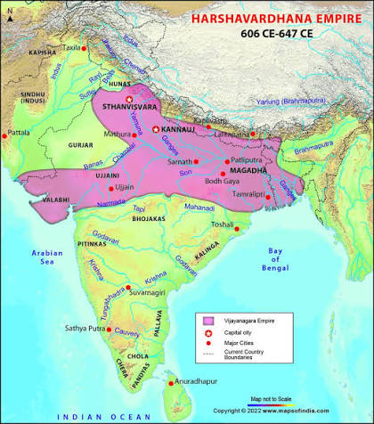
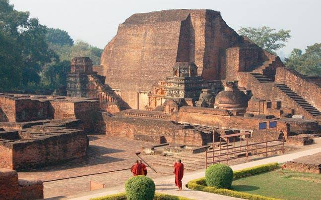
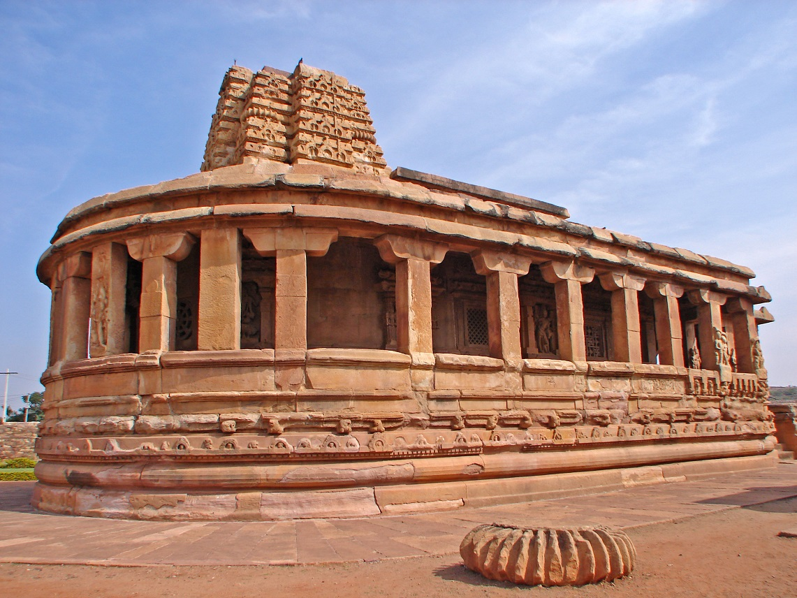
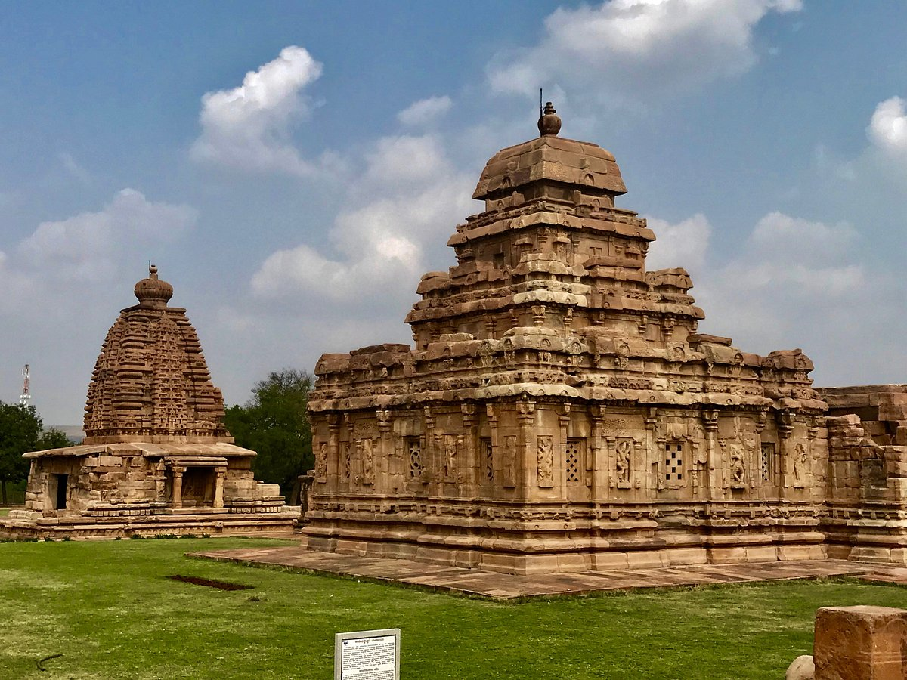
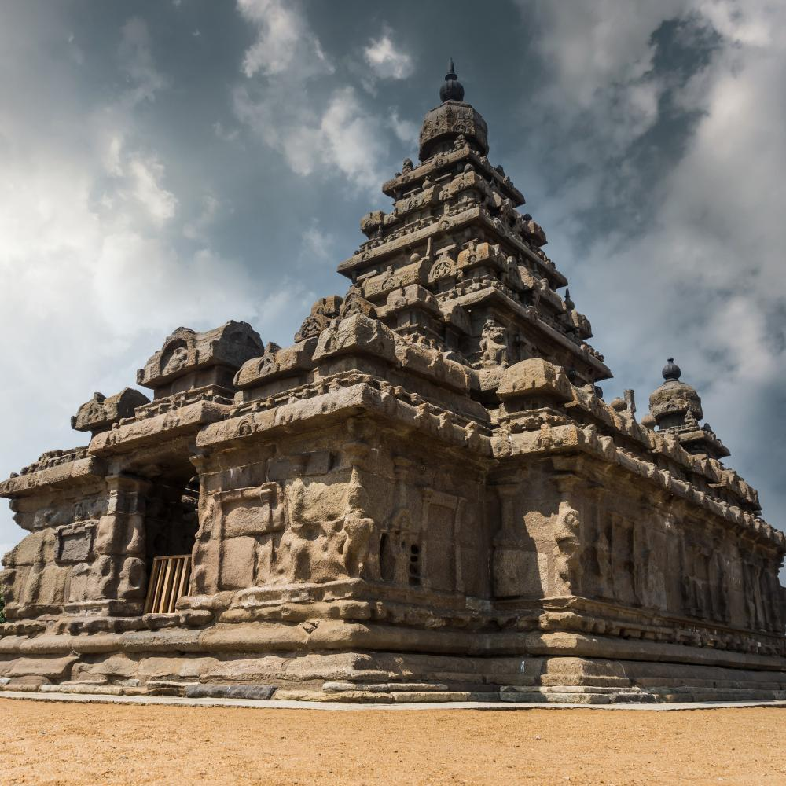
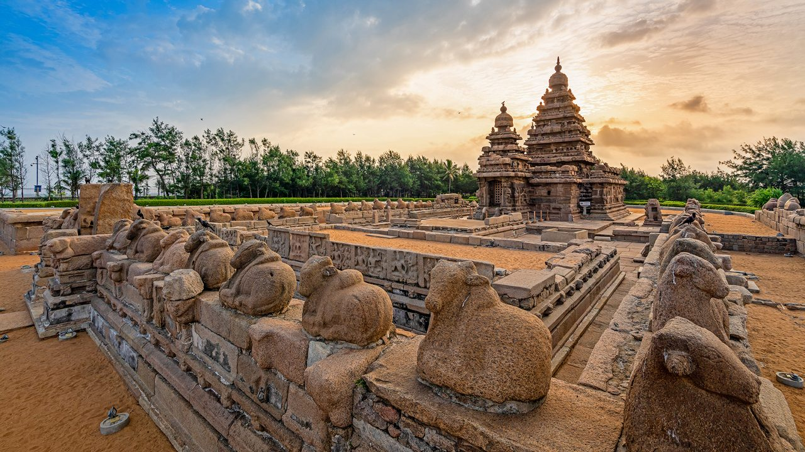
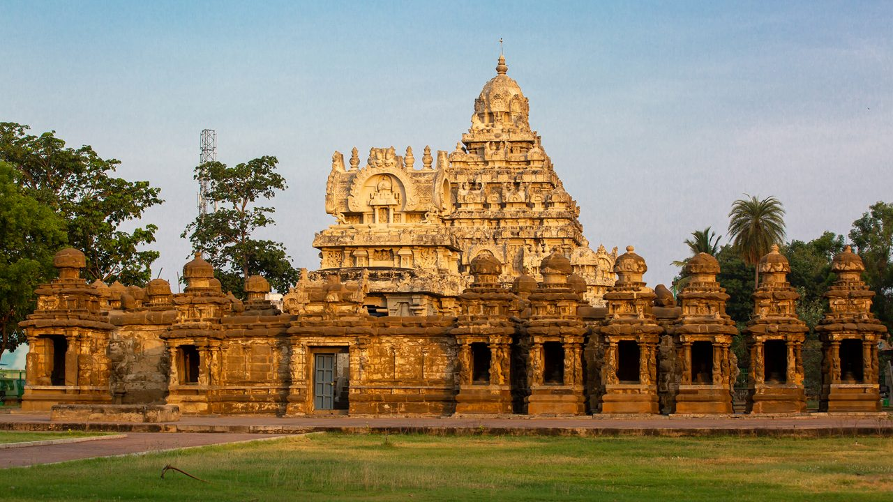

# Post-Gupta Period (c. 550 – 750 CE): SSC Notes

## 1. Core Concepts / Definitions

- **Post-Gupta period:** political fragmentation after the decline of the Imperial Guptas (mid-6th century). It runs till the rise of the Palas, Pratiharas and Rashtrakutas (c. 750 CE).
- **Defining features:**
  - Rise of regional kingdoms: Later Guptas, Maukharis, Pushyabhutis, Maitrakas, Chalukyas, Pallavas.
  - Kannauj emerges as the new political centre of North India.
  - **Harshavardhana** is the last great Hindu emperor of North India (till the Rajputs).
  - Rise of **land grants** and **samantas**, and decline of trade and towns (the "Indian Feudalism" thesis, R.S. Sharma).
  - The **tripartite struggle** over Kannauj begins in the next phase, after c. 750.
  - Arab conquest of Sindh (712 CE).
- **Major sources:**
  - Foreign: **Hiuen Tsang** (Si-Yu-Ki), **I-tsing**.
  - Literary: **Banabhatta**'s *Harshacharita* and Harsha's own plays.
  - Epigraphic: Banskhera, Madhuban and Aihole inscriptions.

## 2. Important Chronology

| Year (CE) | Event |
|---|---|
| c. 543 | Pulakeshin I founds Chalukya power at Vatapi (Badami) |
| 554 | Haraha inscription of Maukhari king Isanavarman |
| c. 575 | Simhavishnu establishes Pallava power |
| c. 590 | Prabhakaravardhana consolidates Thanesar |
| 606 | Harsha ascends; Harsha Era (Shri Harsha Samvat) begins |
| c. 612 | Pulakeshin II becomes the Chalukya king |
| c. 618–619 | Pulakeshin II defeats Harsha on the Narmada |
| 630 | Hiuen Tsang arrives in India (leaves in 643) |
| 634 | Aihole inscription of Ravikirti |
| 642 | Narasimhavarman I Pallava defeats and kills Pulakeshin II; occupies Vatapi |
| 643 | Kannauj Assembly and the sixth Prayag Mahamoksha Parishad |
| 647 | Death of Harsha; Arunashva (Arjuna) usurps the throne |
| 712 | Muhammad bin Qasim defeats Dahir of Sindh |
| c. 753 | Dantidurga (Rashtrakuta) overthrows the Chalukyas of Badami |

## 3. Northern Powers

### 3.1 Later Guptas of Magadha
- Founder: **Krishnagupta**. They ruled Magadha and Malwa after the imperial Guptas.
- **Adityasena** is the most notable king; his **Afsad inscription** is a key source.
- **Mahasenagupta** was defeated by **Susthitavarman of Kamarupa**.
- **Devagupta of Malwa** was a Later Gupta ally of Shashanka. He killed Grahavarman, the Maukhari king.

### 3.2 Maukharis of Kannauj
- Founder: **Harivarman**. Capital: **Kannauj**.
- **Isanavarman** took the title **Maharajadhiraja**. His Haraha inscription is dated 554 CE.
- **Grahavarman** married **Rajyashri**, Harsha's sister.
- After Grahavarman was killed, Rajyashri was imprisoned at Kannauj. Harsha later rescued her and took over Kannauj.

### 3.3 Pushyabhutis (Vardhanas) of Thanesar

| King | Key Point |
|---|---|
| Pushyabhuti | Founder; capital Thanesar (Sthanvishvara) |
| Prabhakaravardhana | Assumed the title **Parama-bhattaraka Maharajadhiraja**; called *Huna-harina-kesari* (lion to the Hun deer) |
| Rajyavardhana II | Brother of Harsha; killed by **Shashanka** through treachery (c. 606) |
| **Harshavardhana** | Reigned 606–647; Thanesar to Kannauj; last great Hindu emperor of the north |

### 3.4 Shashanka of Gauda
- Ruler of **Gauda (Bengal)**, with his capital at **Karnasuvarna** (near Murshidabad).
- A **Shaiva** and an enemy of Buddhism.
- Hiuen Tsang accuses him of cutting down the **Bodhi tree at Bodh Gaya**.
- Killed Rajyavardhana II. Died c. 637, after which his kingdom broke up.

### 3.5 Kamarupa (Assam)
- Ruler: **Bhaskaravarman** (Kumara) of the Varman dynasty, a friend and ally of Harsha.
- Hiuen Tsang visited his court. **Nidhanpur copper plates** are an important source.

### 3.6 Maitrakas of Valabhi (Gujarat)
- Founder: **Bhatarka**.
- **Dhruvasena II (Baladitya)** was defeated by Harsha, then married Harsha's daughter.
- **Valabhi** was a great centre of learning (I-tsing compares it with Nalanda).

*Fig. 1: Harsha's empire. His rule covered much of North India with Kannauj as capital; he was checked on the Narmada by the Chalukya king Pulakeshin II, a frequent SSC point.*

## 4. Harshavardhana (606–647 CE)

### 4.1 Key Facts
- Became king at about 16 years of age. Titles: **Siladitya, Sakalottarapathanatha** (Lord of the Northern Region), Parameshvara.
- Shifted his capital from **Thanesar to Kannauj**.
- **Conquests:** Gauda (against Shashanka), Valabhi, Kamarupa (alliance), Sindh, and **Ganjam (Kalinga)** in 643, his last known conquest.
- **Only recorded defeat:** by **Pulakeshin II** on the **Narmada** (c. 618–619). The Aihole inscription records this.
- **Religion:** originally a Shaiva (as per Banabhatta), later a patron of **Mahayana Buddhism**. He also supported Brahmins and Jainas.
- **Kannauj Assembly (643 CE):** held to honour Hiuen Tsang and Mahayana doctrine.
- **Prayag Mahamoksha Parishad:** held every five years at the Ganga–Yamuna confluence, where Harsha gave away his wealth in charity. Hiuen Tsang attended the **sixth** one.

### 4.2 Works and Court
- **Harsha's plays (Sanskrit):** *Ratnavali*, *Priyadarshika*, *Nagananda*.
- **Banabhatta:** *Harshacharita* (biography of Harsha) and *Kadambari*.
- **Others at court:** Mayura and Matanga Divakara.
- **Sources for Harsha's reign:** **Banskhera** (628 CE) and **Madhuban** (631 CE) copper plates, plus the **Sonpat** copper seal.
- The Banskhera plate carries **Harsha's own signature**.

### 4.3 Administration

| Unit | Official / Detail |
|---|---|
| Bhukti | Province (governor: Uparika) |
| Vishaya | District (Vishayapati) |
| Pathaka | Sub-district |
| Grama | Village (Gramika) |

- **Important officers:**
  - **Mahasandhivigrahadhikrita:** minister of war and peace (foreign affairs).
  - **Mahabaladhikrita:** commander-in-chief.
  - **Aksapataladhikrita:** keeper of records.
  - **Sarvagata:** spies. **Dutaka:** messenger.
- **Revenue:**
  - Land tax (**bhaga**) was about **one-sixth** of produce.
  - Other levies: **hiranya** (cash), **bali**.
  - Many officials were paid through **land grants** rather than cash.
- **Revenue division (per Hiuen Tsang):** four parts: state expenses, scholars, officials, religious bodies.

### 4.4 Hiuen Tsang's Account (629/630–643 CE)
- A Chinese Buddhist pilgrim, the "**Prince of Pilgrims**". Book: **Si-Yu-Ki**.
- He studied at **Nalanda** under **Shilabhadra**.
- He praised Harsha's justice but noted harsh punishments and security issues on roads (he was robbed once).
- He described the **four varnas** and treated **Chandalas** and scavengers as outcasts.
- He noted the decline of **Pataliputra** and the rise of **Kannauj**.
- Chinese contacts with Harsha: Harsha sent an envoy to Tang China. The Chinese envoy **Wang Xuance** reached India later and defeated the usurper Arunashva.

*Fig. 2: Nalanda Mahavihara, Bihar. A major Buddhist university where Hiuen Tsang studied under Shilabhadra and which Harsha patronised, a regular topic in SSC history.*

### 4.5 After Harsha
- Died in **647 CE** with no heir. **Arjuna (Arunashva)** seized the throne.
- Empire collapsed. **Yashovarman** later rose at Kannauj.

## 5. The Deccan: Chalukyas of Badami

### 5.1 Key Rulers
- **Pulakeshin I (c. 543):** capital **Vatapi (Badami)**; performed the **Ashvamedha**.
- **Kirtivarman I:** consolidated power; defeated the Nalas, Mauryas of Konkan and Kadambas.
- **Pulakeshin II (610–642):**
  - Greatest ruler; title **Dakshinapathesvara**.
  - Defeated **Harsha** on the Narmada.
  - Defeated **Mahendravarman I** at Pullalur.
  - Made his brother **Kubja Vishnuvardhana** ruler of **Vengi**, founding the **Eastern Chalukyas**.
  - Exchanged embassies with the Persian king Khusrau II.
  - Killed in 642 by **Narasimhavarman I** of the Pallavas.
- **Vikramaditya II:** took Kanchi; his queen Lokamahadevi built the **Virupaksha temple** at Pattadakal.
- **Kirtivarman II:** last ruler; overthrown by **Dantidurga** (Rashtrakuta) c. 753.

### 5.2 Aihole Inscription
- Composed by court poet **Ravikirti** in 634 CE, in Sanskrit.
- A **prashasti** of Pulakeshin II. It records his victory over Harsha and is the source of the "Dakshinapathesvara" title.

### 5.3 Art and Architecture
- **Vesara** (Karnata Dravida) style: a mix of Nagara and Dravida features.
- **Sites:** **Aihole** (Durga temple, Lad Khan, Meguti Jain temple), **Badami** cave temples, **Pattadakal** (UNESCO World Heritage Site).
- Ajanta paintings are traditionally linked to this age, including a scene on the Persian embassy.

*Fig. 3: Durga Temple, Aihole. A Chalukyan temple of the 7th–8th century; Aihole is called the cradle of temple architecture and is also where the 634 CE prashasti of Pulakeshin II was found.*

*Fig. 4: Virupaksha Temple, Pattadakal. Built by Queen Lokamahadevi to commemorate Vikramaditya II's victory over the Pallavas at Kanchi; Pattadakal is a UNESCO World Heritage Site.*

## 6. The Far South: Pallavas of Kanchi

### 6.1 Key Rulers

| Ruler | Key Point |
|---|---|
| Simhavishnu (c. 575) | Defeated the Kalabhras; real founder of the Pallava empire |
| **Mahendravarman I** (600–630) | Wrote *Mattavilasa Prahasana*; titles Vichitrachitta, Gunabhara; began **rock-cut temples** (Mandagapattu inscription); converted from Jainism to Shaivism by **Appar**; defeated by Pulakeshin II |
| **Narasimhavarman I Mamalla** (630–668) | Defeated and killed Pulakeshin II, took Vatapi (title **Vatapikonda**); founded **Mamallapuram**; Hiuen Tsang visited Kanchi (c. 640) |
| Paramesvaravarman I | Fought Chalukya Vikramaditya I (Peruvalanallur) |
| **Narasimhavarman II Rajasimha** (c. 700–728) | Built the **Kailasanatha temple** (Kanchi) and the **Shore Temple** (Mamallapuram); Dandin at court |
| Nandivarman II Pallavamalla | Vaikuntha Perumal temple, Kanchi |

### 6.2 Pallava Art Styles

| Phase | Ruler | Feature |
|---|---|---|
| Mahendra style | Mahendravarman I | Rock-cut cave temples (mandapas) |
| Mamalla style | Narasimhavarman I | Monolithic **rathas** (Pancha Rathas) and cave temples at Mamallapuram |
| Rajasimha style | Narasimhavarman II | Structural temples (Shore, Kailasanatha) |
| Nandivarman style | Nandivarman II | Smaller structural temples |

- **Arjuna's Penance (Descent of the Ganga)** is a famous open-air relief at Mamallapuram.
- Mamallapuram was designated a UNESCO World Heritage Site in 1984.
- **Administration:** Nadu (district), **Kottam**; village assemblies (sabha, ur); *Grantha* script developed.

*Fig. 5: Pancha Rathas, Mamallapuram. Monolithic rock-cut temples of the Mamalla style under Narasimhavarman I; they were carved from single rocks and are a typical SSC art-and-culture question.*

*Fig. 6: Shore Temple, Mamallapuram. A structural granite temple built by Narasimhavarman II Rajasimha, marking the shift from rock-cut to structural Pallava architecture.*

*Fig. 7: Kailasanatha Temple, Kanchipuram. Built by Rajasimha; do not confuse it with the Kailasa temple at Ellora, which is Rashtrakuta and later.*

## 7. Other Contemporary Powers

- **Karkotas of Kashmir:** founder **Durlabhavardhana** (c. 625). **Lalitaditya Muktapida** built the **Martand Sun Temple**. Later source: Kalhana's *Rajatarangini*.
- **Yashovarman of Kannauj (c. 725–752):**
  - Patron of **Vakpati** (*Gaudavaho*) and **Bhavabhuti** (*Malatimadhava*, *Mahaviracharita*, *Uttararamacharita*).
  - Defeated by Lalitaditya.
- **Arab conquest of Sindh (711–712):**
  - Umayyad governor **Hajjaj bin Yusuf**; general **Muhammad bin Qasim**.
  - Defeated **Dahir** (Brahmin dynasty of Chach) at **Rawar**.
  - Immediate cause: seizure of Arab ships near **Debal**.
  - Source: **Chachnama**.
  - Impact: limited and local; the **Pratihara king Nagabhata I** stopped Arab advance (c. 738).
- **Transition (c. 750):** Gopala founds the **Palas** in Bengal; Dantidurga founds the **Rashtrakutas**; **Gurjara-Pratiharas** rise.

## 8. Society, Economy, Religion and Culture

### 8.1 Economy and Society
- **Land grants:** **agrahara** and **brahmadeya** (grants to Brahmins and temples), with administrative rights; this fed the rise of **samantas**.
- Decline of long-distance trade and town life; fewer coins. Harsha's coins are very rare.
- Caste rigidity increased; **Sati** is mentioned in the sources.
- Rise of **Kayasthas** as scribes and record-keepers is noted.

### 8.2 Religion
- **Buddhism** declined gradually, though Nalanda and Valabhi flourished. **Mahayana** dominated.
- **Tantrism** and **Bhakti** rose.
- **Tamil Bhakti:** **Nayanars** (Shaiva: Appar, Sambandar, Sundarar, compiled in the *Tevaram*) and **Alvars** (Vaishnava).
- **Shankaracharya** (8th century, traditional Advaita revival); **Kumarila Bhatta** (Mimamsa).

### 8.3 Literature

| Author | Work |
|---|---|
| Banabhatta | *Harshacharita*, *Kadambari* |
| Harsha | *Ratnavali*, *Priyadarshika*, *Nagananda* |
| Bharavi | *Kiratarjuniya* |
| Dandin | *Kavyadarsha*, *Dashakumaracharita* |
| Bhartrihari | *Shatakatraya*, *Vakyapadiya* |
| Bhavabhuti | *Malatimadhava*, *Uttararamacharita* |
| Subandhu | *Vasavadatta* |
| Magha | *Shishupalavadha* |
| Mahendravarman I | *Mattavilasa Prahasana* |

## 9. Shortcuts and Tricks

- **Harsha's three titles:** Siladitya, Sakalottarapathanatha, Parama-Maheshvara.
- **Harsha plays:** **R-P-N** (Ratnavali, Priyadarshika, Nagananda).
- **Capital order:** Thanesar → Kannauj (Harsha); Vatapi (Chalukyas); Kanchi (Pallavas).
- **Chalukya–Pallava duels:** Pulakeshin II beat Mahendra I; Narasimha I beat Pulakeshin II; Vikramaditya II took Kanchi.
- **Rock-cut → monolith → structural:** Mahendra → Mamalla → Rajasimha.
- **Who built what:**
  - Pallava: Shore Temple and Kailasanatha, Kanchi.
  - Chalukya: Virupaksha, Pattadakal.
  - Rashtrakuta (later): Kailasa, Ellora.
- **Inscription matching:** Aihole = Pulakeshin II; Banskhera/Madhuban = Harsha; Afsad = Adityasena (Later Gupta); Haraha = Isanavarman (Maukhari).

## 10. PYQ-Pattern Questions with Solutions
*(PYQ-pattern: based on frequently asked SSC questions; exam and year not claimed.)*

**Q1.** Which Chinese pilgrim visited India during Harsha's reign?
**Answer: Hiuen Tsang.** Fa-Hien came in the Gupta age; I-tsing came later in the 7th century.

**Q2.** Who defeated Harsha on the banks of the Narmada?
**Answer: Pulakeshin II.** The Aihole inscription records it.

**Q3.** Who composed the Aihole inscription?
**Answer: Ravikirti.** It is a prashasti of Pulakeshin II (634 CE).

**Q4.** Harsha shifted his capital from Thanesar to:
**Answer: Kannauj.** This was done after Grahavarman's death.

**Q5.** The Harsha Era began in:
**Answer: 606 CE.** It marks his accession.

**Q6.** Who built the Shore Temple at Mamallapuram?
**Answer: Narasimhavarman II (Rajasimha).** Narasimhavarman I founded Mamallapuram, but the structural Shore Temple is of Rajasimha.

**Q7.** Which Pallava king was converted from Jainism to Shaivism by Appar?
**Answer: Mahendravarman I.** He was also the author of *Mattavilasa Prahasana*.

**Q8.** Which ruler of Gauda is said to have cut down the Bodhi tree?
**Answer: Shashanka.** He also killed Rajyavardhana.

**Q9.** The Kannauj Assembly of 643 CE was held in honour of:
**Answer: Hiuen Tsang.** It promoted Mahayana Buddhism.

**Q10.** *Harshacharita* was written by:
**Answer: Banabhatta.** His other major work is *Kadambari*.

**Q11.** Who was the Arab general who conquered Sindh in 712?
**Answer: Muhammad bin Qasim.** He defeated Dahir.

**Q12.** Who defeated Pulakeshin II and took the title Vatapikonda?
**Answer: Narasimhavarman I.** The Pallavas took Vatapi in 642.

**Q13.** The Martand Sun Temple was built by:
**Answer: Lalitaditya Muktapida.** He was a Karkota king of Kashmir.

## 11. Practice Questions

**Q1.** Which dynasty ruled from Valabhi?
**Answer: Maitrakas.** Founder Bhatarka; Dhruvasena II was Harsha's son-in-law.

**Q2.** Who was the Maukhari king married to Harsha's sister Rajyashri?
**Answer: Grahavarman.**

**Q3.** Which Chalukya queen built the Virupaksha Temple at Pattadakal?
**Answer: Lokamahadevi.** She was the queen of Vikramaditya II.

**Q4.** Which official in Harsha's administration headed war and peace?
**Answer: Mahasandhivigrahadhikrita.**

**Q5.** Who founded the Eastern Chalukya line of Vengi?
**Answer: Kubja Vishnuvardhana.** He was the brother of Pulakeshin II.

**Q6.** The Banskhera copper plate of Harsha is dated:
**Answer: 628 CE.** It bears his signature.

**Q7.** The poet Bhavabhuti was patronised by:
**Answer: Yashovarman of Kannauj.**

**Q8.** Which text is the main source of the Arab conquest of Sindh?
**Answer: Chachnama.**

**Q9.** Which Pallava king founded Mamallapuram?
**Answer: Narasimhavarman I (Mamalla).**

**Q10.** Match: Afsad inscription, Aihole inscription.
**Answer: Afsad = Adityasena (Later Gupta); Aihole = Pulakeshin II (Chalukya).**

## 12. Common Exam Traps

- **Harsha did not belong to the Gupta dynasty.** He was a Pushyabhuti (Vardhana), and the Guptas were his predecessors by centuries.
- Harsha was **defeated** by Pulakeshin II, not the other way round.
- Do not mix **Hiuen Tsang** (7th century, Harsha) with **Fa-Hien** (5th century, Chandragupta II).
- **Aihole** inscription → Pulakeshin II; **Allahabad pillar** → Samudragupta.
- **Narasimhavarman I** (Mamallapuram, defeated Pulakeshin II) is not **Narasimhavarman II** (Shore Temple, Kailasanatha).
- The Kailasanatha at **Kanchi** (Pallava) is not the Kailasa temple at **Ellora** (Rashtrakuta).
- **Kannauj** was Harsha's later capital; **Thanesar** was his original one.
- Harsha was initially Shaiva and later Mahayana Buddhist, not Hinayana.
- Harsha's plays are in Sanskrit; *Harshacharita* was written by Banabhatta, not Harsha.
- Arab conquest of Sindh did not spread to the rest of India; Pratiharas and Chalukyas stopped them.

## 13. Last-Minute Revision Table

| Topic | Key Fact |
|---|---|
| Harsha's reign | 606–647 CE; Thanesar → Kannauj |
| Harsha Era | 606 CE |
| Harsha's defeat | Pulakeshin II, Narmada |
| Hiuen Tsang | 630–643 in India; studied at Nalanda under Shilabhadra |
| Kannauj Assembly | 643 CE |
| Prayag Mahamoksha Parishad | Every five years at Prayag |
| Harsha plays | Ratnavali, Priyadarshika, Nagananda |
| Banabhatta | Harshacharita, Kadambari |
| Harsha inscriptions | Banskhera (628), Madhuban (631), Sonpat seal |
| Shashanka | Gauda; capital Karnasuvarna; cut Bodhi tree |
| Maukhari capital | Kannauj; Isanavarman (Haraha, 554) |
| Later Gupta | Adityasena; Afsad inscription |
| Pulakeshin II | 610–642; Dakshinapathesvara; Aihole (634) |
| Narasimhavarman I | Killed Pulakeshin II; Mamallapuram; Pancha Rathas |
| Mahendravarman I | Rock-cut; Mattavilasa Prahasana; Appar |
| Rajasimha | Shore Temple; Kailasanatha, Kanchi |
| Lalitaditya | Karkota; Martand Sun Temple |
| Yashovarman | Kannauj; Bhavabhuti, Vakpati |
| Arab conquest of Sindh | 711–712; Muhammad bin Qasim vs Dahir; Chachnama |
| End of period | c. 750–753: Palas, Pratiharas, Rashtrakutas arise |