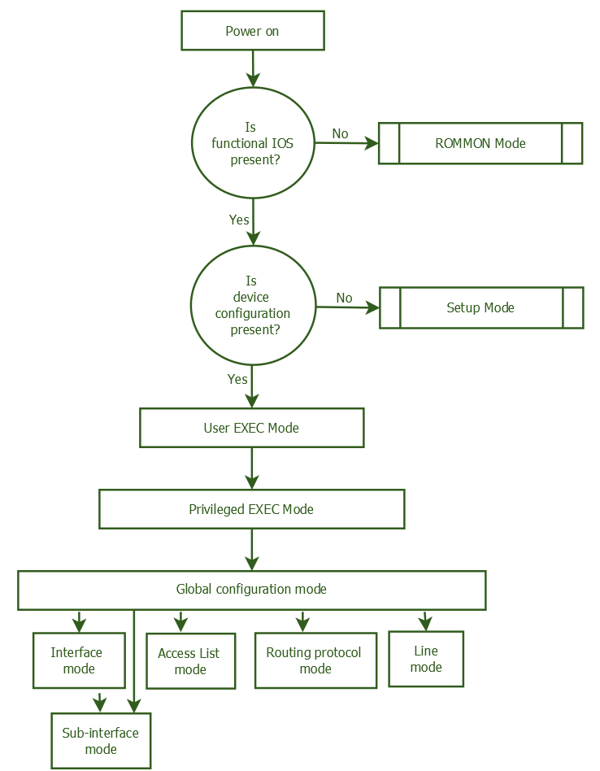
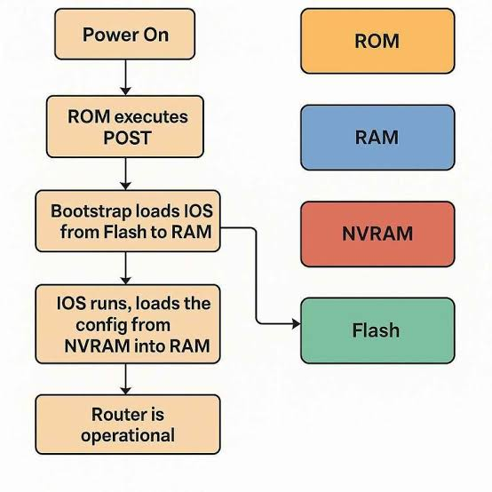

# Cisco IOS CLI: Console Access, Modes, Config Files and Enable Passwords

## 1. Overview

- **Cisco IOS** is the operating system on Cisco routers and switches. It is unrelated to Apple's iOS.
- The **CLI (Command-Line Interface)** is the main text interface for configuring and managing these devices.
- Practice environment: Cisco **Packet Tracer** or a lab device.

## 2. Connecting to a Device (Console Access)

| Console port type | Cable and notes |
|---|---|
| **RJ-45 console port** | **Rollover cable** (RJ-45 to DB-9) plus a **serial-to-USB adapter** for modern laptops |
| **USB mini-B console port** | Standard USB cable to the laptop |


**Rollover pinout:** the pins are fully reversed end to end.

| End A | End B |
|---|---|
| Pin 1 | Pin 8 |
| Pin 2 | Pin 7 |
| Pin 3 | Pin 6 |
| Pin 4 | Pin 5 |

**Default terminal settings (PuTTY, Tera Term, etc.):**

| Parameter | Default |
|---|---|
| Speed (baud) | **9600 bps** |
| Data bits | **8** |
| Parity | **None** |
| Stop bits | **1** |
| Flow control | **None** |

## 3. CLI Modes and Navigation

| Mode | Prompt | Purpose | Enter | Leave |
|---|---|---|---|---|
| **User EXEC** | `Router>` | Limited, mostly view-only | Default on login | `exit` (logs out) |
| **Privileged EXEC** | `Router#` | Full viewing, reload, clock, save config | `enable` (`en`) | `disable` (back to User EXEC); `exit` logs out |
| **Global Config** | `Router(config)#` | Device-wide configuration | `configure terminal` (`conf t`) | `exit` (one level up); `end` or `Ctrl+Z` (straight to Privileged EXEC) |



*Fig. 2: Cisco IOS mode hierarchy. User EXEC leads to Privileged EXEC, which leads to Global Configuration and then its sub-modes. Learn each prompt, since it tells you which mode you are in.*

### Navigation and syntax rules

- **`?` with no space**, as in `e?`: lists commands that start with those letters.
- **`?` after a space**, as in `enable ?`: lists the valid arguments for that command.
- **Tab**: completes a command if the typed text is unique.
- **Abbreviation**: any unique prefix works (`conf t`, `sh run`, `en`).
- **`do`**: runs a Privileged EXEC command from config mode, for example `do show running-config`.
- **`no`**: removes or disables a setting, for example `no service password-encryption`.
- **Mistyped word:** an unknown command is treated as a hostname lookup (a delay), so check spelling first.
- **Editing shortcuts:**

| Key | Action |
|---|---|
| `Ctrl+A` / `Ctrl+E` | Jump to start or end of line |
| `Ctrl+Z` | Same as `end` |
| `Up` / `Down` arrows | Command history |

## 4. Configuration Files

| File | Memory | Behaviour | View |
|---|---|---|---|
| **running-config** | **RAM** (volatile) | Active configuration; lost on reload if unsaved | `show running-config` (`sh run`) |
| **startup-config** | **NVRAM** (non-volatile) | Loaded into RAM at boot | `show startup-config` |



*Fig. 3: Cisco device memory types. RAM holds the running-config, NVRAM holds the startup-config, and flash holds the IOS image. Knowing where each file lives explains why unsaved changes are lost on reboot.*

**Saving the configuration (Privileged EXEC), all equivalent:**

```text
Router# copy running-config startup-config
Router# write
Router# write memory
```

The first is the official form; `write` and `write memory` are older shortcuts that still work.

## 5. Securing Privileged EXEC Mode

```text
Router(config)# enable password cisco123
Router(config)# enable secret MySecret456
Router(config)# service password-encryption
```

| Feature | `enable password` | `enable secret` |
|---|---|---|
| Default storage | **Plain text** | **Hashed** (MD5, Type 5, by default) |
| Precedence | Lower | **Higher**; overrides `enable password` if both exist |
| Affected by `service password-encryption` | Yes (becomes Type 7) | No |
| Case-sensitive | Yes | Yes |

**`service password-encryption`**
- Encrypts plain-text passwords in the config using **Type 7**.
- Type 7 is **weak and reversible** with freely available tools. It only hides passwords from casual viewing.
- `no service password-encryption` does **not** decrypt existing Type 7 passwords. It only means new passwords are stored in plain text.

**Modern note:** newer IOS versions can use stronger hashes for `enable secret` (Type 8 or Type 9) through the `algorithm-type` option. Support depends on the IOS version.

## 6. Mnemonics and Memory Aids

- **Prompt symbols:** `>` = limited (User), `#` = privileged, `(config)#` = changing things.
- **Terminal default:** "**9600 8-N-1**" (baud 9600, 8 data bits, no parity, 1 stop bit).
- **Secret beats password:** *secret* is hashed, so it wins.
- **`?` spacing:** no space finds commands, a space finds arguments.
- **Config memory:** **R**unning = **R**AM; **S**tartup = **N**VRAM (stays when power is off).

## 7. Worked Examples

**Example 1: Save and verify a change**

```text
Router> enable
Router# configure terminal
Router(config)# hostname R1
R1(config)# end
R1# copy running-config startup-config
R1# show startup-config
```

The hostname change is in RAM at once and is written to NVRAM when you run the copy command.

**Example 2: Which password applies?**
A device has both `enable password cisco` and `enable secret Cisco2`.
- Only **`Cisco2`** works.
- `enable secret` takes precedence, and the password is case-sensitive.

**Example 3: Run a show command from config mode**

```text
R1(config)# do show running-config
```

The `do` keyword avoids having to exit to Privileged EXEC.

## 8. Exam-Style Pattern Questions (pattern-based, CCNA)

**Q1.** Which cable connects a laptop to a Cisco RJ-45 console port?
**Answer:** A **rollover cable**, usually with a serial-to-USB adapter.

**Q2.** What are the default console settings?
**Answer:** 9600 baud, 8 data bits, no parity, 1 stop bit, no flow control.

**Q3.** Which prompt shows Privileged EXEC mode?
**Answer:** `Router#`.

**Q4.** How do you move from `Router(config)#` directly to `Router#`?
**Answer:** `end` or `Ctrl+Z` (`exit` goes up only one level).

**Q5.** Which memory holds the running-config, and what happens on reload?
**Answer:** **RAM**. Unsaved changes are lost on reload.

**Q6.** Which command saves the active config so it survives a reboot?
**Answer:** `copy running-config startup-config` (also `write` or `write memory`).

**Q7.** Both `enable password` and `enable secret` are set. Which is used?
**Answer:** `enable secret`.

**Q8.** After `service password-encryption`, which type of encryption protects `enable password`, and is it strong?
**Answer:** **Type 7**. It is weak and easily reversed.

**Q9.** You enter `no service password-encryption`. What happens to existing Type 7 passwords?
**Answer:** They **stay encrypted**. Only newly entered passwords are saved in clear text.

**Q10.** What does `show ?` versus `sh?` return?
**Answer:** `show ?` (with a space) lists the arguments of `show`. `sh?` (no space) lists commands that begin with "sh".

**Q11.** How do you run `show running-config` while in global config mode?
**Answer:** `do show running-config`.

**Q12.** Which RJ-45 pin on one end of a rollover cable connects to pin 3 on the other?
**Answer:** Pin 6 (pin 3 and pin 6 are swapped).

## 9. Practice Questions

**Q1 (Easy).** Which mode allows you to restart the device and view the full configuration?
**Answer:** Privileged EXEC mode.

**Q2 (Easy).** What does `configure terminal` do, and what is its shortcut?
**Answer:** It enters Global Configuration mode; shortcut `conf t`.

**Q3 (Easy).** Where is the startup-config stored?
**Answer:** NVRAM.

**Q4 (Moderate).** An engineer edits an interface, forgets to save, and the router loses power. What happens?
**Answer:** The change is lost. After reboot the router loads the old startup-config from NVRAM.

**Q5 (Moderate).** Why is `enable secret` preferred to `enable password`?
**Answer:** It is stored as a hash, not plain text, and is not reversible like Type 7.

**Q6 (Moderate).** The command `sh run` works, but `s r` does not. Why?
**Answer:** `s r` is ambiguous (several commands start with "s"). A shortened command must be unique.

**Q7 (Difficult).** Someone says "service password-encryption makes my passwords secure." Evaluate.
**Answer:** Only partly. Type 7 is reversible, so it prevents casual shoulder-surfing, not real attacks. Use `enable secret` (hashed) for strong protection.

**Q8 (Difficult).** A device shows the prompt `Router(config)#`. You type `exit` once, then `exit` again. What happens?
**Answer:** The first `exit` goes to `Router#`. The second `exit` logs out of the session, since `exit` from Privileged EXEC ends it. To go to User EXEC, use `disable`.

## 10. Common Mistakes and Traps

- Confusing Cisco **IOS** with Apple **iOS**.
- Using a straight-through Ethernet cable on the console port instead of a **rollover** cable.
- Forgetting to **save**: running-config is in RAM, startup-config in NVRAM.
- Thinking `enable password` is secure. It is plain text unless encryption is turned on, and then only Type 7.
- Believing `no service password-encryption` decrypts existing passwords. It does not.
- Treating `exit` and `end` as the same: `exit` goes up one level, `end` goes to Privileged EXEC.
- Using `exit` to leave Privileged EXEC and expecting User EXEC. That logs out; use `disable`.
- Ignoring `?` spacing: `e?` and `e ?` give different results.
- Source-note correction: `Ctrl+C` is not the standard way to leave config mode. Use `end` or `Ctrl+Z`.

## 11. Quick Revision Table

| Topic | Key point |
|---|---|
| Console cable | Rollover (RJ-45 to DB-9) plus USB adapter, or USB mini-B |
| Console defaults | 9600, 8, none, 1, none |
| User EXEC | `Router>`; limited access |
| Privileged EXEC | `Router#`; enter with `enable`, leave with `disable` |
| Global Config | `Router(config)#`; enter with `conf t`, leave with `exit` or `end` |
| `?` | No space = commands; space = arguments |
| `do` | Run Privileged EXEC commands from config mode |
| `no` | Negate a command |
| running-config | RAM; active; lost if unsaved |
| startup-config | NVRAM; loaded at boot |
| Save | `copy run start`, `write`, `write memory` |
| `enable secret` | Hashed; overrides `enable password` |
| `service password-encryption` | Type 7, weak; existing passwords stay encrypted after `no` |